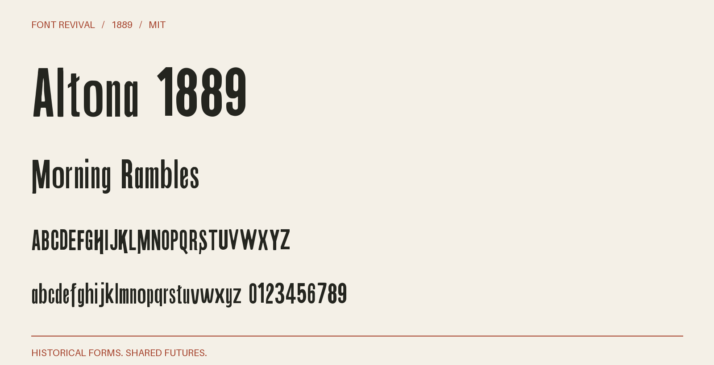

# Altona 1889

Heavy condensed display letters with sloping crossbars, alternating descending terminals and a distinct historical lowercase.



**1889 · Regular · Version 1.001 · 104 characters · MIT**

[OTF](fonts/Altona1889-Regular.otf) · [TTF](fonts/Altona1889-Regular.ttf) · [WOFF2](web/Altona1889-Regular.woff2) · [PDF specimen](specimens/specimen.pdf) · [Changes](CHANGELOG.md)

## Use

Install either desktop format. For websites, copy `web/`, include `font.css`,
and use `font-family: "Altona 1889"`. Designed for display sizes.

## Design

**Designer:** Unidentified in the consulted historical specimen

**Foundry:** Boston and Central Type Foundries

**Observed:** Directly sampled characters: 24789ABCDEFGHIKLMNOPRSTUWXYabcdefghiklmnopqrstuvy. Printed page 170, PDF page 176. Larger impressions anchor the master; smaller sizes supply additional characters. Additional directly traced impressions supply 56Vw. Exact editions, pages, crops, scale anchors and cleanup are recorded in source/tracing.json and reference/specimen-restoration-sources.json.

**Reconstructed:** Inferred companion letters and figures: JQZjxz013. Punctuation and remaining symbols are new project drawings. Both cases are retained. The specimen mixes descending and plain terminal variants of several letters; this master selects one observed variant per character, without claiming a complete alternate set. Spacing and harmonisation of optical sizes are modern choices. The 1889 suffix dates the source, not a claim of first release.

## Sources

1. [Specimen book from the Boston type foundry (1889), Altona; printed p. 170, one-based PDF page 176, Internet Archive leaf 176](https://archive.org/details/specimenbookfrom00unse/page/n176/mode/1up) — 1889 US publication, public domain under the maximum historical 95-year term. Library of Congress scan hosted by Internet Archive; retained institutional metadata says the Library is unaware of copyright restrictions. Original native JP2 leaf; no modern digital typeface used. [Rights basis](https://archive.org/metadata/specimenbookfrom00unse).
2. [ATF 1898, leaf 327](https://archive.org/details/deskbookofprinti00amer/page/n327/mode/1up) — 1898 US publication, public domain by age. Historical scan and institutional metadata retained; no modern digital font used. Native JP2 page. [Rights basis](https://archive.org/metadata/deskbookofprinti00amer).

Source images are in `reference/`; the source record is [font.json](font.json).
Historical reference material retains the rights status recorded there.
Copyright (c) 2026 Harold Lehmann. The digital revival is released under the included [MIT License](LICENSE).

## Build or improve

From the repository root:

```sh
python scripts/fontrevival.py build altona-1889
python scripts/fontrevival.py check altona-1889
```

Edit `source/font.ttx` or export an individual glyph with
`python scripts/fontrevival.py glyph altona-1889 j`.
Follow the shared [revival workflow](../../docs/WORKFLOW.md) for additions and revisions.
