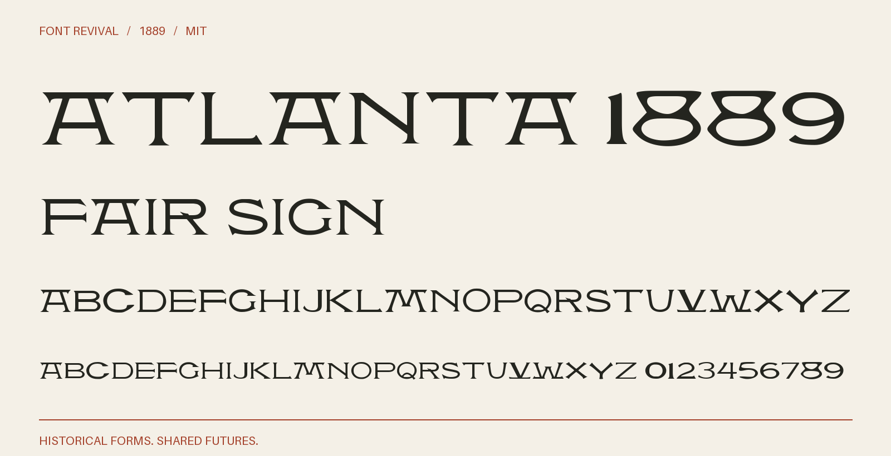

# Atlanta 1889

Wide display capitals with flared terminals, pointed spurs and a low decorative M.



**1889 · Regular · Version 1.000 · 104 characters · Capitals only · MIT**

[OTF](fonts/Atlanta1889-Regular.otf) · [TTF](fonts/Atlanta1889-Regular.ttf) · [WOFF2](web/Atlanta1889-Regular.woff2) · [PDF specimen](specimens/specimen.pdf) · [Changes](CHANGELOG.md)

## Use

Install either desktop format. For websites, copy `web/`, include `font.css`,
and use `font-family: "Atlanta 1889"`. Designed for display sizes.

## Design

**Designer:** Unidentified in the consulted historical specimen

**Foundry:** Boston and Central Type Foundries

**Observed:** Directly sampled characters: 2458ABCDEFGHIKLMNOPQRSTUVXY. See source/tracing.json for individual native crops; larger impressions anchor the master and smaller ones supply missing sorts.

**Reconstructed:** Inferred alphabet and figure companions: JWZ013679. Explicit repairs of small observed impressions: VX. Details and construction bases are recorded per glyph in source/companions.json. Some missing forms are adapted from the adjacent related historical design, with that page retained as a secondary source. Punctuation and remaining symbols are new MIT project drawings. Lowercase aliases capitals. Spacing and optical-size harmonisation are modern choices; 1889 dates the specimen, not a claimed first issue.

## Sources

1. [Specimen book from the Boston type foundry (1889), Atlanta; printed p. 187, one-based PDF page 193, Internet Archive leaf 193](https://archive.org/details/specimenbookfrom00unse/page/n193/mode/1up) — 1889 US publication, public domain under the maximum historical 95-year term. Library of Congress scan hosted by Internet Archive; retained institutional metadata says the Library is unaware of copyright restrictions. Original native JP2 leaf; no modern digital typeface used. [Rights basis](https://archive.org/metadata/specimenbookfrom00unse).
2. [Specimen book from the Boston type foundry (1889), Victoria; printed p. 186, one-based PDF page 192, Internet Archive leaf 192; related historical design used only for explicitly inferred companions](https://archive.org/details/specimenbookfrom00unse/page/n192/mode/1up) — 1889 US publication, public domain under the maximum historical 95-year term. Library of Congress scan hosted by Internet Archive; retained institutional metadata says the Library is unaware of copyright restrictions. Original native JP2 leaf; no modern digital typeface used. [Rights basis](https://archive.org/metadata/specimenbookfrom00unse).

Source images are in `reference/`; the source record is [font.json](font.json).
Historical reference material retains the rights status recorded there.
Copyright (c) 2026 Harold Lehmann. The digital revival is released under the included [MIT License](LICENSE).

## Build or improve

From the repository root:

```sh
python scripts/fontrevival.py build atlanta-1889
python scripts/fontrevival.py check atlanta-1889
```

Edit `source/font.ttx` or export an individual glyph with
`python scripts/fontrevival.py glyph atlanta-1889 j`.
Follow the shared [revival workflow](../../docs/WORKFLOW.md) for additions and revisions.
