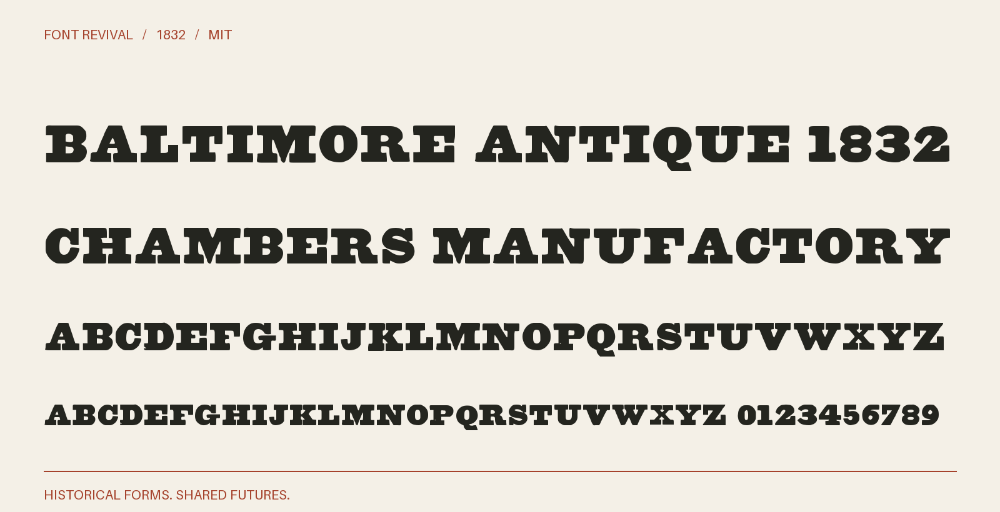

# Baltimore Antique 1832

Heavy slab-serif titling capitals from the Long Primer Antique specimen.



**1832 · Regular · Version 1.000 · 104 characters · Capitals only · MIT**

[OTF](fonts/BaltimoreAntique1832-Regular.otf) · [TTF](fonts/BaltimoreAntique1832-Regular.ttf) · [WOFF2](web/BaltimoreAntique1832-Regular.woff2) · [PDF specimen](specimens/specimen.pdf) · [Changes](CHANGELOG.md)

## Use

Install either desktop format. For websites, copy `web/`, include `font.css`,
and use `font-family: "Baltimore Antique 1832"`. Designed for display sizes.

## Design

**Designer:** Unidentified in the historical specimen

**Foundry:** Baltimore Type Foundry; F. Lucas, Jr., agent

**Observed:** Directly sampled characters: $&0123456789ABCDEFGHIJKLMNOPQRSTUVWXYZ. From Long Primer Antique, one-based PDF page 75 of the unpaginated 1832 volume.

**Reconstructed:** Punctuation and remaining symbols are explicit new MIT project companion drawings. Lowercase input uses the observed capitals. Digital spacing is new; the original relative widths, heavy strokes and Q tail are retained. The year dates this specimen, not a claimed first issue.

## Sources

1. [A specimen of printing types and ornaments from the Baltimore Type Foundry (1832), Long Primer Antique; unnumbered leaf, PDF page 75, Internet Archive leaf 74](https://archive.org/details/ldpd_12198261_000/page/n74/mode/1up) — 1832 US publication, public domain by age. Columbia University Libraries scan; the DPLA catalogue records Public domain. Exact original JP2 leaf and the existing institutional evidence are retained locally. No modern digital typeface was used. [Rights basis](https://dp.la/item/c773fb687c8cc1c610a04becf6baf8e2).

Source images are in `reference/`; the source record is [font.json](font.json).
Historical reference material retains the rights status recorded there.
Copyright (c) 2026 Harold Lehmann. The digital revival is released under the included [MIT License](LICENSE).

## Build or improve

From the repository root:

```sh
python scripts/fontrevival.py build baltimore-antique-1832
python scripts/fontrevival.py check baltimore-antique-1832
```

Edit `source/font.ttx` or export an individual glyph with
`python scripts/fontrevival.py glyph baltimore-antique-1832 j`.
Follow the shared [revival workflow](../../docs/WORKFLOW.md) for additions and revisions.
