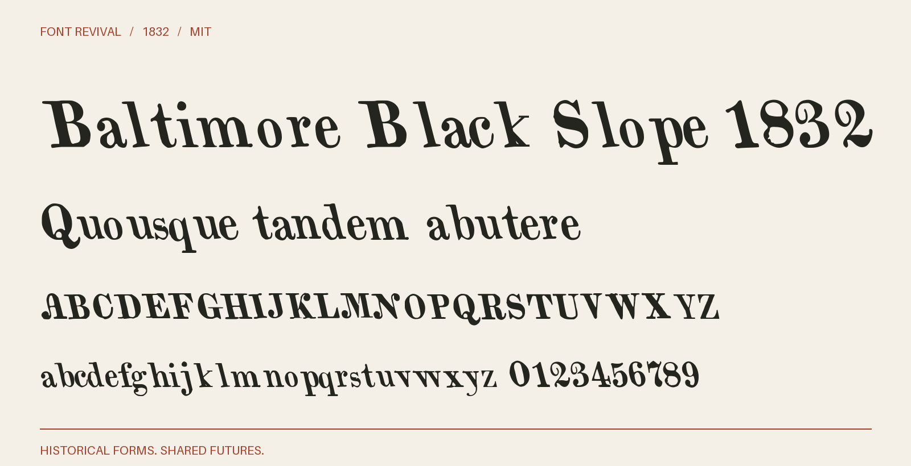

# Baltimore Black Slope 1832

Backslanted Roman display letters with curled capitals, ball terminals and a distinct historical lowercase.



**1832 · Regular · Version 1.000 · 105 characters · MIT**

[OTF](fonts/BaltimoreBlackSlope1832-Regular.otf) · [TTF](fonts/BaltimoreBlackSlope1832-Regular.ttf) · [WOFF2](web/BaltimoreBlackSlope1832-Regular.woff2) · [PDF specimen](specimens/specimen.pdf) · [Changes](CHANGELOG.md)

## Use

Install either desktop format. For websites, copy `web/`, include `font.css`,
and use `font-family: "Baltimore Black Slope 1832"`. Designed for display sizes.

## Design

**Designer:** Unidentified in the historical specimen

**Foundry:** Baltimore Type Foundry; F. Lucas, Jr., agent

**Observed:** Observed characters: $0123456789ABCDEFGHIJKLMNOPQRSTUVWXabcdefghijlmnopqrstuvxæ. English Black Slope, one-based PDF page 81 (archive leaf 80), an unnumbered leaf of the 1832 Baltimore specimen. Both cases and the lining figures are sampled from this impression.

**Reconstructed:** Y and Z are new companion adaptations of the Title Letter on PDF page 77; k, w, y and z are inferred companions constructed from the observed l/v and the new Z. Punctuation other than $ is new MIT project work. Both the backslant and lowercase are retained. Digital spacing and correction of the tilted baseline are new; the historical word Black here is not a claim of blackletter.

## Sources

1. [A specimen of printing types and ornaments from the Baltimore Type Foundry (1832), English Black Slope; unnumbered PDF page 81, Internet Archive leaf 80](https://archive.org/details/ldpd_12198261_000/page/n80/mode/1up) — 1832 US publication, public domain by age. Columbia University Libraries scan; the DPLA catalogue records Public domain. Exact native JP2 and institutional evidence retained locally. [Rights basis](https://dp.la/item/c773fb687c8cc1c610a04becf6baf8e2).
2. [Related Title Letter, Baltimore 1832, PDF page 77, archive leaf 76; model for explicit Y/Z companions](https://archive.org/details/ldpd_12198261_000/page/n76/mode/1up) — 1832 US publication, public domain by age. Columbia University Libraries scan; the DPLA catalogue records Public domain. Exact native JP2 and institutional evidence retained locally. [Rights basis](https://dp.la/item/c773fb687c8cc1c610a04becf6baf8e2).

Source images are in `reference/`; the source record is [font.json](font.json).
Historical reference material retains the rights status recorded there.
Copyright (c) 2026 Harold Lehmann. The digital revival is released under the included [MIT License](LICENSE).

## Build or improve

From the repository root:

```sh
python scripts/fontrevival.py build baltimore-black-slope-1832
python scripts/fontrevival.py check baltimore-black-slope-1832
```

Edit `source/font.ttx` or export an individual glyph with
`python scripts/fontrevival.py glyph baltimore-black-slope-1832 j`.
Follow the shared [revival workflow](../../docs/WORKFLOW.md) for additions and revisions.
