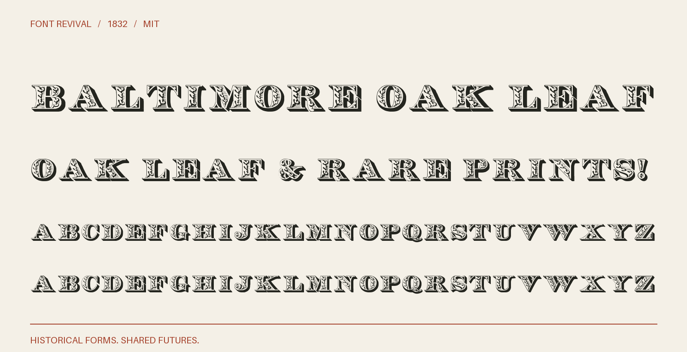

# Baltimore Oak Leaf 1832

A complete alphabet of shaded oak-leaf capitals, traced from the full reference sheet, including its leafy R. Capitals, ampersand and three punctuation marks; lowercase keys use capitals. No figures.



**1832 · Regular · Version 1.000 · 58 characters · Capitals only · MIT**

[OTF](fonts/BaltimoreOakLeaf1832-Regular.otf) · [TTF](fonts/BaltimoreOakLeaf1832-Regular.ttf) · [WOFF2](web/BaltimoreOakLeaf1832-Regular.woff2) · [PDF specimen](specimens/specimen.pdf) · [Changes](CHANGELOG.md)

## Use

Install either desktop format. For websites, copy `web/`, include `font.css`,
and use `font-family: "Baltimore Oak Leaf 1832"`. Designed for display sizes.

## Design

**Designer:** Unidentified in the historical specimen

**Foundry:** Baltimore Type Foundry; F. Lucas, Jr., agent

**Observed:** All 26 capitals and & . , ! are direct traces of the complete Oak Leaf sheet hosted by Luc Devroye. The R follows that sheet, including its leafy lower leg. The retained Baltimore and Boston period specimens document the historical design and related impressions; they are not substituted for letters on the complete sheet.

**Reconstructed:** No inferred letterforms, figures or additional symbols. Thresholding and cubic curve fitting interpret the sheet. Uniform glyph scaling, sidebearings and punctuation baseline placement are new digital metrics. Lowercase keys alias capitals. The intermediate publication of the complete sheet is unidentified; its historical attribution is accepted as the working source, not independently proven for every sort.

## Sources

1. [Oak Leaf complete alphabet sheet, hosted by Luc Devroye; attributed to Baltimore Type Foundry, 1832](https://luc.devroye.org/BaltimoreTypeFoundry--OakLeaf-1832.png) — The underlying Oak Leaf design is documented in the 1832 Baltimore specimen and is public domain by age. The complete reproduction is hosted by Luc Devroye; its intermediate publication and reproduction history are unidentified. The attribution is the working basis for this revival. The project MIT license covers original digital work and does not assert ownership of the reference sheet. [Rights basis](https://archive.org/details/ldpd_12198261_000/page/n66/mode/1up).
2. [A specimen of printing types and ornaments from the Baltimore Type Foundry (1832), unnumbered leaf; PDF page 67, Internet Archive leaf 66](https://archive.org/details/ldpd_12198261_000/page/n66/mode/1up) — 1832 US publication, public domain by age; Columbia University Libraries historical scan, distributed through Internet Archive. DPLA item c773fb687c8cc1c610a04becf6baf8e2 records Public domain. No external modern digital typeface or modern reference drawing was used; inferred companions are original project drawings. The MIT license applies to original project work, not ownership of the historical design. [Rights basis](https://dp.la/item/c773fb687c8cc1c610a04becf6baf8e2).
3. [Specimen of printing types from the Boston Type & Stereotype Foundry (1832), unpaginated; PDF page 139, archive leaf 139](https://archive.org/details/specimenofprinti00bost/page/n139/mode/1up) — 1832 US publication, public domain by age. Library of Congress scan; the retained archive record states that the Library is unaware of copyright restrictions. [Rights basis](https://archive.org/details/specimenofprinti00bost).

Source images are in `reference/`; the source record is [font.json](font.json).
Historical reference material retains the rights status recorded there.
Copyright (c) 2026 Harold Lehmann. The digital revival is released under the included [MIT License](LICENSE).

## Build or improve

From the repository root:

```sh
python scripts/fontrevival.py build baltimore-oak-leaf-1832
python scripts/fontrevival.py check baltimore-oak-leaf-1832
```

Edit `source/font.ttx` or export an individual glyph with
`python scripts/fontrevival.py glyph baltimore-oak-leaf-1832 j`.
Follow the shared [revival workflow](../../docs/WORKFLOW.md) for additions and revisions.
