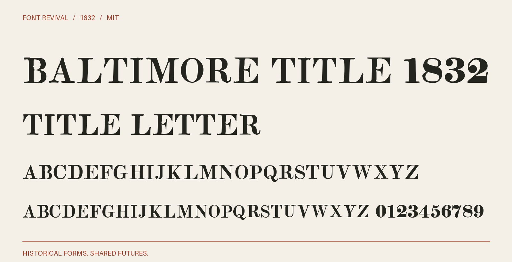

# Baltimore Title 1832

Roman title capitals with flat serifs, moderate contrast and a curled Q tail.



**1832 · Regular · Version 1.000 · 108 characters · Capitals only · MIT**

[OTF](fonts/BaltimoreTitle1832-Regular.otf) · [TTF](fonts/BaltimoreTitle1832-Regular.ttf) · [WOFF2](web/BaltimoreTitle1832-Regular.woff2) · [PDF specimen](specimens/specimen.pdf) · [Changes](CHANGELOG.md)

## Use

Install either desktop format. For websites, copy `web/`, include `font.css`,
and use `font-family: "Baltimore Title 1832"`. Designed for display sizes.

## Design

**Designer:** Unidentified in the historical specimen

**Foundry:** Baltimore Type Foundry; F. Lucas, Jr., agent

**Observed:** Observed capitals ABCDEFGHIJKLMNOPQRSTUVWXYZƌ from Title Letter, Two Lines Brevier, one-based PDF page 77 of the unpaginated 1832 volume.

**Reconstructed:** Figures are companion adaptations of the observed Two Lines Brevier Roman figures on PDF page 73. Punctuation and other symbols are explicit new MIT project drawings. Lowercase input aliases capitals. Digital spacing is new. No lowercase or figures are claimed to be printed in this alphabet.

## Sources

1. [A specimen of printing types and ornaments from the Baltimore Type Foundry (1832), Title Letter, Two Lines Brevier; unnumbered leaf, PDF page 77, Internet Archive leaf 76](https://archive.org/details/ldpd_12198261_000/page/n76/mode/1up) — 1832 US publication, public domain by age. Columbia University Libraries scan; the DPLA catalogue records Public domain. Exact native JP2 and institutional evidence retained locally. [Rights basis](https://dp.la/item/c773fb687c8cc1c610a04becf6baf8e2).
2. [Related Two Lines Brevier Roman figures, Baltimore 1832, PDF page 73, archive leaf 72](https://archive.org/details/ldpd_12198261_000/page/n72/mode/1up) — 1832 US publication, public domain by age. Columbia University Libraries scan; the DPLA catalogue records Public domain. Exact native JP2 and institutional evidence retained locally. [Rights basis](https://dp.la/item/c773fb687c8cc1c610a04becf6baf8e2).

Source images are in `reference/`; the source record is [font.json](font.json).
Historical reference material retains the rights status recorded there.
Copyright (c) 2026 Harold Lehmann. The digital revival is released under the included [MIT License](LICENSE).

## Build or improve

From the repository root:

```sh
python scripts/fontrevival.py build baltimore-title-1832
python scripts/fontrevival.py check baltimore-title-1832
```

Edit `source/font.ttx` or export an individual glyph with
`python scripts/fontrevival.py glyph baltimore-title-1832 j`.
Follow the shared [revival workflow](../../docs/WORKFLOW.md) for additions and revisions.
