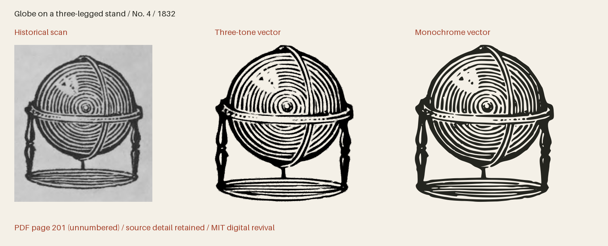

# Boston Cuts 1832

Pictorial cuts and ornaments from the Boston Type & Stereotype Foundry specimen of 1832, with shared designs cross-referenced to the existing collection.



**391 icon(s) · Version 1.000 · MIT**

[SVG files](svg/) · [SVG sprite](web/icons.svg) · [OTF](fonts/BostonCuts1832-Regular.otf) · [TTF](fonts/BostonCuts1832-Regular.ttf) · [WOFF2](web/BostonCuts1832-Regular.woff2) · [Comparison and size proof](specimens/specimen.pdf) · [Icon manifest](icons.json) · [Changes](CHANGELOG.md)

[Three-tone SVGs](svg/multitone/) · [Three-tone sprite](web/icons-multitone.svg) · [Transparent three-tone PNGs](png/multitone/)

## Use in HTML

[Download all web bundle parts](#web-bundle-parts), unzip it, and place
the extracted `collection` folder beside your HTML file. Keep its subfolders
together. The examples below then work as written; adjust the paths if you move
the folder elsewhere. The bundle contains SVGs, PNGs, fonts, CSS, instructions
and the license. No JavaScript or font installation is needed for SVG use.

### Three-tone image — works from disk too

The individual SVG displays all three tones at their default strengths, with a
transparent background. Change `height` to resize it; the proportions are retained.

```html

```

An `` has its own colour context: page CSS cannot recolour its internal
regions. For a decorative image beside a text label, use `alt=""` instead.

### Three-tone sprite — customise every tone

Copy `web/icons-multitone.svg` and use the following complete example on an
HTTP(S) page served from the same origin as the sprite. It draws dark primary ink
and two strengths of red. Each colour and opacity can be changed independently.

```html
<style>
  .revival-cut {
    display: inline-block;
    font-size: 96px;
    height: 1em;
    width: 0.842773em;
    vertical-align: middle;
    --fr-primary-color: #24251f;
    --fr-secondary-color: #a5422c;
    --fr-tertiary-color: #a5422c;
    --fr-primary-opacity: 1;
    --fr-secondary-opacity: 0.55;
    --fr-tertiary-opacity: 0.25;
  }
</style>
<svg class="revival-cut" role="img" aria-label="Globe on a three-legged stand">
  <use href="collection/boston-cuts-1832/web/icons-multitone.svg#boston-1832-p201-4"></use>
</svg>
```

Use the same secondary and tertiary colour and opacity for a two-tone appearance.
The defaults are primary 100%, secondary 55% and tertiary 25%; these are separate
vector regions, not a gradient. The tone assignments interpret the historical
impression. A transparent PNG of the default tones is also provided.

External SVG sprites can be blocked on `file://` pages. To customise tones on a
page opened from disk, open the individual SVG in a text editor, copy its complete
`<svg>…</svg>` markup into your HTML, and add `class="revival-cut"` to that SVG.
The same CSS above then applies to its inline paths. Keep its `viewBox` and paths.
The gallery itself uses inline SVG so its previews work directly from disk.

### Monochrome icon font

Copy the whole `web/` folder, including CSS and webfonts. Standard icon fonts show
the solid artwork; use the SVG examples above for three-tone artwork.

```html
<link rel="stylesheet" href="collection/boston-cuts-1832/web/icons.css">
<span class="fr-icon fr-boston-1832-p201-4" aria-hidden="true"
      style="font-size:96px;color:#a5422c"></span>
<span>Globe on a three-legged stand</span>
```

The example hides a decorative icon from screen readers and supplies visible
text. For an icon that conveys meaning on its own, use `role="img"` and an
`aria-label` instead of `aria-hidden`. Font size and colour use ordinary CSS.

Install the OTF or TTF for desktop use. The manifest lists each icon's Private Use
codepoint and recommended minimum display size. These codepoints are not ordinary
text characters; IDs and codepoints are permanent within this collection.
The example above uses U+E000 and is recommended from
64 px. The 16–192 pt proofs show how detail holds up at different sizes.
Keep the included LICENSE with redistributed assets.

## Evidence and editing

**Foundry:** Boston Type & Stereotype Foundry; John G. Rogers, agent

**Designer:** Boston Type & Stereotype Foundry; individual engravers generally unidentified; observed signatures retained

**Observed:** Observed impressions from the 1832 Boston specimen. The numbered cut sequence, separate set members, unnumbered impressions and existing-collection equivalents are recorded in source/inventory.json.

**Interpreted or new:** No new pictorial content. Thresholding, documented crop cleanup, cubic curve fitting and font-unit rounding interpret the scanned impressions. Names, search tags, Private Use assignments, scale and bearings are new project work. Paper, catalogue numbers and prices are excluded. Multi-tone companions separate observed ink strengths into three disjoint vector regions at default opacities 1, 0.55 and 0.25; these are modern interpretations, not evidence of separately printed inks. Downloadable fonts use documented bounded approximations for 79 oversized engravings. Ten especially dense cuts use modern diagonal coverage screening to preserve shading; the full historical engraved contours remain in the canonical artwork and SVGs.

- [Specimen of printing types from the Boston Type & Stereotype Foundry (1832), unnumbered leaf; PDF page 199, Internet Archive leaf 199](https://archive.org/details/specimenofprinti00bost/page/n199/mode/1up) — 1832 US publication, public domain by age. Library of Congress scan distributed through Internet Archive. The retained archive metadata states that the Library of Congress is unaware of any copyright restrictions for this item. No modern font or redrawing was traced. MIT applies to original project work. [Rights basis](https://archive.org/details/specimenofprinti00bost).
- [Specimen of printing types from the Boston Type & Stereotype Foundry (1832), unnumbered leaf; PDF page 201, Internet Archive leaf 201](https://archive.org/details/specimenofprinti00bost/page/n201/mode/1up) — 1832 US publication, public domain by age. Library of Congress scan distributed through Internet Archive. The retained archive metadata states that the Library of Congress is unaware of any copyright restrictions for this item. No modern font or redrawing was traced. MIT applies to original project work. [Rights basis](https://archive.org/details/specimenofprinti00bost).
- [Specimen of printing types from the Boston Type & Stereotype Foundry (1832), unnumbered leaf; PDF page 203, Internet Archive leaf 203](https://archive.org/details/specimenofprinti00bost/page/n203/mode/1up) — 1832 US publication, public domain by age. Library of Congress scan distributed through Internet Archive. The retained archive metadata states that the Library of Congress is unaware of any copyright restrictions for this item. No modern font or redrawing was traced. MIT applies to original project work. [Rights basis](https://archive.org/details/specimenofprinti00bost).
- [Specimen of printing types from the Boston Type & Stereotype Foundry (1832), unnumbered leaf; PDF page 205, Internet Archive leaf 205](https://archive.org/details/specimenofprinti00bost/page/n205/mode/1up) — 1832 US publication, public domain by age. Library of Congress scan distributed through Internet Archive. The retained archive metadata states that the Library of Congress is unaware of any copyright restrictions for this item. No modern font or redrawing was traced. MIT applies to original project work. [Rights basis](https://archive.org/details/specimenofprinti00bost).
- [Specimen of printing types from the Boston Type & Stereotype Foundry (1832), unnumbered leaf; PDF page 207, Internet Archive leaf 207](https://archive.org/details/specimenofprinti00bost/page/n207/mode/1up) — 1832 US publication, public domain by age. Library of Congress scan distributed through Internet Archive. The retained archive metadata states that the Library of Congress is unaware of any copyright restrictions for this item. No modern font or redrawing was traced. MIT applies to original project work. [Rights basis](https://archive.org/details/specimenofprinti00bost).
- [Specimen of printing types from the Boston Type & Stereotype Foundry (1832), unnumbered leaf; PDF page 209, Internet Archive leaf 209](https://archive.org/details/specimenofprinti00bost/page/n209/mode/1up) — 1832 US publication, public domain by age. Library of Congress scan distributed through Internet Archive. The retained archive metadata states that the Library of Congress is unaware of any copyright restrictions for this item. No modern font or redrawing was traced. MIT applies to original project work. [Rights basis](https://archive.org/details/specimenofprinti00bost).
- [Specimen of printing types from the Boston Type & Stereotype Foundry (1832), unnumbered leaf; PDF page 211, Internet Archive leaf 211](https://archive.org/details/specimenofprinti00bost/page/n211/mode/1up) — 1832 US publication, public domain by age. Library of Congress scan distributed through Internet Archive. The retained archive metadata states that the Library of Congress is unaware of any copyright restrictions for this item. No modern font or redrawing was traced. MIT applies to original project work. [Rights basis](https://archive.org/details/specimenofprinti00bost).
- [Specimen of printing types from the Boston Type & Stereotype Foundry (1832), unnumbered leaf; PDF page 213, Internet Archive leaf 213](https://archive.org/details/specimenofprinti00bost/page/n213/mode/1up) — 1832 US publication, public domain by age. Library of Congress scan distributed through Internet Archive. The retained archive metadata states that the Library of Congress is unaware of any copyright restrictions for this item. No modern font or redrawing was traced. MIT applies to original project work. [Rights basis](https://archive.org/details/specimenofprinti00bost).
- [Specimen of printing types from the Boston Type & Stereotype Foundry (1832), unnumbered leaf; PDF page 215, Internet Archive leaf 215](https://archive.org/details/specimenofprinti00bost/page/n215/mode/1up) — 1832 US publication, public domain by age. Library of Congress scan distributed through Internet Archive. The retained archive metadata states that the Library of Congress is unaware of any copyright restrictions for this item. No modern font or redrawing was traced. MIT applies to original project work. [Rights basis](https://archive.org/details/specimenofprinti00bost).
- [Specimen of printing types from the Boston Type & Stereotype Foundry (1832), unnumbered leaf; PDF page 217, Internet Archive leaf 217](https://archive.org/details/specimenofprinti00bost/page/n217/mode/1up) — 1832 US publication, public domain by age. Library of Congress scan distributed through Internet Archive. The retained archive metadata states that the Library of Congress is unaware of any copyright restrictions for this item. No modern font or redrawing was traced. MIT applies to original project work. [Rights basis](https://archive.org/details/specimenofprinti00bost).
- [Specimen of printing types from the Boston Type & Stereotype Foundry (1832), unnumbered leaf; PDF page 219, Internet Archive leaf 219](https://archive.org/details/specimenofprinti00bost/page/n219/mode/1up) — 1832 US publication, public domain by age. Library of Congress scan distributed through Internet Archive. The retained archive metadata states that the Library of Congress is unaware of any copyright restrictions for this item. No modern font or redrawing was traced. MIT applies to original project work. [Rights basis](https://archive.org/details/specimenofprinti00bost).
- [Specimen of printing types from the Boston Type & Stereotype Foundry (1832), unnumbered leaf; PDF page 221, Internet Archive leaf 221](https://archive.org/details/specimenofprinti00bost/page/n221/mode/1up) — 1832 US publication, public domain by age. Library of Congress scan distributed through Internet Archive. The retained archive metadata states that the Library of Congress is unaware of any copyright restrictions for this item. No modern font or redrawing was traced. MIT applies to original project work. [Rights basis](https://archive.org/details/specimenofprinti00bost).
- [Specimen of printing types from the Boston Type & Stereotype Foundry (1832), unnumbered leaf; PDF page 223, Internet Archive leaf 223](https://archive.org/details/specimenofprinti00bost/page/n223/mode/1up) — 1832 US publication, public domain by age. Library of Congress scan distributed through Internet Archive. The retained archive metadata states that the Library of Congress is unaware of any copyright restrictions for this item. No modern font or redrawing was traced. MIT applies to original project work. [Rights basis](https://archive.org/details/specimenofprinti00bost).
- [Specimen of printing types from the Boston Type & Stereotype Foundry (1832), unnumbered leaf; PDF page 225, Internet Archive leaf 225](https://archive.org/details/specimenofprinti00bost/page/n225/mode/1up) — 1832 US publication, public domain by age. Library of Congress scan distributed through Internet Archive. The retained archive metadata states that the Library of Congress is unaware of any copyright restrictions for this item. No modern font or redrawing was traced. MIT applies to original project work. [Rights basis](https://archive.org/details/specimenofprinti00bost).
- [Specimen of printing types from the Boston Type & Stereotype Foundry (1832), unnumbered leaf; PDF page 227, Internet Archive leaf 227](https://archive.org/details/specimenofprinti00bost/page/n227/mode/1up) — 1832 US publication, public domain by age. Library of Congress scan distributed through Internet Archive. The retained archive metadata states that the Library of Congress is unaware of any copyright restrictions for this item. No modern font or redrawing was traced. MIT applies to original project work. [Rights basis](https://archive.org/details/specimenofprinti00bost).
- [Specimen of printing types from the Boston Type & Stereotype Foundry (1832), unnumbered leaf; PDF page 229, Internet Archive leaf 229](https://archive.org/details/specimenofprinti00bost/page/n229/mode/1up) — 1832 US publication, public domain by age. Library of Congress scan distributed through Internet Archive. The retained archive metadata states that the Library of Congress is unaware of any copyright restrictions for this item. No modern font or redrawing was traced. MIT applies to original project work. [Rights basis](https://archive.org/details/specimenofprinti00bost).
- [Specimen of printing types from the Boston Type & Stereotype Foundry (1832), unnumbered leaf; PDF page 231, Internet Archive leaf 231](https://archive.org/details/specimenofprinti00bost/page/n231/mode/1up) — 1832 US publication, public domain by age. Library of Congress scan distributed through Internet Archive. The retained archive metadata states that the Library of Congress is unaware of any copyright restrictions for this item. No modern font or redrawing was traced. MIT applies to original project work. [Rights basis](https://archive.org/details/specimenofprinti00bost).
- [Specimen of printing types from the Boston Type & Stereotype Foundry (1832), unnumbered leaf; PDF page 233, Internet Archive leaf 233](https://archive.org/details/specimenofprinti00bost/page/n233/mode/1up) — 1832 US publication, public domain by age. Library of Congress scan distributed through Internet Archive. The retained archive metadata states that the Library of Congress is unaware of any copyright restrictions for this item. No modern font or redrawing was traced. MIT applies to original project work. [Rights basis](https://archive.org/details/specimenofprinti00bost).
- [Specimen of printing types from the Boston Type & Stereotype Foundry (1832), unnumbered leaf; PDF page 235, Internet Archive leaf 235](https://archive.org/details/specimenofprinti00bost/page/n235/mode/1up) — 1832 US publication, public domain by age. Library of Congress scan distributed through Internet Archive. The retained archive metadata states that the Library of Congress is unaware of any copyright restrictions for this item. No modern font or redrawing was traced. MIT applies to original project work. [Rights basis](https://archive.org/details/specimenofprinti00bost).
- [Specimen of printing types from the Boston Type & Stereotype Foundry (1832), unnumbered leaf; PDF page 237, Internet Archive leaf 237](https://archive.org/details/specimenofprinti00bost/page/n237/mode/1up) — 1832 US publication, public domain by age. Library of Congress scan distributed through Internet Archive. The retained archive metadata states that the Library of Congress is unaware of any copyright restrictions for this item. No modern font or redrawing was traced. MIT applies to original project work. [Rights basis](https://archive.org/details/specimenofprinti00bost).
- [Specimen of printing types from the Boston Type & Stereotype Foundry (1832), unnumbered leaf; PDF page 239, Internet Archive leaf 239](https://archive.org/details/specimenofprinti00bost/page/n239/mode/1up) — 1832 US publication, public domain by age. Library of Congress scan distributed through Internet Archive. The retained archive metadata states that the Library of Congress is unaware of any copyright restrictions for this item. No modern font or redrawing was traced. MIT applies to original project work. [Rights basis](https://archive.org/details/specimenofprinti00bost).
- [Specimen of printing types from the Boston Type & Stereotype Foundry (1832), unnumbered leaf; PDF page 241, Internet Archive leaf 241](https://archive.org/details/specimenofprinti00bost/page/n241/mode/1up) — 1832 US publication, public domain by age. Library of Congress scan distributed through Internet Archive. The retained archive metadata states that the Library of Congress is unaware of any copyright restrictions for this item. No modern font or redrawing was traced. MIT applies to original project work. [Rights basis](https://archive.org/details/specimenofprinti00bost).
- [Specimen of printing types from the Boston Type & Stereotype Foundry (1832), unnumbered leaf; PDF page 243, Internet Archive leaf 243](https://archive.org/details/specimenofprinti00bost/page/n243/mode/1up) — 1832 US publication, public domain by age. Library of Congress scan distributed through Internet Archive. The retained archive metadata states that the Library of Congress is unaware of any copyright restrictions for this item. No modern font or redrawing was traced. MIT applies to original project work. [Rights basis](https://archive.org/details/specimenofprinti00bost).
- [Specimen of printing types from the Boston Type & Stereotype Foundry (1832), unnumbered leaf; PDF page 245, Internet Archive leaf 245](https://archive.org/details/specimenofprinti00bost/page/n245/mode/1up) — 1832 US publication, public domain by age. Library of Congress scan distributed through Internet Archive. The retained archive metadata states that the Library of Congress is unaware of any copyright restrictions for this item. No modern font or redrawing was traced. MIT applies to original project work. [Rights basis](https://archive.org/details/specimenofprinti00bost).
- [Specimen of printing types from the Boston Type & Stereotype Foundry (1832), unnumbered leaf; PDF page 247, Internet Archive leaf 247](https://archive.org/details/specimenofprinti00bost/page/n247/mode/1up) — 1832 US publication, public domain by age. Library of Congress scan distributed through Internet Archive. The retained archive metadata states that the Library of Congress is unaware of any copyright restrictions for this item. No modern font or redrawing was traced. MIT applies to original project work. [Rights basis](https://archive.org/details/specimenofprinti00bost).
- [Specimen of printing types from the Boston Type & Stereotype Foundry (1832), unnumbered leaf; PDF page 249, Internet Archive leaf 249](https://archive.org/details/specimenofprinti00bost/page/n249/mode/1up) — 1832 US publication, public domain by age. Library of Congress scan distributed through Internet Archive. The retained archive metadata states that the Library of Congress is unaware of any copyright restrictions for this item. No modern font or redrawing was traced. MIT applies to original project work. [Rights basis](https://archive.org/details/specimenofprinti00bost).
- [Specimen of printing types from the Boston Type & Stereotype Foundry (1832), unnumbered leaf; PDF page 251, Internet Archive leaf 251](https://archive.org/details/specimenofprinti00bost/page/n251/mode/1up) — 1832 US publication, public domain by age. Library of Congress scan distributed through Internet Archive. The retained archive metadata states that the Library of Congress is unaware of any copyright restrictions for this item. No modern font or redrawing was traced. MIT applies to original project work. [Rights basis](https://archive.org/details/specimenofprinti00bost).
- [Specimen of printing types from the Boston Type & Stereotype Foundry (1832), unnumbered leaf; PDF page 253, Internet Archive leaf 253](https://archive.org/details/specimenofprinti00bost/page/n253/mode/1up) — 1832 US publication, public domain by age. Library of Congress scan distributed through Internet Archive. The retained archive metadata states that the Library of Congress is unaware of any copyright restrictions for this item. No modern font or redrawing was traced. MIT applies to original project work. [Rights basis](https://archive.org/details/specimenofprinti00bost).
- [Specimen of printing types from the Boston Type & Stereotype Foundry (1832), unnumbered leaf; PDF page 255, Internet Archive leaf 255](https://archive.org/details/specimenofprinti00bost/page/n255/mode/1up) — 1832 US publication, public domain by age. Library of Congress scan distributed through Internet Archive. The retained archive metadata states that the Library of Congress is unaware of any copyright restrictions for this item. No modern font or redrawing was traced. MIT applies to original project work. [Rights basis](https://archive.org/details/specimenofprinti00bost).
- [Specimen of printing types from the Boston Type & Stereotype Foundry (1832), unnumbered leaf; PDF page 257, Internet Archive leaf 257](https://archive.org/details/specimenofprinti00bost/page/n257/mode/1up) — 1832 US publication, public domain by age. Library of Congress scan distributed through Internet Archive. The retained archive metadata states that the Library of Congress is unaware of any copyright restrictions for this item. No modern font or redrawing was traced. MIT applies to original project work. [Rights basis](https://archive.org/details/specimenofprinti00bost).
- [Specimen of printing types from the Boston Type & Stereotype Foundry (1832), unnumbered leaf; PDF page 259, Internet Archive leaf 259](https://archive.org/details/specimenofprinti00bost/page/n259/mode/1up) — 1832 US publication, public domain by age. Library of Congress scan distributed through Internet Archive. The retained archive metadata states that the Library of Congress is unaware of any copyright restrictions for this item. No modern font or redrawing was traced. MIT applies to original project work. [Rights basis](https://archive.org/details/specimenofprinti00bost).
- [Specimen of printing types from the Boston Type & Stereotype Foundry (1832), unnumbered leaf; PDF page 261, Internet Archive leaf 261](https://archive.org/details/specimenofprinti00bost/page/n261/mode/1up) — 1832 US publication, public domain by age. Library of Congress scan distributed through Internet Archive. The retained archive metadata states that the Library of Congress is unaware of any copyright restrictions for this item. No modern font or redrawing was traced. MIT applies to original project work. [Rights basis](https://archive.org/details/specimenofprinti00bost).
- [Specimen of printing types from the Boston Type & Stereotype Foundry (1832), unnumbered leaf; PDF page 263, Internet Archive leaf 263](https://archive.org/details/specimenofprinti00bost/page/n263/mode/1up) — 1832 US publication, public domain by age. Library of Congress scan distributed through Internet Archive. The retained archive metadata states that the Library of Congress is unaware of any copyright restrictions for this item. No modern font or redrawing was traced. MIT applies to original project work. [Rights basis](https://archive.org/details/specimenofprinti00bost).
- [Specimen of printing types from the Boston Type & Stereotype Foundry (1832), unnumbered leaf; PDF page 265, Internet Archive leaf 265](https://archive.org/details/specimenofprinti00bost/page/n265/mode/1up) — 1832 US publication, public domain by age. Library of Congress scan distributed through Internet Archive. The retained archive metadata states that the Library of Congress is unaware of any copyright restrictions for this item. No modern font or redrawing was traced. MIT applies to original project work. [Rights basis](https://archive.org/details/specimenofprinti00bost).
- [Specimen of printing types from the Boston Type & Stereotype Foundry (1832), unnumbered leaf; PDF page 267, Internet Archive leaf 267](https://archive.org/details/specimenofprinti00bost/page/n267/mode/1up) — 1832 US publication, public domain by age. Library of Congress scan distributed through Internet Archive. The retained archive metadata states that the Library of Congress is unaware of any copyright restrictions for this item. No modern font or redrawing was traced. MIT applies to original project work. [Rights basis](https://archive.org/details/specimenofprinti00bost).
- [Specimen of printing types from the Boston Type & Stereotype Foundry (1832), unnumbered leaf; PDF page 269, Internet Archive leaf 269](https://archive.org/details/specimenofprinti00bost/page/n269/mode/1up) — 1832 US publication, public domain by age. Library of Congress scan distributed through Internet Archive. The retained archive metadata states that the Library of Congress is unaware of any copyright restrictions for this item. No modern font or redrawing was traced. MIT applies to original project work. [Rights basis](https://archive.org/details/specimenofprinti00bost).
- [Specimen of printing types from the Boston Type & Stereotype Foundry (1832), unnumbered leaf; PDF page 271, Internet Archive leaf 271](https://archive.org/details/specimenofprinti00bost/page/n271/mode/1up) — 1832 US publication, public domain by age. Library of Congress scan distributed through Internet Archive. The retained archive metadata states that the Library of Congress is unaware of any copyright restrictions for this item. No modern font or redrawing was traced. MIT applies to original project work. [Rights basis](https://archive.org/details/specimenofprinti00bost).
- [Specimen of printing types from the Boston Type & Stereotype Foundry (1832), unnumbered leaf; PDF page 273, Internet Archive leaf 273](https://archive.org/details/specimenofprinti00bost/page/n273/mode/1up) — 1832 US publication, public domain by age. Library of Congress scan distributed through Internet Archive. The retained archive metadata states that the Library of Congress is unaware of any copyright restrictions for this item. No modern font or redrawing was traced. MIT applies to original project work. [Rights basis](https://archive.org/details/specimenofprinti00bost).
- [Specimen of printing types from the Boston Type & Stereotype Foundry (1832), unnumbered leaf; PDF page 275, Internet Archive leaf 275](https://archive.org/details/specimenofprinti00bost/page/n275/mode/1up) — 1832 US publication, public domain by age. Library of Congress scan distributed through Internet Archive. The retained archive metadata states that the Library of Congress is unaware of any copyright restrictions for this item. No modern font or redrawing was traced. MIT applies to original project work. [Rights basis](https://archive.org/details/specimenofprinti00bost).
- [Specimen of printing types from the Boston Type & Stereotype Foundry (1832), unnumbered leaf; PDF page 277, Internet Archive leaf 277](https://archive.org/details/specimenofprinti00bost/page/n277/mode/1up) — 1832 US publication, public domain by age. Library of Congress scan distributed through Internet Archive. The retained archive metadata states that the Library of Congress is unaware of any copyright restrictions for this item. No modern font or redrawing was traced. MIT applies to original project work. [Rights basis](https://archive.org/details/specimenofprinti00bost).
- [Specimen of printing types from the Boston Type & Stereotype Foundry (1832), unnumbered leaf; PDF page 279, Internet Archive leaf 279](https://archive.org/details/specimenofprinti00bost/page/n279/mode/1up) — 1832 US publication, public domain by age. Library of Congress scan distributed through Internet Archive. The retained archive metadata states that the Library of Congress is unaware of any copyright restrictions for this item. No modern font or redrawing was traced. MIT applies to original project work. [Rights basis](https://archive.org/details/specimenofprinti00bost).
- [Specimen of printing types from the Boston Type & Stereotype Foundry (1832), unnumbered leaf; PDF page 281, Internet Archive leaf 281](https://archive.org/details/specimenofprinti00bost/page/n281/mode/1up) — 1832 US publication, public domain by age. Library of Congress scan distributed through Internet Archive. The retained archive metadata states that the Library of Congress is unaware of any copyright restrictions for this item. No modern font or redrawing was traced. MIT applies to original project work. [Rights basis](https://archive.org/details/specimenofprinti00bost).
- [Specimen of printing types from the Boston Type & Stereotype Foundry (1832), unnumbered leaf; PDF page 283, Internet Archive leaf 283](https://archive.org/details/specimenofprinti00bost/page/n283/mode/1up) — 1832 US publication, public domain by age. Library of Congress scan distributed through Internet Archive. The retained archive metadata states that the Library of Congress is unaware of any copyright restrictions for this item. No modern font or redrawing was traced. MIT applies to original project work. [Rights basis](https://archive.org/details/specimenofprinti00bost).
- [Specimen of printing types from the Boston Type & Stereotype Foundry (1832), unnumbered leaf; PDF page 285, Internet Archive leaf 285](https://archive.org/details/specimenofprinti00bost/page/n285/mode/1up) — 1832 US publication, public domain by age. Library of Congress scan distributed through Internet Archive. The retained archive metadata states that the Library of Congress is unaware of any copyright restrictions for this item. No modern font or redrawing was traced. MIT applies to original project work. [Rights basis](https://archive.org/details/specimenofprinti00bost).
- [Specimen of printing types from the Boston Type & Stereotype Foundry (1832), unnumbered leaf; PDF page 287, Internet Archive leaf 287](https://archive.org/details/specimenofprinti00bost/page/n287/mode/1up) — 1832 US publication, public domain by age. Library of Congress scan distributed through Internet Archive. The retained archive metadata states that the Library of Congress is unaware of any copyright restrictions for this item. No modern font or redrawing was traced. MIT applies to original project work. [Rights basis](https://archive.org/details/specimenofprinti00bost).
- [Specimen of printing types from the Boston Type & Stereotype Foundry (1832), unnumbered leaf; PDF page 289, Internet Archive leaf 289](https://archive.org/details/specimenofprinti00bost/page/n289/mode/1up) — 1832 US publication, public domain by age. Library of Congress scan distributed through Internet Archive. The retained archive metadata states that the Library of Congress is unaware of any copyright restrictions for this item. No modern font or redrawing was traced. MIT applies to original project work. [Rights basis](https://archive.org/details/specimenofprinti00bost).
- [Specimen of printing types from the Boston Type & Stereotype Foundry (1832), unnumbered leaf; PDF page 291, Internet Archive leaf 291](https://archive.org/details/specimenofprinti00bost/page/n291/mode/1up) — 1832 US publication, public domain by age. Library of Congress scan distributed through Internet Archive. The retained archive metadata states that the Library of Congress is unaware of any copyright restrictions for this item. No modern font or redrawing was traced. MIT applies to original project work. [Rights basis](https://archive.org/details/specimenofprinti00bost).
- [Specimen of printing types from the Boston Type & Stereotype Foundry (1832), unnumbered leaf; PDF page 293, Internet Archive leaf 293](https://archive.org/details/specimenofprinti00bost/page/n293/mode/1up) — 1832 US publication, public domain by age. Library of Congress scan distributed through Internet Archive. The retained archive metadata states that the Library of Congress is unaware of any copyright restrictions for this item. No modern font or redrawing was traced. MIT applies to original project work. [Rights basis](https://archive.org/details/specimenofprinti00bost).
- [Specimen of printing types from the Boston Type & Stereotype Foundry (1832), unnumbered leaf; PDF page 295, Internet Archive leaf 295](https://archive.org/details/specimenofprinti00bost/page/n295/mode/1up) — 1832 US publication, public domain by age. Library of Congress scan distributed through Internet Archive. The retained archive metadata states that the Library of Congress is unaware of any copyright restrictions for this item. No modern font or redrawing was traced. MIT applies to original project work. [Rights basis](https://archive.org/details/specimenofprinti00bost).
- [Specimen of printing types from the Boston Type & Stereotype Foundry (1832), unnumbered leaf; PDF page 297, Internet Archive leaf 297](https://archive.org/details/specimenofprinti00bost/page/n297/mode/1up) — 1832 US publication, public domain by age. Library of Congress scan distributed through Internet Archive. The retained archive metadata states that the Library of Congress is unaware of any copyright restrictions for this item. No modern font or redrawing was traced. MIT applies to original project work. [Rights basis](https://archive.org/details/specimenofprinti00bost).
- [Specimen of printing types from the Boston Type & Stereotype Foundry (1832), unnumbered leaf; PDF page 299, Internet Archive leaf 299](https://archive.org/details/specimenofprinti00bost/page/n299/mode/1up) — 1832 US publication, public domain by age. Library of Congress scan distributed through Internet Archive. The retained archive metadata states that the Library of Congress is unaware of any copyright restrictions for this item. No modern font or redrawing was traced. MIT applies to original project work. [Rights basis](https://archive.org/details/specimenofprinti00bost).
- [Specimen of printing types from the Boston Type & Stereotype Foundry (1832), unnumbered leaf; PDF page 301, Internet Archive leaf 301](https://archive.org/details/specimenofprinti00bost/page/n301/mode/1up) — 1832 US publication, public domain by age. Library of Congress scan distributed through Internet Archive. The retained archive metadata states that the Library of Congress is unaware of any copyright restrictions for this item. No modern font or redrawing was traced. MIT applies to original project work. [Rights basis](https://archive.org/details/specimenofprinti00bost).
- [Specimen of printing types from the Boston Type & Stereotype Foundry (1832), unnumbered leaf; PDF page 303, Internet Archive leaf 303](https://archive.org/details/specimenofprinti00bost/page/n303/mode/1up) — 1832 US publication, public domain by age. Library of Congress scan distributed through Internet Archive. The retained archive metadata states that the Library of Congress is unaware of any copyright restrictions for this item. No modern font or redrawing was traced. MIT applies to original project work. [Rights basis](https://archive.org/details/specimenofprinti00bost).
- [Specimen of printing types from the Boston Type & Stereotype Foundry (1832), unnumbered leaf; PDF page 305, Internet Archive leaf 305](https://archive.org/details/specimenofprinti00bost/page/n305/mode/1up) — 1832 US publication, public domain by age. Library of Congress scan distributed through Internet Archive. The retained archive metadata states that the Library of Congress is unaware of any copyright restrictions for this item. No modern font or redrawing was traced. MIT applies to original project work. [Rights basis](https://archive.org/details/specimenofprinti00bost).
- [Specimen of printing types from the Boston Type & Stereotype Foundry (1832), unnumbered leaf; PDF page 307, Internet Archive leaf 307](https://archive.org/details/specimenofprinti00bost/page/n307/mode/1up) — 1832 US publication, public domain by age. Library of Congress scan distributed through Internet Archive. The retained archive metadata states that the Library of Congress is unaware of any copyright restrictions for this item. No modern font or redrawing was traced. MIT applies to original project work. [Rights basis](https://archive.org/details/specimenofprinti00bost).
- [Specimen of printing types from the Boston Type & Stereotype Foundry (1832), unnumbered leaf; PDF page 309, Internet Archive leaf 309](https://archive.org/details/specimenofprinti00bost/page/n309/mode/1up) — 1832 US publication, public domain by age. Library of Congress scan distributed through Internet Archive. The retained archive metadata states that the Library of Congress is unaware of any copyright restrictions for this item. No modern font or redrawing was traced. MIT applies to original project work. [Rights basis](https://archive.org/details/specimenofprinti00bost).
- [Specimen of printing types from the Boston Type & Stereotype Foundry (1832), unnumbered leaf; PDF page 311, Internet Archive leaf 311](https://archive.org/details/specimenofprinti00bost/page/n311/mode/1up) — 1832 US publication, public domain by age. Library of Congress scan distributed through Internet Archive. The retained archive metadata states that the Library of Congress is unaware of any copyright restrictions for this item. No modern font or redrawing was traced. MIT applies to original project work. [Rights basis](https://archive.org/details/specimenofprinti00bost).
- [Specimen of printing types from the Boston Type & Stereotype Foundry (1832), unnumbered leaf; PDF page 313, Internet Archive leaf 313](https://archive.org/details/specimenofprinti00bost/page/n313/mode/1up) — 1832 US publication, public domain by age. Library of Congress scan distributed through Internet Archive. The retained archive metadata states that the Library of Congress is unaware of any copyright restrictions for this item. No modern font or redrawing was traced. MIT applies to original project work. [Rights basis](https://archive.org/details/specimenofprinti00bost).
- [Specimen of printing types from the Boston Type & Stereotype Foundry (1832), unnumbered leaf; PDF page 315, Internet Archive leaf 315](https://archive.org/details/specimenofprinti00bost/page/n315/mode/1up) — 1832 US publication, public domain by age. Library of Congress scan distributed through Internet Archive. The retained archive metadata states that the Library of Congress is unaware of any copyright restrictions for this item. No modern font or redrawing was traced. MIT applies to original project work. [Rights basis](https://archive.org/details/specimenofprinti00bost).
- [Specimen of printing types from the Boston Type & Stereotype Foundry (1832), unnumbered leaf; PDF page 317, Internet Archive leaf 317](https://archive.org/details/specimenofprinti00bost/page/n317/mode/1up) — 1832 US publication, public domain by age. Library of Congress scan distributed through Internet Archive. The retained archive metadata states that the Library of Congress is unaware of any copyright restrictions for this item. No modern font or redrawing was traced. MIT applies to original project work. [Rights basis](https://archive.org/details/specimenofprinti00bost).
- [Specimen of printing types from the Boston Type & Stereotype Foundry (1832), unnumbered leaf; PDF page 319, Internet Archive leaf 319](https://archive.org/details/specimenofprinti00bost/page/n319/mode/1up) — 1832 US publication, public domain by age. Library of Congress scan distributed through Internet Archive. The retained archive metadata states that the Library of Congress is unaware of any copyright restrictions for this item. No modern font or redrawing was traced. MIT applies to original project work. [Rights basis](https://archive.org/details/specimenofprinti00bost).
- [Specimen of printing types from the Boston Type & Stereotype Foundry (1832), unnumbered leaf; PDF page 321, Internet Archive leaf 321](https://archive.org/details/specimenofprinti00bost/page/n321/mode/1up) — 1832 US publication, public domain by age. Library of Congress scan distributed through Internet Archive. The retained archive metadata states that the Library of Congress is unaware of any copyright restrictions for this item. No modern font or redrawing was traced. MIT applies to original project work. [Rights basis](https://archive.org/details/specimenofprinti00bost).
- [Specimen of printing types from the Boston Type & Stereotype Foundry (1832), unnumbered leaf; PDF page 323, Internet Archive leaf 323](https://archive.org/details/specimenofprinti00bost/page/n323/mode/1up) — 1832 US publication, public domain by age. Library of Congress scan distributed through Internet Archive. The retained archive metadata states that the Library of Congress is unaware of any copyright restrictions for this item. No modern font or redrawing was traced. MIT applies to original project work. [Rights basis](https://archive.org/details/specimenofprinti00bost).
- [Specimen of printing types from the Boston Type & Stereotype Foundry (1832), unnumbered leaf; PDF page 325, Internet Archive leaf 325](https://archive.org/details/specimenofprinti00bost/page/n325/mode/1up) — 1832 US publication, public domain by age. Library of Congress scan distributed through Internet Archive. The retained archive metadata states that the Library of Congress is unaware of any copyright restrictions for this item. No modern font or redrawing was traced. MIT applies to original project work. [Rights basis](https://archive.org/details/specimenofprinti00bost).
- [Specimen of printing types from the Boston Type & Stereotype Foundry (1832), unnumbered leaf; PDF page 327, Internet Archive leaf 327](https://archive.org/details/specimenofprinti00bost/page/n327/mode/1up) — 1832 US publication, public domain by age. Library of Congress scan distributed through Internet Archive. The retained archive metadata states that the Library of Congress is unaware of any copyright restrictions for this item. No modern font or redrawing was traced. MIT applies to original project work. [Rights basis](https://archive.org/details/specimenofprinti00bost).
- [Specimen of printing types from the Boston Type & Stereotype Foundry (1832), unnumbered leaf; PDF page 329, Internet Archive leaf 329](https://archive.org/details/specimenofprinti00bost/page/n329/mode/1up) — 1832 US publication, public domain by age. Library of Congress scan distributed through Internet Archive. The retained archive metadata states that the Library of Congress is unaware of any copyright restrictions for this item. No modern font or redrawing was traced. MIT applies to original project work. [Rights basis](https://archive.org/details/specimenofprinti00bost).
- [Specimen of printing types from the Boston Type & Stereotype Foundry (1832), unnumbered leaf; PDF page 331, Internet Archive leaf 331](https://archive.org/details/specimenofprinti00bost/page/n331/mode/1up) — 1832 US publication, public domain by age. Library of Congress scan distributed through Internet Archive. The retained archive metadata states that the Library of Congress is unaware of any copyright restrictions for this item. No modern font or redrawing was traced. MIT applies to original project work. [Rights basis](https://archive.org/details/specimenofprinti00bost).
- [Specimen of printing types from the Boston Type & Stereotype Foundry (1832), unnumbered leaf; PDF page 333, Internet Archive leaf 333](https://archive.org/details/specimenofprinti00bost/page/n333/mode/1up) — 1832 US publication, public domain by age. Library of Congress scan distributed through Internet Archive. The retained archive metadata states that the Library of Congress is unaware of any copyright restrictions for this item. No modern font or redrawing was traced. MIT applies to original project work. [Rights basis](https://archive.org/details/specimenofprinti00bost).
- [Specimen of printing types from the Boston Type & Stereotype Foundry (1832), unnumbered leaf; PDF page 335, Internet Archive leaf 335](https://archive.org/details/specimenofprinti00bost/page/n335/mode/1up) — 1832 US publication, public domain by age. Library of Congress scan distributed through Internet Archive. The retained archive metadata states that the Library of Congress is unaware of any copyright restrictions for this item. No modern font or redrawing was traced. MIT applies to original project work. [Rights basis](https://archive.org/details/specimenofprinti00bost).
- [Specimen of printing types from the Boston Type & Stereotype Foundry (1832), unnumbered leaf; PDF page 337, Internet Archive leaf 337](https://archive.org/details/specimenofprinti00bost/page/n337/mode/1up) — 1832 US publication, public domain by age. Library of Congress scan distributed through Internet Archive. The retained archive metadata states that the Library of Congress is unaware of any copyright restrictions for this item. No modern font or redrawing was traced. MIT applies to original project work. [Rights basis](https://archive.org/details/specimenofprinti00bost).
- [Specimen of printing types from the Boston Type & Stereotype Foundry (1832), unnumbered leaf; PDF page 339, Internet Archive leaf 339](https://archive.org/details/specimenofprinti00bost/page/n339/mode/1up) — 1832 US publication, public domain by age. Library of Congress scan distributed through Internet Archive. The retained archive metadata states that the Library of Congress is unaware of any copyright restrictions for this item. No modern font or redrawing was traced. MIT applies to original project work. [Rights basis](https://archive.org/details/specimenofprinti00bost).
- [Specimen of printing types from the Boston Type & Stereotype Foundry (1832), unnumbered leaf; PDF page 341, Internet Archive leaf 341](https://archive.org/details/specimenofprinti00bost/page/n341/mode/1up) — 1832 US publication, public domain by age. Library of Congress scan distributed through Internet Archive. The retained archive metadata states that the Library of Congress is unaware of any copyright restrictions for this item. No modern font or redrawing was traced. MIT applies to original project work. [Rights basis](https://archive.org/details/specimenofprinti00bost).
- [Specimen of printing types from the Boston Type & Stereotype Foundry (1832), unnumbered leaf; PDF page 343, Internet Archive leaf 343](https://archive.org/details/specimenofprinti00bost/page/n343/mode/1up) — 1832 US publication, public domain by age. Library of Congress scan distributed through Internet Archive. The retained archive metadata states that the Library of Congress is unaware of any copyright restrictions for this item. No modern font or redrawing was traced. MIT applies to original project work. [Rights basis](https://archive.org/details/specimenofprinti00bost).
- [Specimen of printing types from the Boston Type & Stereotype Foundry (1832), unnumbered leaf; PDF page 345, Internet Archive leaf 345](https://archive.org/details/specimenofprinti00bost/page/n345/mode/1up) — 1832 US publication, public domain by age. Library of Congress scan distributed through Internet Archive. The retained archive metadata states that the Library of Congress is unaware of any copyright restrictions for this item. No modern font or redrawing was traced. MIT applies to original project work. [Rights basis](https://archive.org/details/specimenofprinti00bost).
- [Specimen of printing types from the Boston Type & Stereotype Foundry (1832), unnumbered leaf; PDF page 347, Internet Archive leaf 347](https://archive.org/details/specimenofprinti00bost/page/n347/mode/1up) — 1832 US publication, public domain by age. Library of Congress scan distributed through Internet Archive. The retained archive metadata states that the Library of Congress is unaware of any copyright restrictions for this item. No modern font or redrawing was traced. MIT applies to original project work. [Rights basis](https://archive.org/details/specimenofprinti00bost).
- [Specimen of printing types from the Boston Type & Stereotype Foundry (1832), unnumbered leaf; PDF page 349, Internet Archive leaf 349](https://archive.org/details/specimenofprinti00bost/page/n349/mode/1up) — 1832 US publication, public domain by age. Library of Congress scan distributed through Internet Archive. The retained archive metadata states that the Library of Congress is unaware of any copyright restrictions for this item. No modern font or redrawing was traced. MIT applies to original project work. [Rights basis](https://archive.org/details/specimenofprinti00bost).
- [Specimen of printing types from the Boston Type & Stereotype Foundry (1832), unnumbered leaf; PDF page 351, Internet Archive leaf 351](https://archive.org/details/specimenofprinti00bost/page/n351/mode/1up) — 1832 US publication, public domain by age. Library of Congress scan distributed through Internet Archive. The retained archive metadata states that the Library of Congress is unaware of any copyright restrictions for this item. No modern font or redrawing was traced. MIT applies to original project work. [Rights basis](https://archive.org/details/specimenofprinti00bost).
- [Specimen of printing types from the Boston Type & Stereotype Foundry (1832), unnumbered leaf; PDF page 353, Internet Archive leaf 353](https://archive.org/details/specimenofprinti00bost/page/n353/mode/1up) — 1832 US publication, public domain by age. Library of Congress scan distributed through Internet Archive. The retained archive metadata states that the Library of Congress is unaware of any copyright restrictions for this item. No modern font or redrawing was traced. MIT applies to original project work. [Rights basis](https://archive.org/details/specimenofprinti00bost).
- [Specimen of printing types from the Boston Type & Stereotype Foundry (1832), unnumbered leaf; PDF page 355, Internet Archive leaf 355](https://archive.org/details/specimenofprinti00bost/page/n355/mode/1up) — 1832 US publication, public domain by age. Library of Congress scan distributed through Internet Archive. The retained archive metadata states that the Library of Congress is unaware of any copyright restrictions for this item. No modern font or redrawing was traced. MIT applies to original project work. [Rights basis](https://archive.org/details/specimenofprinti00bost).
- [Specimen of printing types from the Boston Type & Stereotype Foundry (1832), unnumbered leaf; PDF page 357, Internet Archive leaf 357](https://archive.org/details/specimenofprinti00bost/page/n357/mode/1up) — 1832 US publication, public domain by age. Library of Congress scan distributed through Internet Archive. The retained archive metadata states that the Library of Congress is unaware of any copyright restrictions for this item. No modern font or redrawing was traced. MIT applies to original project work. [Rights basis](https://archive.org/details/specimenofprinti00bost).
- [Specimen of printing types from the Boston Type & Stereotype Foundry (1832), unnumbered leaf; PDF page 359, Internet Archive leaf 359](https://archive.org/details/specimenofprinti00bost/page/n359/mode/1up) — 1832 US publication, public domain by age. Library of Congress scan distributed through Internet Archive. The retained archive metadata states that the Library of Congress is unaware of any copyright restrictions for this item. No modern font or redrawing was traced. MIT applies to original project work. [Rights basis](https://archive.org/details/specimenofprinti00bost).
- [Specimen of printing types from the Boston Type & Stereotype Foundry (1832), unnumbered leaf; PDF page 361, Internet Archive leaf 361](https://archive.org/details/specimenofprinti00bost/page/n361/mode/1up) — 1832 US publication, public domain by age. Library of Congress scan distributed through Internet Archive. The retained archive metadata states that the Library of Congress is unaware of any copyright restrictions for this item. No modern font or redrawing was traced. MIT applies to original project work. [Rights basis](https://archive.org/details/specimenofprinti00bost).
- [Specimen of printing types from the Boston Type & Stereotype Foundry (1832), unnumbered leaf; PDF page 363, Internet Archive leaf 363](https://archive.org/details/specimenofprinti00bost/page/n363/mode/1up) — 1832 US publication, public domain by age. Library of Congress scan distributed through Internet Archive. The retained archive metadata states that the Library of Congress is unaware of any copyright restrictions for this item. No modern font or redrawing was traced. MIT applies to original project work. [Rights basis](https://archive.org/details/specimenofprinti00bost).
- [Specimen of printing types from the Boston Type & Stereotype Foundry (1832), unnumbered leaf; PDF page 365, Internet Archive leaf 365](https://archive.org/details/specimenofprinti00bost/page/n365/mode/1up) — 1832 US publication, public domain by age. Library of Congress scan distributed through Internet Archive. The retained archive metadata states that the Library of Congress is unaware of any copyright restrictions for this item. No modern font or redrawing was traced. MIT applies to original project work. [Rights basis](https://archive.org/details/specimenofprinti00bost).
- [Specimen of printing types from the Boston Type & Stereotype Foundry (1832), unnumbered leaf; PDF page 367, Internet Archive leaf 367](https://archive.org/details/specimenofprinti00bost/page/n367/mode/1up) — 1832 US publication, public domain by age. Library of Congress scan distributed through Internet Archive. The retained archive metadata states that the Library of Congress is unaware of any copyright restrictions for this item. No modern font or redrawing was traced. MIT applies to original project work. [Rights basis](https://archive.org/details/specimenofprinti00bost).
- [Specimen of printing types from the Boston Type & Stereotype Foundry (1832), unnumbered leaf; PDF page 369, Internet Archive leaf 369](https://archive.org/details/specimenofprinti00bost/page/n369/mode/1up) — 1832 US publication, public domain by age. Library of Congress scan distributed through Internet Archive. The retained archive metadata states that the Library of Congress is unaware of any copyright restrictions for this item. No modern font or redrawing was traced. MIT applies to original project work. [Rights basis](https://archive.org/details/specimenofprinti00bost).
- [Specimen of printing types from the Boston Type & Stereotype Foundry (1832), unnumbered leaf; PDF page 371, Internet Archive leaf 371](https://archive.org/details/specimenofprinti00bost/page/n371/mode/1up) — 1832 US publication, public domain by age. Library of Congress scan distributed through Internet Archive. The retained archive metadata states that the Library of Congress is unaware of any copyright restrictions for this item. No modern font or redrawing was traced. MIT applies to original project work. [Rights basis](https://archive.org/details/specimenofprinti00bost).
- [Specimen of printing types from the Boston Type & Stereotype Foundry (1832), unnumbered leaf; PDF page 373, Internet Archive leaf 373](https://archive.org/details/specimenofprinti00bost/page/n373/mode/1up) — 1832 US publication, public domain by age. Library of Congress scan distributed through Internet Archive. The retained archive metadata states that the Library of Congress is unaware of any copyright restrictions for this item. No modern font or redrawing was traced. MIT applies to original project work. [Rights basis](https://archive.org/details/specimenofprinti00bost).
- [Specimen of printing types from the Boston Type & Stereotype Foundry (1832), unnumbered leaf; PDF page 375, Internet Archive leaf 375](https://archive.org/details/specimenofprinti00bost/page/n375/mode/1up) — 1832 US publication, public domain by age. Library of Congress scan distributed through Internet Archive. The retained archive metadata states that the Library of Congress is unaware of any copyright restrictions for this item. No modern font or redrawing was traced. MIT applies to original project work. [Rights basis](https://archive.org/details/specimenofprinti00bost).
- [Specimen of printing types from the Boston Type & Stereotype Foundry (1832), unnumbered leaf; PDF page 377, Internet Archive leaf 377](https://archive.org/details/specimenofprinti00bost/page/n377/mode/1up) — 1832 US publication, public domain by age. Library of Congress scan distributed through Internet Archive. The retained archive metadata states that the Library of Congress is unaware of any copyright restrictions for this item. No modern font or redrawing was traced. MIT applies to original project work. [Rights basis](https://archive.org/details/specimenofprinti00bost).
- [Specimen of printing types from the Boston Type & Stereotype Foundry (1832), unnumbered leaf; PDF page 379, Internet Archive leaf 379](https://archive.org/details/specimenofprinti00bost/page/n379/mode/1up) — 1832 US publication, public domain by age. Library of Congress scan distributed through Internet Archive. The retained archive metadata states that the Library of Congress is unaware of any copyright restrictions for this item. No modern font or redrawing was traced. MIT applies to original project work. [Rights basis](https://archive.org/details/specimenofprinti00bost).
- [Specimen of printing types from the Boston Type & Stereotype Foundry (1832), unnumbered leaf; PDF page 381, Internet Archive leaf 381](https://archive.org/details/specimenofprinti00bost/page/n381/mode/1up) — 1832 US publication, public domain by age. Library of Congress scan distributed through Internet Archive. The retained archive metadata states that the Library of Congress is unaware of any copyright restrictions for this item. No modern font or redrawing was traced. MIT applies to original project work. [Rights basis](https://archive.org/details/specimenofprinti00bost).
- [Specimen of printing types from the Boston Type & Stereotype Foundry (1832), unnumbered leaf; PDF page 383, Internet Archive leaf 383](https://archive.org/details/specimenofprinti00bost/page/n383/mode/1up) — 1832 US publication, public domain by age. Library of Congress scan distributed through Internet Archive. The retained archive metadata states that the Library of Congress is unaware of any copyright restrictions for this item. No modern font or redrawing was traced. MIT applies to original project work. [Rights basis](https://archive.org/details/specimenofprinti00bost).
- [Specimen of printing types from the Boston Type & Stereotype Foundry (1832), unnumbered leaf; PDF page 385, Internet Archive leaf 385](https://archive.org/details/specimenofprinti00bost/page/n385/mode/1up) — 1832 US publication, public domain by age. Library of Congress scan distributed through Internet Archive. The retained archive metadata states that the Library of Congress is unaware of any copyright restrictions for this item. No modern font or redrawing was traced. MIT applies to original project work. [Rights basis](https://archive.org/details/specimenofprinti00bost).
- [Specimen of printing types from the Boston Type & Stereotype Foundry (1832), unnumbered leaf; PDF page 387, Internet Archive leaf 387](https://archive.org/details/specimenofprinti00bost/page/n387/mode/1up) — 1832 US publication, public domain by age. Library of Congress scan distributed through Internet Archive. The retained archive metadata states that the Library of Congress is unaware of any copyright restrictions for this item. No modern font or redrawing was traced. MIT applies to original project work. [Rights basis](https://archive.org/details/specimenofprinti00bost).
- [Specimen of printing types from the Boston Type & Stereotype Foundry (1832), unnumbered leaf; PDF page 389, Internet Archive leaf 389](https://archive.org/details/specimenofprinti00bost/page/n389/mode/1up) — 1832 US publication, public domain by age. Library of Congress scan distributed through Internet Archive. The retained archive metadata states that the Library of Congress is unaware of any copyright restrictions for this item. No modern font or redrawing was traced. MIT applies to original project work. [Rights basis](https://archive.org/details/specimenofprinti00bost).
- [Specimen of printing types from the Boston Type & Stereotype Foundry (1832), unnumbered leaf; PDF page 391, Internet Archive leaf 391](https://archive.org/details/specimenofprinti00bost/page/n391/mode/1up) — 1832 US publication, public domain by age. Library of Congress scan distributed through Internet Archive. The retained archive metadata states that the Library of Congress is unaware of any copyright restrictions for this item. No modern font or redrawing was traced. MIT applies to original project work. [Rights basis](https://archive.org/details/specimenofprinti00bost).

Copyright (c) 2026 Harold Lehmann. Historical public-domain material retains its status.
Read [the method](source/METHOD.md), [inventory](source/inventory.json) and
[icon workflow](../../docs/ICONS.md). The canonical master is `source/font.ttx`;
SVGs, sprite, fonts and manifests are generated from it with glyph edits applied.

```sh
python scripts/fontrevival.py build boston-cuts-1832
python scripts/fontrevival.py sizecheck boston-cuts-1832
python scripts/fontrevival.py check boston-cuts-1832
python scripts/fontrevival.py glyph boston-cuts-1832 uniE000
```

## Sprite files

The sprites span numbered SVG files in `web/`. Each icon’s manifest entry and gallery example names the file containing it. Keep all sprite files together when distributing the collection.

## Detailed engravings and font limits

SVG and the editable CFF master retain the full outlines. The OTF, TTF and webfonts use reviewed approximations for outlines exceeding font renderer limits. Their measurements and master fingerprints are recorded in `source/truetype-glyphs/`; see `source/METHOD.md` for display-size review.

All downloadable fonts use reviewed simplifications for the most detailed engravings. The editable master, SVGs and tonal PNGs retain the full historical outlines; use SVG for enlarged artwork.

## Web bundle parts

Download every part and extract them into the same folder.

- [ZIP part 1](downloads/boston-cuts-1832-web.zip) — 89.0 MB
- [ZIP part 2](downloads/boston-cuts-1832-web-2.zip) — 89.4 MB
- [ZIP part 3](downloads/boston-cuts-1832-web-3.zip) — 85.0 MB
- [ZIP part 4](downloads/boston-cuts-1832-web-4.zip) — 37.1 MB
