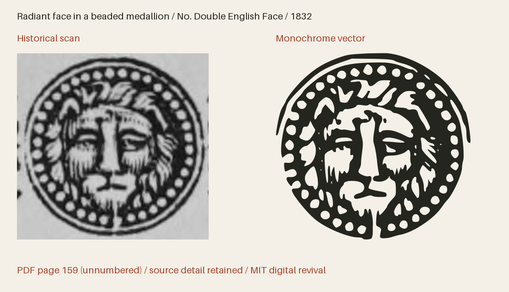

# Boston Ornaments 1832

52 distinct dashes, check borders, border corners and repeat pieces from the Boston foundry specimen of 1832.



**52 icon(s) · Version 1.000 · Artwork: MIT · Fonts: MIT or SIL OFL 1.1**

[SVG files](svg/) · [SVG sprite](web/icons.svg) · [OTF](fonts/BostonOrnaments1832-Regular.otf) · [TTF](fonts/BostonOrnaments1832-Regular.ttf) · [WOFF2](web/BostonOrnaments1832-Regular.woff2) · [Comparison and size proof](specimens/specimen.pdf) · [Icon manifest](icons.json) · [Changes](CHANGELOG.md)


## Use in HTML

[Download the web bundle (ZIP)](downloads/boston-ornaments-1832-web.zip), unzip it, and place
the extracted `collection` folder beside your HTML file. Keep its subfolders
together. The examples below then work as written; adjust the paths if you move
the folder elsewhere. The bundle contains SVGs, PNGs, fonts, CSS, instructions
and license notices. No JavaScript or font installation is needed for SVG use.

### Three-tone image — works from disk too

The individual SVG displays all three tones at their default strengths, with a
transparent background. Change `height` to resize it; the proportions are retained.

```html

```

An `` has its own colour context: page CSS cannot recolour its internal
regions. For a decorative image beside a text label, use `alt=""` instead.

### Three-tone sprite — customise every tone

Copy `web/icons-multitone.svg` and use the following complete example on an
HTTP(S) page served from the same origin as the sprite. It draws dark primary ink
and two strengths of red. Each colour and opacity can be changed independently.

```html
<style>
  .revival-cut {
    display: inline-block;
    font-size: 96px;
    height: 1em;
    width: 0.941406em;
    vertical-align: middle;
    --fr-primary-color: #24251f;
    --fr-secondary-color: #a5422c;
    --fr-tertiary-color: #a5422c;
    --fr-primary-opacity: 1;
    --fr-secondary-opacity: 0.55;
    --fr-tertiary-opacity: 0.25;
  }
</style>
<svg class="revival-cut" role="img" aria-label="Radiant face in a beaded medallion">
  <use href="collection/boston-ornaments-1832/web/icons.svg#boston-1832-p159-double-english-face"></use>
</svg>
```

Use the same secondary and tertiary colour and opacity for a two-tone appearance.
The defaults are primary 100%, secondary 55% and tertiary 25%; these are separate
vector regions, not a gradient. The tone assignments interpret the historical
impression. A transparent PNG of the default tones is also provided.

External SVG sprites can be blocked on `file://` pages. To customise tones on a
page opened from disk, open the individual SVG in a text editor, copy its complete
`<svg>…</svg>` markup into your HTML, and add `class="revival-cut"` to that SVG.
The same CSS above then applies to its inline paths. Keep its `viewBox` and paths.
The gallery itself uses inline SVG so its previews work directly from disk.

### Monochrome icon font

Copy the whole `web/` folder, including CSS and webfonts. Standard icon fonts show
the solid artwork; use the SVG examples above for three-tone artwork.

```html
<link rel="stylesheet" href="collection/boston-ornaments-1832/web/icons.css">
<span class="fr-icon fr-boston-1832-p159-double-english-face" aria-hidden="true"
      style="font-size:96px;color:#a5422c"></span>
<span>Radiant face in a beaded medallion</span>
```

The example hides a decorative icon from screen readers and supplies visible
text. For an icon that conveys meaning on its own, use `role="img"` and an
`aria-label` instead of `aria-hidden`. Font size and colour use ordinary CSS.

Install the OTF or TTF for desktop use. The manifest lists each icon's Private Use
codepoint and recommended minimum display size. These codepoints are not ordinary
text characters; IDs and codepoints are permanent within this collection.
The example above uses U+E000 and is recommended from
64 px. The 16–192 pt proofs show how detail holds up at different sizes.
Keep the included LICENSE with redistributed assets.

The fonts and editable font source data are available under your choice of the [MIT License](LICENSE) or [SIL Open Font License 1.1](OFL.txt) (`MIT OR OFL-1.1`), with no Reserved Font Names. See [font licensing](FONT-LICENSES.txt) for the scope and notices. Other original project files, including standalone artwork, code and documentation, use MIT.

## Evidence and editing

**Foundry:** Boston Type and Stereotype Foundry

**Designer:** Individual engravers unidentified in the specimen

**Observed:** Complete distinct historical ornamental sorts; repeated settings and source sizes are linked to canonical designs in the source inventory.

**Interpreted or new:** No invented ornamental content. Recorded crop cleanup excludes neighbouring numbers and isolated scan specks. Measured rigid rotations straighten tilted impressions; uniform scaling preserves proportions.

- [Boston Type and Stereotype Foundry specimen (1832), ornaments, archive leaf 159](https://archive.org/details/specimenofprinti00bost/page/n159/mode/1up) — 1832 US publication, public domain by age. Library of Congress scan distributed through Internet Archive. The retained archive metadata states that the Library of Congress is unaware of any copyright restrictions for this item. No modern font or redrawing was traced. MIT applies to original project work. [Rights basis](https://archive.org/details/specimenofprinti00bost).
- [Boston Type and Stereotype Foundry specimen (1832), ornaments, archive leaf 161](https://archive.org/details/specimenofprinti00bost/page/n161/mode/1up) — 1832 US publication, public domain by age. Library of Congress scan distributed through Internet Archive. The retained archive metadata states that the Library of Congress is unaware of any copyright restrictions for this item. No modern font or redrawing was traced. MIT applies to original project work. [Rights basis](https://archive.org/details/specimenofprinti00bost).
- [Boston Type and Stereotype Foundry specimen (1832), ornaments, archive leaf 167](https://archive.org/details/specimenofprinti00bost/page/n167/mode/1up) — 1832 US publication, public domain by age. Library of Congress scan distributed through Internet Archive. The retained archive metadata states that the Library of Congress is unaware of any copyright restrictions for this item. No modern font or redrawing was traced. MIT applies to original project work. [Rights basis](https://archive.org/details/specimenofprinti00bost).
- [Boston Type and Stereotype Foundry specimen (1832), ornaments, archive leaf 173](https://archive.org/details/specimenofprinti00bost/page/n173/mode/1up) — 1832 US publication, public domain by age. Library of Congress scan distributed through Internet Archive. The retained archive metadata states that the Library of Congress is unaware of any copyright restrictions for this item. No modern font or redrawing was traced. MIT applies to original project work. [Rights basis](https://archive.org/details/specimenofprinti00bost).
- [Boston Type and Stereotype Foundry specimen (1832), ornaments, archive leaf 175](https://archive.org/details/specimenofprinti00bost/page/n175/mode/1up) — 1832 US publication, public domain by age. Library of Congress scan distributed through Internet Archive. The retained archive metadata states that the Library of Congress is unaware of any copyright restrictions for this item. No modern font or redrawing was traced. MIT applies to original project work. [Rights basis](https://archive.org/details/specimenofprinti00bost).
- [Boston Type and Stereotype Foundry specimen (1832), ornaments, archive leaf 177](https://archive.org/details/specimenofprinti00bost/page/n177/mode/1up) — 1832 US publication, public domain by age. Library of Congress scan distributed through Internet Archive. The retained archive metadata states that the Library of Congress is unaware of any copyright restrictions for this item. No modern font or redrawing was traced. MIT applies to original project work. [Rights basis](https://archive.org/details/specimenofprinti00bost).
- [Boston Type and Stereotype Foundry specimen (1832), ornaments, archive leaf 179](https://archive.org/details/specimenofprinti00bost/page/n179/mode/1up) — 1832 US publication, public domain by age. Library of Congress scan distributed through Internet Archive. The retained archive metadata states that the Library of Congress is unaware of any copyright restrictions for this item. No modern font or redrawing was traced. MIT applies to original project work. [Rights basis](https://archive.org/details/specimenofprinti00bost).
- [Boston Type and Stereotype Foundry specimen (1832), ornaments, archive leaf 181](https://archive.org/details/specimenofprinti00bost/page/n181/mode/1up) — 1832 US publication, public domain by age. Library of Congress scan distributed through Internet Archive. The retained archive metadata states that the Library of Congress is unaware of any copyright restrictions for this item. No modern font or redrawing was traced. MIT applies to original project work. [Rights basis](https://archive.org/details/specimenofprinti00bost).
- [Boston Type and Stereotype Foundry specimen (1832), ornaments, archive leaf 183](https://archive.org/details/specimenofprinti00bost/page/n183/mode/1up) — 1832 US publication, public domain by age. Library of Congress scan distributed through Internet Archive. The retained archive metadata states that the Library of Congress is unaware of any copyright restrictions for this item. No modern font or redrawing was traced. MIT applies to original project work. [Rights basis](https://archive.org/details/specimenofprinti00bost).
- [Boston Type and Stereotype Foundry specimen (1832), ornaments, archive leaf 185](https://archive.org/details/specimenofprinti00bost/page/n185/mode/1up) — 1832 US publication, public domain by age. Library of Congress scan distributed through Internet Archive. The retained archive metadata states that the Library of Congress is unaware of any copyright restrictions for this item. No modern font or redrawing was traced. MIT applies to original project work. [Rights basis](https://archive.org/details/specimenofprinti00bost).
- [Boston Type and Stereotype Foundry specimen (1832), ornaments, archive leaf 187](https://archive.org/details/specimenofprinti00bost/page/n187/mode/1up) — 1832 US publication, public domain by age. Library of Congress scan distributed through Internet Archive. The retained archive metadata states that the Library of Congress is unaware of any copyright restrictions for this item. No modern font or redrawing was traced. MIT applies to original project work. [Rights basis](https://archive.org/details/specimenofprinti00bost).
- [Boston Type and Stereotype Foundry specimen (1832), ornaments, archive leaf 189](https://archive.org/details/specimenofprinti00bost/page/n189/mode/1up) — 1832 US publication, public domain by age. Library of Congress scan distributed through Internet Archive. The retained archive metadata states that the Library of Congress is unaware of any copyright restrictions for this item. No modern font or redrawing was traced. MIT applies to original project work. [Rights basis](https://archive.org/details/specimenofprinti00bost).
- [Boston Type and Stereotype Foundry specimen (1832), ornaments, archive leaf 191](https://archive.org/details/specimenofprinti00bost/page/n191/mode/1up) — 1832 US publication, public domain by age. Library of Congress scan distributed through Internet Archive. The retained archive metadata states that the Library of Congress is unaware of any copyright restrictions for this item. No modern font or redrawing was traced. MIT applies to original project work. [Rights basis](https://archive.org/details/specimenofprinti00bost).
- [Boston Type and Stereotype Foundry specimen (1832), ornaments, archive leaf 193](https://archive.org/details/specimenofprinti00bost/page/n193/mode/1up) — 1832 US publication, public domain by age. Library of Congress scan distributed through Internet Archive. The retained archive metadata states that the Library of Congress is unaware of any copyright restrictions for this item. No modern font or redrawing was traced. MIT applies to original project work. [Rights basis](https://archive.org/details/specimenofprinti00bost).
- [Boston Type and Stereotype Foundry specimen (1832), ornaments, archive leaf 195](https://archive.org/details/specimenofprinti00bost/page/n195/mode/1up) — 1832 US publication, public domain by age. Library of Congress scan distributed through Internet Archive. The retained archive metadata states that the Library of Congress is unaware of any copyright restrictions for this item. No modern font or redrawing was traced. MIT applies to original project work. [Rights basis](https://archive.org/details/specimenofprinti00bost).
- [Boston Type and Stereotype Foundry specimen (1832), ornaments, archive leaf 197](https://archive.org/details/specimenofprinti00bost/page/n197/mode/1up) — 1832 US publication, public domain by age. Library of Congress scan distributed through Internet Archive. The retained archive metadata states that the Library of Congress is unaware of any copyright restrictions for this item. No modern font or redrawing was traced. MIT applies to original project work. [Rights basis](https://archive.org/details/specimenofprinti00bost).

Copyright (c) 2026 Harold Lehmann. Historical public-domain material retains its status.
Read [the method](source/METHOD.md), [inventory](source/inventory.json) and
[icon workflow](../../docs/ICONS.md). The canonical master is `source/font.ttx`;
SVGs, sprite, fonts and manifests are generated from it with glyph edits applied.

```sh
python scripts/fontrevival.py build boston-ornaments-1832
python scripts/fontrevival.py sizecheck boston-ornaments-1832
python scripts/fontrevival.py check boston-ornaments-1832
python scripts/fontrevival.py glyph boston-ornaments-1832 uniE000
```
