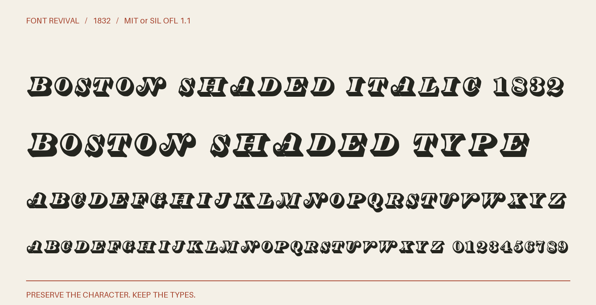

# Boston Shaded Italic 1832

Swash italic titling capitals with an open face and cast shadow, from the Boston foundry’s 1832 specimen.



**1832 · Regular · Version 1.000 · 78 characters · Capitals only · MIT or SIL OFL 1.1**

[OTF](fonts/BostonShadedItalic1832-Regular.otf) · [TTF](fonts/BostonShadedItalic1832-Regular.ttf) · [WOFF2](web/BostonShadedItalic1832-Regular.woff2) · [PDF specimen](specimens/specimen.pdf) · [Changes](CHANGELOG.md)

## Use

Install either desktop format. For websites, copy `web/`, include `font.css`,
and use `font-family: "Boston Shaded Italic 1832"`. Designed for display sizes.

## Design

**Designer:** Unidentified in the historical specimen

**Foundry:** Boston Type and Stereotype Foundry

**Observed:** Complete A–Z capitals from Shaded Two Line Pearl Italic, with matching larger Shaded Two Line Minion Italic L, M, figures, currency and punctuation on archive leaf111.

**Reconstructed:** No inferred visible characters. Lowercase input aliases capitals; ASCII apostrophe aliases the observed closing apostrophe. Blank spaces, metrics and digital spacing are new.

## Sources

1. [Boston Type and Stereotype Foundry specimen (1832), shaded or Italian display types, unnumbered leaf 111](https://archive.org/details/specimenofprinti00bost/page/n111/mode/1up) — 1832 US publication, public domain by age. Library of Congress scan distributed through Internet Archive. The retained archive metadata states that the Library of Congress is unaware of any copyright restrictions for this item. No modern font or redrawing was traced. MIT applies to original project work. [Rights basis](https://archive.org/details/specimenofprinti00bost).

Source images are in `reference/`; the source record is [font.json](font.json).
Historical reference material retains the rights status recorded there.
Copyright (c) 2026 Harold Lehmann. The fonts and editable font source data are available under your choice of the [MIT License](LICENSE) or [SIL Open Font License 1.1](OFL.txt) (`MIT OR OFL-1.1`), with no Reserved Font Names. See [font licensing](FONT-LICENSES.txt) for the scope and notices. Other original project files, including standalone artwork, code and documentation, use MIT.

## Build or improve

From the repository root:

```sh
python scripts/fontrevival.py build boston-shaded-italic-1832
python scripts/fontrevival.py check boston-shaded-italic-1832
```

Edit `source/font.ttx` or export an individual glyph with
`python scripts/fontrevival.py glyph boston-shaded-italic-1832 j`.
Follow the shared [revival workflow](../../docs/WORKFLOW.md) for additions and revisions.
