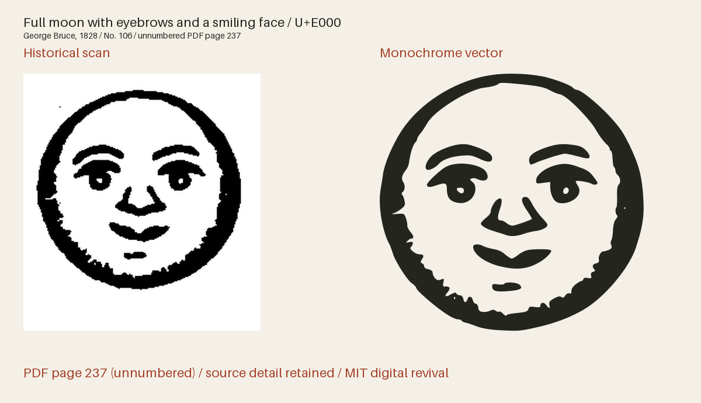

# Bruce Cuts 1828

Pictorial cuts, framed scenes, animals, tools, heraldry and pointing hands from George Bruce’s 1828 specimen.



**499 icon(s) · Version 1.006 · Artwork: MIT · Fonts: MIT or SIL OFL 1.1**

[SVG files](svg/) · [SVG sprite](web/icons.svg) · [OTF](fonts/BruceCuts1828-Regular.otf) · [TTF](fonts/BruceCuts1828-Regular.ttf) · [WOFF2](web/BruceCuts1828-Regular.woff2) · [Comparison and size proof](specimens/specimen.pdf) · [Icon manifest](icons.json) · [Changes](CHANGELOG.md)


## Use in HTML

[Download the web bundle (ZIP)](downloads/bruce-cuts-1828-web.zip), unzip it, and place
the extracted `collection` folder beside your HTML file. Keep its subfolders
together. The examples below then work as written; adjust the paths if you move
the folder elsewhere. The bundle contains SVGs, PNGs, fonts, CSS, instructions
and license notices. No JavaScript or font installation is needed for SVG use.

### Three-tone image — works from disk too

The individual SVG displays all three tones at their default strengths, with a
transparent background. Change `height` to resize it; the proportions are retained.

```html

```

An `` has its own colour context: page CSS cannot recolour its internal
regions. For a decorative image beside a text label, use `alt=""` instead.

### Three-tone sprite — customise every tone

Copy `web/icons-multitone.svg` and use the following complete example on an
HTTP(S) page served from the same origin as the sprite. It draws dark primary ink
and two strengths of red. Each colour and opacity can be changed independently.

```html
<style>
  .revival-cut {
    display: inline-block;
    font-size: 96px;
    height: 1em;
    width: 0.941406em;
    vertical-align: middle;
    --fr-primary-color: #24251f;
    --fr-secondary-color: #a5422c;
    --fr-tertiary-color: #a5422c;
    --fr-primary-opacity: 1;
    --fr-secondary-opacity: 0.55;
    --fr-tertiary-opacity: 0.25;
  }
</style>
<svg class="revival-cut" role="img" aria-label="Full moon with eyebrows and a smiling face">
  <use href="collection/bruce-cuts-1828/web/icons.svg#bruce-1828-p237-cut-106"></use>
</svg>
```

Use the same secondary and tertiary colour and opacity for a two-tone appearance.
The defaults are primary 100%, secondary 55% and tertiary 25%; these are separate
vector regions, not a gradient. The tone assignments interpret the historical
impression. A transparent PNG of the default tones is also provided.

External SVG sprites can be blocked on `file://` pages. To customise tones on a
page opened from disk, open the individual SVG in a text editor, copy its complete
`<svg>…</svg>` markup into your HTML, and add `class="revival-cut"` to that SVG.
The same CSS above then applies to its inline paths. Keep its `viewBox` and paths.
The gallery itself uses inline SVG so its previews work directly from disk.

### Monochrome icon font

Copy the whole `web/` folder, including CSS and webfonts. Standard icon fonts show
the solid artwork; use the SVG examples above for three-tone artwork.

```html
<link rel="stylesheet" href="collection/bruce-cuts-1828/web/icons.css">
<span class="fr-icon fr-bruce-1828-p237-cut-106" aria-hidden="true"
      style="font-size:96px;color:#a5422c"></span>
<span>Full moon with eyebrows and a smiling face</span>
```

The example hides a decorative icon from screen readers and supplies visible
text. For an icon that conveys meaning on its own, use `role="img"` and an
`aria-label` instead of `aria-hidden`. Font size and colour use ordinary CSS.

Install the OTF or TTF for desktop use. The manifest lists each icon's Private Use
codepoint and recommended minimum display size. These codepoints are not ordinary
text characters; IDs and codepoints are permanent within this collection.
The example above uses U+E000 and is recommended from
96 px. The 16–192 pt proofs show how detail holds up at different sizes.
Keep the included LICENSE with redistributed assets.

The fonts and editable font source data are available under your choice of the [MIT License](LICENSE) or [SIL Open Font License 1.1](OFL.txt) (`MIT OR OFL-1.1`), with no Reserved Font Names. See [font licensing](FONT-LICENSES.txt) for the scope and notices. Other original project files, including standalone artwork, code and documentation, use MIT.

## Evidence and editing

**Foundry:** George Bruce, New York

**Designer:** Individual engravers unidentified in the specimen

**Observed:** 499 distinct complete cuts from unnumbered PDF pages 237–403. The inventory accounts for 816 printed settings, including repeated sheets, links matching designs to existing collection IDs and records unresolved or clipped source impressions.

**Interpreted or new:** No invented pictorial content. Native-page crops, isolated-speck cleanup, cubic fitting and font-unit rounding interpret the printed impressions. Descriptive names, tags, Private Use assignments and digital metrics are new project work. Three compatible font drawings use a documented coverage screen to preserve apparent shading within renderer limits; the full-detail master and SVG keep the traced engraving.

- [A specimen of printing types, and ornaments cast in the letter-foundry of George Bruce (1828), numbered cuts; unnumbered leaf, PDF page 237](https://hdl.handle.net/2027/nyp.33433006349736) — 1828 United States publication; historical artwork is public domain by age. New York Public Library copy digitized by Google, distributed by HathiTrust and mirrored by Circuitous Root. A faithful scan of the historical page, not a modern digital typeface. [Rights basis](https://circuitousroot.com/artifice/letters/press/noncomptype/typography/bruce/index.html).
- [A specimen of printing types, and ornaments cast in the letter-foundry of George Bruce (1828), numbered cuts; unnumbered leaf, PDF page 239](https://hdl.handle.net/2027/nyp.33433006349736) — 1828 United States publication; historical artwork is public domain by age. New York Public Library copy digitized by Google, distributed by HathiTrust and mirrored by Circuitous Root. A faithful scan of the historical page, not a modern digital typeface. [Rights basis](https://circuitousroot.com/artifice/letters/press/noncomptype/typography/bruce/index.html).
- [A specimen of printing types, and ornaments cast in the letter-foundry of George Bruce (1828), numbered cuts; unnumbered leaf, PDF page 241](https://hdl.handle.net/2027/nyp.33433006349736) — 1828 United States publication; historical artwork is public domain by age. New York Public Library copy digitized by Google, distributed by HathiTrust and mirrored by Circuitous Root. A faithful scan of the historical page, not a modern digital typeface. [Rights basis](https://circuitousroot.com/artifice/letters/press/noncomptype/typography/bruce/index.html).
- [A specimen of printing types, and ornaments cast in the letter-foundry of George Bruce (1828), numbered cuts; unnumbered leaf, PDF page 243](https://hdl.handle.net/2027/nyp.33433006349736) — 1828 United States publication; historical artwork is public domain by age. New York Public Library copy digitized by Google, distributed by HathiTrust and mirrored by Circuitous Root. A faithful scan of the historical page, not a modern digital typeface. [Rights basis](https://circuitousroot.com/artifice/letters/press/noncomptype/typography/bruce/index.html).
- [A specimen of printing types, and ornaments cast in the letter-foundry of George Bruce (1828), numbered cuts; unnumbered leaf, PDF page 245](https://hdl.handle.net/2027/nyp.33433006349736) — 1828 United States publication; historical artwork is public domain by age. New York Public Library copy digitized by Google, distributed by HathiTrust and mirrored by Circuitous Root. A faithful scan of the historical page, not a modern digital typeface. [Rights basis](https://circuitousroot.com/artifice/letters/press/noncomptype/typography/bruce/index.html).
- [A specimen of printing types, and ornaments cast in the letter-foundry of George Bruce (1828), numbered cuts; unnumbered leaf, PDF page 247](https://hdl.handle.net/2027/nyp.33433006349736) — 1828 United States publication; historical artwork is public domain by age. New York Public Library copy digitized by Google, distributed by HathiTrust and mirrored by Circuitous Root. A faithful scan of the historical page, not a modern digital typeface. [Rights basis](https://circuitousroot.com/artifice/letters/press/noncomptype/typography/bruce/index.html).
- [A specimen of printing types, and ornaments cast in the letter-foundry of George Bruce (1828), numbered cuts; unnumbered leaf, PDF page 249](https://hdl.handle.net/2027/nyp.33433006349736) — 1828 United States publication; historical artwork is public domain by age. New York Public Library copy digitized by Google, distributed by HathiTrust and mirrored by Circuitous Root. A faithful scan of the historical page, not a modern digital typeface. [Rights basis](https://circuitousroot.com/artifice/letters/press/noncomptype/typography/bruce/index.html).
- [A specimen of printing types, and ornaments cast in the letter-foundry of George Bruce (1828), numbered cuts; unnumbered leaf, PDF page 251](https://hdl.handle.net/2027/nyp.33433006349736) — 1828 United States publication; historical artwork is public domain by age. New York Public Library copy digitized by Google, distributed by HathiTrust and mirrored by Circuitous Root. A faithful scan of the historical page, not a modern digital typeface. [Rights basis](https://circuitousroot.com/artifice/letters/press/noncomptype/typography/bruce/index.html).
- [A specimen of printing types, and ornaments cast in the letter-foundry of George Bruce (1828), numbered cuts; unnumbered leaf, PDF page 253](https://hdl.handle.net/2027/nyp.33433006349736) — 1828 United States publication; historical artwork is public domain by age. New York Public Library copy digitized by Google, distributed by HathiTrust and mirrored by Circuitous Root. A faithful scan of the historical page, not a modern digital typeface. [Rights basis](https://circuitousroot.com/artifice/letters/press/noncomptype/typography/bruce/index.html).
- [A specimen of printing types, and ornaments cast in the letter-foundry of George Bruce (1828), numbered cuts; unnumbered leaf, PDF page 255](https://hdl.handle.net/2027/nyp.33433006349736) — 1828 United States publication; historical artwork is public domain by age. New York Public Library copy digitized by Google, distributed by HathiTrust and mirrored by Circuitous Root. A faithful scan of the historical page, not a modern digital typeface. [Rights basis](https://circuitousroot.com/artifice/letters/press/noncomptype/typography/bruce/index.html).
- [A specimen of printing types, and ornaments cast in the letter-foundry of George Bruce (1828), numbered cuts; unnumbered leaf, PDF page 257](https://hdl.handle.net/2027/nyp.33433006349736) — 1828 United States publication; historical artwork is public domain by age. New York Public Library copy digitized by Google, distributed by HathiTrust and mirrored by Circuitous Root. A faithful scan of the historical page, not a modern digital typeface. [Rights basis](https://circuitousroot.com/artifice/letters/press/noncomptype/typography/bruce/index.html).
- [A specimen of printing types, and ornaments cast in the letter-foundry of George Bruce (1828), numbered cuts; unnumbered leaf, PDF page 259](https://hdl.handle.net/2027/nyp.33433006349736) — 1828 United States publication; historical artwork is public domain by age. New York Public Library copy digitized by Google, distributed by HathiTrust and mirrored by Circuitous Root. A faithful scan of the historical page, not a modern digital typeface. [Rights basis](https://circuitousroot.com/artifice/letters/press/noncomptype/typography/bruce/index.html).
- [A specimen of printing types, and ornaments cast in the letter-foundry of George Bruce (1828), numbered cuts; unnumbered leaf, PDF page 261](https://hdl.handle.net/2027/nyp.33433006349736) — 1828 United States publication; historical artwork is public domain by age. New York Public Library copy digitized by Google, distributed by HathiTrust and mirrored by Circuitous Root. A faithful scan of the historical page, not a modern digital typeface. [Rights basis](https://circuitousroot.com/artifice/letters/press/noncomptype/typography/bruce/index.html).
- [A specimen of printing types, and ornaments cast in the letter-foundry of George Bruce (1828), numbered cuts; unnumbered leaf, PDF page 263](https://hdl.handle.net/2027/nyp.33433006349736) — 1828 United States publication; historical artwork is public domain by age. New York Public Library copy digitized by Google, distributed by HathiTrust and mirrored by Circuitous Root. A faithful scan of the historical page, not a modern digital typeface. [Rights basis](https://circuitousroot.com/artifice/letters/press/noncomptype/typography/bruce/index.html).
- [A specimen of printing types, and ornaments cast in the letter-foundry of George Bruce (1828), numbered cuts; unnumbered leaf, PDF page 265](https://hdl.handle.net/2027/nyp.33433006349736) — 1828 United States publication; historical artwork is public domain by age. New York Public Library copy digitized by Google, distributed by HathiTrust and mirrored by Circuitous Root. A faithful scan of the historical page, not a modern digital typeface. [Rights basis](https://circuitousroot.com/artifice/letters/press/noncomptype/typography/bruce/index.html).
- [A specimen of printing types, and ornaments cast in the letter-foundry of George Bruce (1828), numbered cuts; unnumbered leaf, PDF page 267](https://hdl.handle.net/2027/nyp.33433006349736) — 1828 United States publication; historical artwork is public domain by age. New York Public Library copy digitized by Google, distributed by HathiTrust and mirrored by Circuitous Root. A faithful scan of the historical page, not a modern digital typeface. [Rights basis](https://circuitousroot.com/artifice/letters/press/noncomptype/typography/bruce/index.html).
- [A specimen of printing types, and ornaments cast in the letter-foundry of George Bruce (1828), numbered cuts; unnumbered leaf, PDF page 269](https://hdl.handle.net/2027/nyp.33433006349736) — 1828 United States publication; historical artwork is public domain by age. New York Public Library copy digitized by Google, distributed by HathiTrust and mirrored by Circuitous Root. A faithful scan of the historical page, not a modern digital typeface. [Rights basis](https://circuitousroot.com/artifice/letters/press/noncomptype/typography/bruce/index.html).
- [A specimen of printing types, and ornaments cast in the letter-foundry of George Bruce (1828), numbered cuts; unnumbered leaf, PDF page 271](https://hdl.handle.net/2027/nyp.33433006349736) — 1828 United States publication; historical artwork is public domain by age. New York Public Library copy digitized by Google, distributed by HathiTrust and mirrored by Circuitous Root. A faithful scan of the historical page, not a modern digital typeface. [Rights basis](https://circuitousroot.com/artifice/letters/press/noncomptype/typography/bruce/index.html).
- [A specimen of printing types, and ornaments cast in the letter-foundry of George Bruce (1828), numbered cuts; unnumbered leaf, PDF page 273](https://hdl.handle.net/2027/nyp.33433006349736) — 1828 United States publication; historical artwork is public domain by age. New York Public Library copy digitized by Google, distributed by HathiTrust and mirrored by Circuitous Root. A faithful scan of the historical page, not a modern digital typeface. [Rights basis](https://circuitousroot.com/artifice/letters/press/noncomptype/typography/bruce/index.html).
- [A specimen of printing types, and ornaments cast in the letter-foundry of George Bruce (1828), numbered cuts; unnumbered leaf, PDF page 275](https://hdl.handle.net/2027/nyp.33433006349736) — 1828 United States publication; historical artwork is public domain by age. New York Public Library copy digitized by Google, distributed by HathiTrust and mirrored by Circuitous Root. A faithful scan of the historical page, not a modern digital typeface. [Rights basis](https://circuitousroot.com/artifice/letters/press/noncomptype/typography/bruce/index.html).
- [A specimen of printing types, and ornaments cast in the letter-foundry of George Bruce (1828), numbered cuts; unnumbered leaf, PDF page 277](https://hdl.handle.net/2027/nyp.33433006349736) — 1828 United States publication; historical artwork is public domain by age. New York Public Library copy digitized by Google, distributed by HathiTrust and mirrored by Circuitous Root. A faithful scan of the historical page, not a modern digital typeface. [Rights basis](https://circuitousroot.com/artifice/letters/press/noncomptype/typography/bruce/index.html).
- [A specimen of printing types, and ornaments cast in the letter-foundry of George Bruce (1828), numbered cuts; unnumbered leaf, PDF page 279](https://hdl.handle.net/2027/nyp.33433006349736) — 1828 United States publication; historical artwork is public domain by age. New York Public Library copy digitized by Google, distributed by HathiTrust and mirrored by Circuitous Root. A faithful scan of the historical page, not a modern digital typeface. [Rights basis](https://circuitousroot.com/artifice/letters/press/noncomptype/typography/bruce/index.html).
- [A specimen of printing types, and ornaments cast in the letter-foundry of George Bruce (1828), numbered cuts; unnumbered leaf, PDF page 281](https://hdl.handle.net/2027/nyp.33433006349736) — 1828 United States publication; historical artwork is public domain by age. New York Public Library copy digitized by Google, distributed by HathiTrust and mirrored by Circuitous Root. A faithful scan of the historical page, not a modern digital typeface. [Rights basis](https://circuitousroot.com/artifice/letters/press/noncomptype/typography/bruce/index.html).
- [A specimen of printing types, and ornaments cast in the letter-foundry of George Bruce (1828), numbered cuts; unnumbered leaf, PDF page 283](https://hdl.handle.net/2027/nyp.33433006349736) — 1828 United States publication; historical artwork is public domain by age. New York Public Library copy digitized by Google, distributed by HathiTrust and mirrored by Circuitous Root. A faithful scan of the historical page, not a modern digital typeface. [Rights basis](https://circuitousroot.com/artifice/letters/press/noncomptype/typography/bruce/index.html).
- [A specimen of printing types, and ornaments cast in the letter-foundry of George Bruce (1828), numbered cuts; unnumbered leaf, PDF page 285](https://hdl.handle.net/2027/nyp.33433006349736) — 1828 United States publication; historical artwork is public domain by age. New York Public Library copy digitized by Google, distributed by HathiTrust and mirrored by Circuitous Root. A faithful scan of the historical page, not a modern digital typeface. [Rights basis](https://circuitousroot.com/artifice/letters/press/noncomptype/typography/bruce/index.html).
- [A specimen of printing types, and ornaments cast in the letter-foundry of George Bruce (1828), numbered cuts; unnumbered leaf, PDF page 287](https://hdl.handle.net/2027/nyp.33433006349736) — 1828 United States publication; historical artwork is public domain by age. New York Public Library copy digitized by Google, distributed by HathiTrust and mirrored by Circuitous Root. A faithful scan of the historical page, not a modern digital typeface. [Rights basis](https://circuitousroot.com/artifice/letters/press/noncomptype/typography/bruce/index.html).
- [A specimen of printing types, and ornaments cast in the letter-foundry of George Bruce (1828), numbered cuts; unnumbered leaf, PDF page 289](https://hdl.handle.net/2027/nyp.33433006349736) — 1828 United States publication; historical artwork is public domain by age. New York Public Library copy digitized by Google, distributed by HathiTrust and mirrored by Circuitous Root. A faithful scan of the historical page, not a modern digital typeface. [Rights basis](https://circuitousroot.com/artifice/letters/press/noncomptype/typography/bruce/index.html).
- [A specimen of printing types, and ornaments cast in the letter-foundry of George Bruce (1828), ornaments and cuts; unnumbered leaf, PDF page 291](https://hdl.handle.net/2027/nyp.33433006349736) — 1828 United States publication; historical artwork is public domain by age. New York Public Library copy digitized by Google, distributed by HathiTrust and mirrored by Circuitous Root. A faithful scan of the historical page, not a modern digital typeface. [Rights basis](https://circuitousroot.com/artifice/letters/press/noncomptype/typography/bruce/index.html).
- [A specimen of printing types, and ornaments cast in the letter-foundry of George Bruce (1828), ornaments and cuts; unnumbered leaf, PDF page 293](https://hdl.handle.net/2027/nyp.33433006349736) — 1828 United States publication; historical artwork is public domain by age. New York Public Library copy digitized by Google, distributed by HathiTrust and mirrored by Circuitous Root. A faithful scan of the historical page, not a modern digital typeface. [Rights basis](https://circuitousroot.com/artifice/letters/press/noncomptype/typography/bruce/index.html).
- [A specimen of printing types, and ornaments cast in the letter-foundry of George Bruce (1828), ornaments and cuts; unnumbered leaf, PDF page 297](https://hdl.handle.net/2027/nyp.33433006349736) — 1828 United States publication; historical artwork is public domain by age. New York Public Library copy digitized by Google, distributed by HathiTrust and mirrored by Circuitous Root. A faithful scan of the historical page, not a modern digital typeface. [Rights basis](https://circuitousroot.com/artifice/letters/press/noncomptype/typography/bruce/index.html).
- [A specimen of printing types, and ornaments cast in the letter-foundry of George Bruce (1828), ornaments and cuts; unnumbered leaf, PDF page 307](https://hdl.handle.net/2027/nyp.33433006349736) — 1828 United States publication; historical artwork is public domain by age. New York Public Library copy digitized by Google, distributed by HathiTrust and mirrored by Circuitous Root. A faithful scan of the historical page, not a modern digital typeface. [Rights basis](https://circuitousroot.com/artifice/letters/press/noncomptype/typography/bruce/index.html).
- [A specimen of printing types, and ornaments cast in the letter-foundry of George Bruce (1828), ornaments and cuts; unnumbered leaf, PDF page 309](https://hdl.handle.net/2027/nyp.33433006349736) — 1828 United States publication; historical artwork is public domain by age. New York Public Library copy digitized by Google, distributed by HathiTrust and mirrored by Circuitous Root. A faithful scan of the historical page, not a modern digital typeface. [Rights basis](https://circuitousroot.com/artifice/letters/press/noncomptype/typography/bruce/index.html).
- [A specimen of printing types, and ornaments cast in the letter-foundry of George Bruce (1828), ornaments and cuts; unnumbered leaf, PDF page 311](https://hdl.handle.net/2027/nyp.33433006349736) — 1828 United States publication; historical artwork is public domain by age. New York Public Library copy digitized by Google, distributed by HathiTrust and mirrored by Circuitous Root. A faithful scan of the historical page, not a modern digital typeface. [Rights basis](https://circuitousroot.com/artifice/letters/press/noncomptype/typography/bruce/index.html).
- [A specimen of printing types, and ornaments cast in the letter-foundry of George Bruce (1828), ornaments and cuts; unnumbered leaf, PDF page 313](https://hdl.handle.net/2027/nyp.33433006349736) — 1828 United States publication; historical artwork is public domain by age. New York Public Library copy digitized by Google, distributed by HathiTrust and mirrored by Circuitous Root. A faithful scan of the historical page, not a modern digital typeface. [Rights basis](https://circuitousroot.com/artifice/letters/press/noncomptype/typography/bruce/index.html).
- [A specimen of printing types, and ornaments cast in the letter-foundry of George Bruce (1828), ornaments and cuts; unnumbered leaf, PDF page 315](https://hdl.handle.net/2027/nyp.33433006349736) — 1828 United States publication; historical artwork is public domain by age. New York Public Library copy digitized by Google, distributed by HathiTrust and mirrored by Circuitous Root. A faithful scan of the historical page, not a modern digital typeface. [Rights basis](https://circuitousroot.com/artifice/letters/press/noncomptype/typography/bruce/index.html).
- [A specimen of printing types, and ornaments cast in the letter-foundry of George Bruce (1828), ornaments and cuts; unnumbered leaf, PDF page 317](https://hdl.handle.net/2027/nyp.33433006349736) — 1828 United States publication; historical artwork is public domain by age. New York Public Library copy digitized by Google, distributed by HathiTrust and mirrored by Circuitous Root. A faithful scan of the historical page, not a modern digital typeface. [Rights basis](https://circuitousroot.com/artifice/letters/press/noncomptype/typography/bruce/index.html).
- [A specimen of printing types, and ornaments cast in the letter-foundry of George Bruce (1828), ornaments and cuts; unnumbered leaf, PDF page 319](https://hdl.handle.net/2027/nyp.33433006349736) — 1828 United States publication; historical artwork is public domain by age. New York Public Library copy digitized by Google, distributed by HathiTrust and mirrored by Circuitous Root. A faithful scan of the historical page, not a modern digital typeface. [Rights basis](https://circuitousroot.com/artifice/letters/press/noncomptype/typography/bruce/index.html).
- [A specimen of printing types, and ornaments cast in the letter-foundry of George Bruce (1828), ornaments and cuts; unnumbered leaf, PDF page 323](https://hdl.handle.net/2027/nyp.33433006349736) — 1828 United States publication; historical artwork is public domain by age. New York Public Library copy digitized by Google, distributed by HathiTrust and mirrored by Circuitous Root. A faithful scan of the historical page, not a modern digital typeface. [Rights basis](https://circuitousroot.com/artifice/letters/press/noncomptype/typography/bruce/index.html).
- [A specimen of printing types, and ornaments cast in the letter-foundry of George Bruce (1828), ornaments and cuts; unnumbered leaf, PDF page 333](https://hdl.handle.net/2027/nyp.33433006349736) — 1828 United States publication; historical artwork is public domain by age. New York Public Library copy digitized by Google, distributed by HathiTrust and mirrored by Circuitous Root. A faithful scan of the historical page, not a modern digital typeface. [Rights basis](https://circuitousroot.com/artifice/letters/press/noncomptype/typography/bruce/index.html).
- [A specimen of printing types, and ornaments cast in the letter-foundry of George Bruce (1828), ornaments and cuts; unnumbered leaf, PDF page 335](https://hdl.handle.net/2027/nyp.33433006349736) — 1828 United States publication; historical artwork is public domain by age. New York Public Library copy digitized by Google, distributed by HathiTrust and mirrored by Circuitous Root. A faithful scan of the historical page, not a modern digital typeface. [Rights basis](https://circuitousroot.com/artifice/letters/press/noncomptype/typography/bruce/index.html).
- [A specimen of printing types, and ornaments cast in the letter-foundry of George Bruce (1828), ornaments and cuts; unnumbered leaf, PDF page 337](https://hdl.handle.net/2027/nyp.33433006349736) — 1828 United States publication; historical artwork is public domain by age. New York Public Library copy digitized by Google, distributed by HathiTrust and mirrored by Circuitous Root. A faithful scan of the historical page, not a modern digital typeface. [Rights basis](https://circuitousroot.com/artifice/letters/press/noncomptype/typography/bruce/index.html).
- [A specimen of printing types, and ornaments cast in the letter-foundry of George Bruce (1828), ornaments and cuts; unnumbered leaf, PDF page 339](https://hdl.handle.net/2027/nyp.33433006349736) — 1828 United States publication; historical artwork is public domain by age. New York Public Library copy digitized by Google, distributed by HathiTrust and mirrored by Circuitous Root. A faithful scan of the historical page, not a modern digital typeface. [Rights basis](https://circuitousroot.com/artifice/letters/press/noncomptype/typography/bruce/index.html).
- [A specimen of printing types, and ornaments cast in the letter-foundry of George Bruce (1828), ornaments and cuts; unnumbered leaf, PDF page 341](https://hdl.handle.net/2027/nyp.33433006349736) — 1828 United States publication; historical artwork is public domain by age. New York Public Library copy digitized by Google, distributed by HathiTrust and mirrored by Circuitous Root. A faithful scan of the historical page, not a modern digital typeface. [Rights basis](https://circuitousroot.com/artifice/letters/press/noncomptype/typography/bruce/index.html).
- [A specimen of printing types, and ornaments cast in the letter-foundry of George Bruce (1828), ornaments and cuts; unnumbered leaf, PDF page 343](https://hdl.handle.net/2027/nyp.33433006349736) — 1828 United States publication; historical artwork is public domain by age. New York Public Library copy digitized by Google, distributed by HathiTrust and mirrored by Circuitous Root. A faithful scan of the historical page, not a modern digital typeface. [Rights basis](https://circuitousroot.com/artifice/letters/press/noncomptype/typography/bruce/index.html).
- [A specimen of printing types, and ornaments cast in the letter-foundry of George Bruce (1828), ornaments and cuts; unnumbered leaf, PDF page 345](https://hdl.handle.net/2027/nyp.33433006349736) — 1828 United States publication; historical artwork is public domain by age. New York Public Library copy digitized by Google, distributed by HathiTrust and mirrored by Circuitous Root. A faithful scan of the historical page, not a modern digital typeface. [Rights basis](https://circuitousroot.com/artifice/letters/press/noncomptype/typography/bruce/index.html).
- [A specimen of printing types, and ornaments cast in the letter-foundry of George Bruce (1828), ornaments and cuts; unnumbered leaf, PDF page 347](https://hdl.handle.net/2027/nyp.33433006349736) — 1828 United States publication; historical artwork is public domain by age. New York Public Library copy digitized by Google, distributed by HathiTrust and mirrored by Circuitous Root. A faithful scan of the historical page, not a modern digital typeface. [Rights basis](https://circuitousroot.com/artifice/letters/press/noncomptype/typography/bruce/index.html).
- [A specimen of printing types, and ornaments cast in the letter-foundry of George Bruce (1828), ornaments and cuts; unnumbered leaf, PDF page 349](https://hdl.handle.net/2027/nyp.33433006349736) — 1828 United States publication; historical artwork is public domain by age. New York Public Library copy digitized by Google, distributed by HathiTrust and mirrored by Circuitous Root. A faithful scan of the historical page, not a modern digital typeface. [Rights basis](https://circuitousroot.com/artifice/letters/press/noncomptype/typography/bruce/index.html).
- [A specimen of printing types, and ornaments cast in the letter-foundry of George Bruce (1828), ornaments and cuts; unnumbered leaf, PDF page 351](https://hdl.handle.net/2027/nyp.33433006349736) — 1828 United States publication; historical artwork is public domain by age. New York Public Library copy digitized by Google, distributed by HathiTrust and mirrored by Circuitous Root. A faithful scan of the historical page, not a modern digital typeface. [Rights basis](https://circuitousroot.com/artifice/letters/press/noncomptype/typography/bruce/index.html).
- [A specimen of printing types, and ornaments cast in the letter-foundry of George Bruce (1828), ornaments and cuts; unnumbered leaf, PDF page 353](https://hdl.handle.net/2027/nyp.33433006349736) — 1828 United States publication; historical artwork is public domain by age. New York Public Library copy digitized by Google, distributed by HathiTrust and mirrored by Circuitous Root. A faithful scan of the historical page, not a modern digital typeface. [Rights basis](https://circuitousroot.com/artifice/letters/press/noncomptype/typography/bruce/index.html).
- [A specimen of printing types, and ornaments cast in the letter-foundry of George Bruce (1828), ornaments and cuts; unnumbered leaf, PDF page 355](https://hdl.handle.net/2027/nyp.33433006349736) — 1828 United States publication; historical artwork is public domain by age. New York Public Library copy digitized by Google, distributed by HathiTrust and mirrored by Circuitous Root. A faithful scan of the historical page, not a modern digital typeface. [Rights basis](https://circuitousroot.com/artifice/letters/press/noncomptype/typography/bruce/index.html).
- [A specimen of printing types, and ornaments cast in the letter-foundry of George Bruce (1828), ornaments and cuts; unnumbered leaf, PDF page 357](https://hdl.handle.net/2027/nyp.33433006349736) — 1828 United States publication; historical artwork is public domain by age. New York Public Library copy digitized by Google, distributed by HathiTrust and mirrored by Circuitous Root. A faithful scan of the historical page, not a modern digital typeface. [Rights basis](https://circuitousroot.com/artifice/letters/press/noncomptype/typography/bruce/index.html).
- [A specimen of printing types, and ornaments cast in the letter-foundry of George Bruce (1828), ornaments and cuts; unnumbered leaf, PDF page 359](https://hdl.handle.net/2027/nyp.33433006349736) — 1828 United States publication; historical artwork is public domain by age. New York Public Library copy digitized by Google, distributed by HathiTrust and mirrored by Circuitous Root. A faithful scan of the historical page, not a modern digital typeface. [Rights basis](https://circuitousroot.com/artifice/letters/press/noncomptype/typography/bruce/index.html).
- [A specimen of printing types, and ornaments cast in the letter-foundry of George Bruce (1828), ornaments and cuts; unnumbered leaf, PDF page 361](https://hdl.handle.net/2027/nyp.33433006349736) — 1828 United States publication; historical artwork is public domain by age. New York Public Library copy digitized by Google, distributed by HathiTrust and mirrored by Circuitous Root. A faithful scan of the historical page, not a modern digital typeface. [Rights basis](https://circuitousroot.com/artifice/letters/press/noncomptype/typography/bruce/index.html).
- [A specimen of printing types, and ornaments cast in the letter-foundry of George Bruce (1828), ornaments and cuts; unnumbered leaf, PDF page 363](https://hdl.handle.net/2027/nyp.33433006349736) — 1828 United States publication; historical artwork is public domain by age. New York Public Library copy digitized by Google, distributed by HathiTrust and mirrored by Circuitous Root. A faithful scan of the historical page, not a modern digital typeface. [Rights basis](https://circuitousroot.com/artifice/letters/press/noncomptype/typography/bruce/index.html).
- [A specimen of printing types, and ornaments cast in the letter-foundry of George Bruce (1828), ornaments and cuts; unnumbered leaf, PDF page 365](https://hdl.handle.net/2027/nyp.33433006349736) — 1828 United States publication; historical artwork is public domain by age. New York Public Library copy digitized by Google, distributed by HathiTrust and mirrored by Circuitous Root. A faithful scan of the historical page, not a modern digital typeface. [Rights basis](https://circuitousroot.com/artifice/letters/press/noncomptype/typography/bruce/index.html).
- [A specimen of printing types, and ornaments cast in the letter-foundry of George Bruce (1828), ornaments and cuts; unnumbered leaf, PDF page 367](https://hdl.handle.net/2027/nyp.33433006349736) — 1828 United States publication; historical artwork is public domain by age. New York Public Library copy digitized by Google, distributed by HathiTrust and mirrored by Circuitous Root. A faithful scan of the historical page, not a modern digital typeface. [Rights basis](https://circuitousroot.com/artifice/letters/press/noncomptype/typography/bruce/index.html).
- [A specimen of printing types, and ornaments cast in the letter-foundry of George Bruce (1828), ornaments and cuts; unnumbered leaf, PDF page 369](https://hdl.handle.net/2027/nyp.33433006349736) — 1828 United States publication; historical artwork is public domain by age. New York Public Library copy digitized by Google, distributed by HathiTrust and mirrored by Circuitous Root. A faithful scan of the historical page, not a modern digital typeface. [Rights basis](https://circuitousroot.com/artifice/letters/press/noncomptype/typography/bruce/index.html).
- [A specimen of printing types, and ornaments cast in the letter-foundry of George Bruce (1828), ornaments and cuts; unnumbered leaf, PDF page 371](https://hdl.handle.net/2027/nyp.33433006349736) — 1828 United States publication; historical artwork is public domain by age. New York Public Library copy digitized by Google, distributed by HathiTrust and mirrored by Circuitous Root. A faithful scan of the historical page, not a modern digital typeface. [Rights basis](https://circuitousroot.com/artifice/letters/press/noncomptype/typography/bruce/index.html).
- [A specimen of printing types, and ornaments cast in the letter-foundry of George Bruce (1828), ornaments and cuts; unnumbered leaf, PDF page 373](https://hdl.handle.net/2027/nyp.33433006349736) — 1828 United States publication; historical artwork is public domain by age. New York Public Library copy digitized by Google, distributed by HathiTrust and mirrored by Circuitous Root. A faithful scan of the historical page, not a modern digital typeface. [Rights basis](https://circuitousroot.com/artifice/letters/press/noncomptype/typography/bruce/index.html).
- [A specimen of printing types, and ornaments cast in the letter-foundry of George Bruce (1828), ornaments and cuts; unnumbered leaf, PDF page 375](https://hdl.handle.net/2027/nyp.33433006349736) — 1828 United States publication; historical artwork is public domain by age. New York Public Library copy digitized by Google, distributed by HathiTrust and mirrored by Circuitous Root. A faithful scan of the historical page, not a modern digital typeface. [Rights basis](https://circuitousroot.com/artifice/letters/press/noncomptype/typography/bruce/index.html).
- [A specimen of printing types, and ornaments cast in the letter-foundry of George Bruce (1828), ornaments and cuts; unnumbered leaf, PDF page 377](https://hdl.handle.net/2027/nyp.33433006349736) — 1828 United States publication; historical artwork is public domain by age. New York Public Library copy digitized by Google, distributed by HathiTrust and mirrored by Circuitous Root. A faithful scan of the historical page, not a modern digital typeface. [Rights basis](https://circuitousroot.com/artifice/letters/press/noncomptype/typography/bruce/index.html).
- [A specimen of printing types, and ornaments cast in the letter-foundry of George Bruce (1828), ornaments and cuts; unnumbered leaf, PDF page 379](https://hdl.handle.net/2027/nyp.33433006349736) — 1828 United States publication; historical artwork is public domain by age. New York Public Library copy digitized by Google, distributed by HathiTrust and mirrored by Circuitous Root. A faithful scan of the historical page, not a modern digital typeface. [Rights basis](https://circuitousroot.com/artifice/letters/press/noncomptype/typography/bruce/index.html).
- [A specimen of printing types, and ornaments cast in the letter-foundry of George Bruce (1828), ornaments and cuts; unnumbered leaf, PDF page 383](https://hdl.handle.net/2027/nyp.33433006349736) — 1828 United States publication; historical artwork is public domain by age. New York Public Library copy digitized by Google, distributed by HathiTrust and mirrored by Circuitous Root. A faithful scan of the historical page, not a modern digital typeface. [Rights basis](https://circuitousroot.com/artifice/letters/press/noncomptype/typography/bruce/index.html).
- [A specimen of printing types, and ornaments cast in the letter-foundry of George Bruce (1828), ornaments and cuts; unnumbered leaf, PDF page 385](https://hdl.handle.net/2027/nyp.33433006349736) — 1828 United States publication; historical artwork is public domain by age. New York Public Library copy digitized by Google, distributed by HathiTrust and mirrored by Circuitous Root. A faithful scan of the historical page, not a modern digital typeface. [Rights basis](https://circuitousroot.com/artifice/letters/press/noncomptype/typography/bruce/index.html).
- [A specimen of printing types, and ornaments cast in the letter-foundry of George Bruce (1828), ornaments and cuts; unnumbered leaf, PDF page 387](https://hdl.handle.net/2027/nyp.33433006349736) — 1828 United States publication; historical artwork is public domain by age. New York Public Library copy digitized by Google, distributed by HathiTrust and mirrored by Circuitous Root. A faithful scan of the historical page, not a modern digital typeface. [Rights basis](https://circuitousroot.com/artifice/letters/press/noncomptype/typography/bruce/index.html).
- [A specimen of printing types, and ornaments cast in the letter-foundry of George Bruce (1828), ornaments and cuts; unnumbered leaf, PDF page 393](https://hdl.handle.net/2027/nyp.33433006349736) — 1828 United States publication; historical artwork is public domain by age. New York Public Library copy digitized by Google, distributed by HathiTrust and mirrored by Circuitous Root. A faithful scan of the historical page, not a modern digital typeface. [Rights basis](https://circuitousroot.com/artifice/letters/press/noncomptype/typography/bruce/index.html).

Copyright (c) 2026 Harold Lehmann. Historical public-domain material retains its status.
Read [the method](source/METHOD.md), [inventory](source/inventory.json) and
[icon workflow](../../docs/ICONS.md). The canonical master is `source/font.ttx`;
SVGs, sprite, fonts and manifests are generated from it with glyph edits applied.

```sh
python scripts/fontrevival.py build bruce-cuts-1828
python scripts/fontrevival.py sizecheck bruce-cuts-1828
python scripts/fontrevival.py check bruce-cuts-1828
python scripts/fontrevival.py glyph bruce-cuts-1828 uniE000
```

## Detailed engravings and font limits

SVG and the editable CFF master retain the full outlines. The OTF, TTF and webfonts use reviewed approximations for outlines exceeding font renderer limits. Their measurements and master fingerprints are recorded in `source/truetype-glyphs/`; see `source/METHOD.md` for display-size review.
