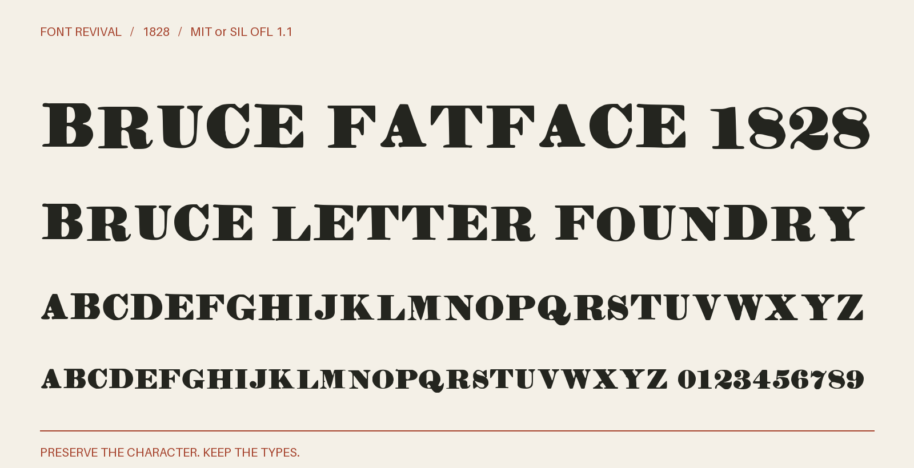

# Bruce Fatface 1828

Broad, heavy fatface titling capitals from George Bruce’s 1828 specimen, with observed figures, ligatures and punctuation.



**1828 · Regular · Version 1.000 · 78 characters · Capitals only · MIT or SIL OFL 1.1**

[OTF](fonts/BruceFatface1828-Regular.otf) · [TTF](fonts/BruceFatface1828-Regular.ttf) · [WOFF2](web/BruceFatface1828-Regular.woff2) · [PDF specimen](specimens/specimen.pdf) · [Changes](CHANGELOG.md)

## Use

Install either desktop format. For websites, copy `web/`, include `font.css`,
and use `font-family: "Bruce Fatface 1828"`. Designed for display sizes.

## Design

**Designer:** Unidentified in the historical specimen

**Foundry:** George Bruce, New York

**Observed:** Complete A–Z titling alphabet, Æ, Œ, &, figures 0–9, dollar and pound signs, comma, semicolon, colon, period, closing apostrophe, hyphen, question mark and exclamation mark. All sampled from Two Line Minion No. 1, unnumbered leaf, PDF page 121.

**Reconstructed:** No inferred visible characters. Lowercase input aliases the capitals; ASCII apostrophe aliases the observed closing apostrophe. Word space, metrics and digital spacing are new. The historical source size identifies the supplying impression; the font is freely scalable.

## Sources

1. [A specimen of printing types, and ornaments cast in the letter-foundry of George Bruce (1828), Two Line Minion No. 1; unnumbered leaf, PDF page 121](https://hdl.handle.net/2027/nyp.33433006349736) — 1828 United States publication; historical artwork is public domain by age. New York Public Library copy digitized by Google, distributed by HathiTrust and mirrored by Circuitous Root. A faithful scan of the historical page, not a modern digital typeface. [Rights basis](https://circuitousroot.com/artifice/letters/press/noncomptype/typography/bruce/index.html).

Source images are in `reference/`; the source record is [font.json](font.json).
Historical reference material retains the rights status recorded there.
Copyright (c) 2026 Harold Lehmann. The fonts and editable font source data are available under your choice of the [MIT License](LICENSE) or [SIL Open Font License 1.1](OFL.txt) (`MIT OR OFL-1.1`), with no Reserved Font Names. See [font licensing](FONT-LICENSES.txt) for the scope and notices. Other original project files, including standalone artwork, code and documentation, use MIT.

## Build or improve

From the repository root:

```sh
python scripts/fontrevival.py build bruce-fatface-1828
python scripts/fontrevival.py check bruce-fatface-1828
```

Edit `source/font.ttx` or export an individual glyph with
`python scripts/fontrevival.py glyph bruce-fatface-1828 j`.
Follow the shared [revival workflow](../../docs/WORKFLOW.md) for additions and revisions.
