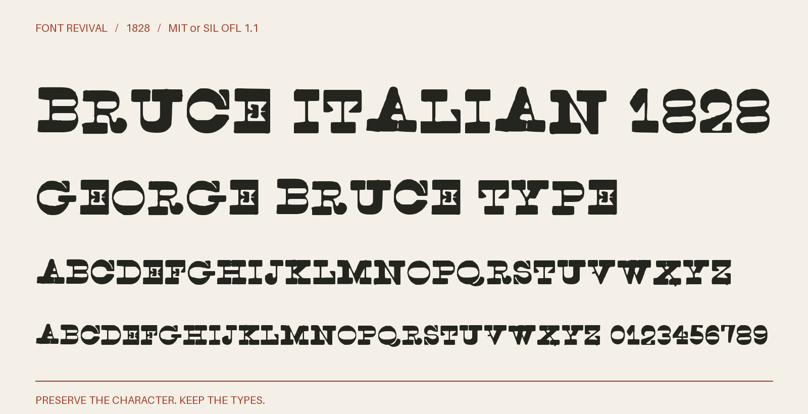

# Bruce Italian 1828

Reverse-contrast titling capitals with heavy horizontal strokes, thin stems and matching figures, from George Bruce’s 1828 specimen.



**1828 · Regular · Version 1.000 · 73 characters · Capitals only · MIT or SIL OFL 1.1**

[OTF](fonts/BruceItalian1828-Regular.otf) · [TTF](fonts/BruceItalian1828-Regular.ttf) · [WOFF2](web/BruceItalian1828-Regular.woff2) · [PDF specimen](specimens/specimen.pdf) · [Changes](CHANGELOG.md)

## Use

Install either desktop format. For websites, copy `web/`, include `font.css`,
and use `font-family: "Bruce Italian 1828"`. Designed for display sizes.

## Design

**Designer:** Unidentified in the historical specimen

**Foundry:** George Bruce, New York

**Observed:** Directly traced ABCDEFGHIJKLMNOPQRSTUVWXYZ,’;:.-!$1234567890 from English Italian on unnumbered PDF page 127 of the 1828 specimen.

**Reconstructed:** No inferred visible characters. Lowercase input aliases the capitals. Blank spaces and digital spacing are new. A measured rigid rotation corrects page tilt; source dimensions and proportions are preserved.

## Sources

1. [A specimen of printing types, and ornaments cast in the letter-foundry of George Bruce (1828), English Italian; unnumbered leaf, PDF page 127](https://hdl.handle.net/2027/nyp.33433006349736) — 1828 United States publication; historical artwork is public domain by age. New York Public Library copy digitized by Google, distributed by HathiTrust and mirrored by Circuitous Root. A faithful scan of the historical page, not a modern digital typeface. [Rights basis](https://circuitousroot.com/artifice/letters/press/noncomptype/typography/bruce/index.html).

Source images are in `reference/`; the source record is [font.json](font.json).
Historical reference material retains the rights status recorded there.
Copyright (c) 2026 Harold Lehmann. The fonts and editable font source data are available under your choice of the [MIT License](LICENSE) or [SIL Open Font License 1.1](OFL.txt) (`MIT OR OFL-1.1`), with no Reserved Font Names. See [font licensing](FONT-LICENSES.txt) for the scope and notices. Other original project files, including standalone artwork, code and documentation, use MIT.

## Build or improve

From the repository root:

```sh
python scripts/fontrevival.py build bruce-italian-1828
python scripts/fontrevival.py check bruce-italian-1828
```

Edit `source/font.ttx` or export an individual glyph with
`python scripts/fontrevival.py glyph bruce-italian-1828 j`.
Follow the shared [revival workflow](../../docs/WORKFLOW.md) for additions and revisions.
