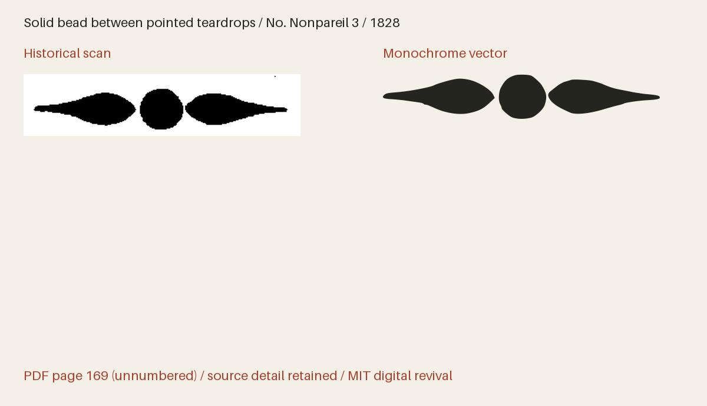

# Bruce Ornaments 1828

Geometric and floral dashes, masks, border repeats, corners and rosettes from George Bruce’s 1828 specimen.



**198 icon(s) · Version 1.006 · Artwork: MIT · Fonts: MIT or SIL OFL 1.1**

[SVG files](svg/) · [SVG sprite](web/icons.svg) · [OTF](fonts/BruceOrnaments1828-Regular.otf) · [TTF](fonts/BruceOrnaments1828-Regular.ttf) · [WOFF2](web/BruceOrnaments1828-Regular.woff2) · [Comparison and size proof](specimens/specimen.pdf) · [Icon manifest](icons.json) · [Changes](CHANGELOG.md)


## Use in HTML

[Download the web bundle (ZIP)](downloads/bruce-ornaments-1828-web.zip), unzip it, and place
the extracted `collection` folder beside your HTML file. Keep its subfolders
together. The examples below then work as written; adjust the paths if you move
the folder elsewhere. The bundle contains SVGs, PNGs, fonts, CSS, instructions
and license notices. No JavaScript or font installation is needed for SVG use.

### Three-tone image — works from disk too

The individual SVG displays all three tones at their default strengths, with a
transparent background. Change `height` to resize it; the proportions are retained.

```html

```

An `` has its own colour context: page CSS cannot recolour its internal
regions. For a decorative image beside a text label, use `alt=""` instead.

### Three-tone sprite — customise every tone

Copy `web/icons-multitone.svg` and use the following complete example on an
HTTP(S) page served from the same origin as the sprite. It draws dark primary ink
and two strengths of red. Each colour and opacity can be changed independently.

```html
<style>
  .revival-cut {
    display: inline-block;
    font-size: 96px;
    height: 1em;
    width: 0.941406em;
    vertical-align: middle;
    --fr-primary-color: #24251f;
    --fr-secondary-color: #a5422c;
    --fr-tertiary-color: #a5422c;
    --fr-primary-opacity: 1;
    --fr-secondary-opacity: 0.55;
    --fr-tertiary-opacity: 0.25;
  }
</style>
<svg class="revival-cut" role="img" aria-label="Solid bead between pointed teardrops">
  <use href="collection/bruce-ornaments-1828/web/icons.svg#bruce-1828-p169-nonpareil-3"></use>
</svg>
```

Use the same secondary and tertiary colour and opacity for a two-tone appearance.
The defaults are primary 100%, secondary 55% and tertiary 25%; these are separate
vector regions, not a gradient. The tone assignments interpret the historical
impression. A transparent PNG of the default tones is also provided.

External SVG sprites can be blocked on `file://` pages. To customise tones on a
page opened from disk, open the individual SVG in a text editor, copy its complete
`<svg>…</svg>` markup into your HTML, and add `class="revival-cut"` to that SVG.
The same CSS above then applies to its inline paths. Keep its `viewBox` and paths.
The gallery itself uses inline SVG so its previews work directly from disk.

### Monochrome icon font

Copy the whole `web/` folder, including CSS and webfonts. Standard icon fonts show
the solid artwork; use the SVG examples above for three-tone artwork.

```html
<link rel="stylesheet" href="collection/bruce-ornaments-1828/web/icons.css">
<span class="fr-icon fr-bruce-1828-p169-nonpareil-3" aria-hidden="true"
      style="font-size:96px;color:#a5422c"></span>
<span>Solid bead between pointed teardrops</span>
```

The example hides a decorative icon from screen readers and supplies visible
text. For an icon that conveys meaning on its own, use `role="img"` and an
`aria-label` instead of `aria-hidden`. Font size and colour use ordinary CSS.

Install the OTF or TTF for desktop use. The manifest lists each icon's Private Use
codepoint and recommended minimum display size. These codepoints are not ordinary
text characters; IDs and codepoints are permanent within this collection.
The example above uses U+E000 and is recommended from
64 px. The 16–192 pt proofs show how detail holds up at different sizes.
Keep the included LICENSE with redistributed assets.

The fonts and editable font source data are available under your choice of the [MIT License](LICENSE) or [SIL Open Font License 1.1](OFL.txt) (`MIT OR OFL-1.1`), with no Reserved Font Names. See [font licensing](FONT-LICENSES.txt) for the scope and notices. Other original project files, including standalone artwork, code and documentation, use MIT.

## Evidence and editing

**Foundry:** George Bruce, New York

**Designer:** Individual engravers unidentified in the specimen

**Observed:** One hundred and ninety-eight distinct drawings: 45 ornamental dashes and masks from unnumbered PDF pages 169–175, and 153 border repeats, corners and floral motifs from pages 177–235. Inventories link repeated settings to the selected Bruce, Baltimore and Boston designs.

**Interpreted or new:** No invented pictorial content. Recorded crops exclude isolated scan specks and neighbouring artwork. Cubic fitting and font-unit rounding interpret the native pixels. Measured rigid rotations straighten the dashes; quadrilateral rectification follows tilted border-block edges while retaining the mean opposing edge lengths. Search labels, tags, Private Use assignments and digital metrics are new project work. Small grayscale crops on PDF235 use fourfold working interpolation for stable curve fitting, without adding source detail. Fine hatching unresolved in the source is not reconstructed.

- [A specimen of printing types, and ornaments cast in the letter-foundry of George Bruce (1828), Ornamental Dashes; unnumbered leaf, PDF page 169](https://hdl.handle.net/2027/nyp.33433006349736) — 1828 United States publication; historical artwork is public domain by age. New York Public Library copy digitized by Google, distributed by HathiTrust and mirrored by Circuitous Root. A faithful scan of the historical page, not a modern digital typeface. [Rights basis](https://circuitousroot.com/artifice/letters/press/noncomptype/typography/bruce/index.html).
- [A specimen of printing types, and ornaments cast in the letter-foundry of George Bruce (1828), Ornamental Dashes; unnumbered leaf, PDF page 171](https://hdl.handle.net/2027/nyp.33433006349736) — 1828 United States publication; historical artwork is public domain by age. New York Public Library copy digitized by Google, distributed by HathiTrust and mirrored by Circuitous Root. A faithful scan of the historical page, not a modern digital typeface. [Rights basis](https://circuitousroot.com/artifice/letters/press/noncomptype/typography/bruce/index.html).
- [A specimen of printing types, and ornaments cast in the letter-foundry of George Bruce (1828), Ornamental Dashes; unnumbered leaf, PDF page 173](https://hdl.handle.net/2027/nyp.33433006349736) — 1828 United States publication; historical artwork is public domain by age. New York Public Library copy digitized by Google, distributed by HathiTrust and mirrored by Circuitous Root. A faithful scan of the historical page, not a modern digital typeface. [Rights basis](https://circuitousroot.com/artifice/letters/press/noncomptype/typography/bruce/index.html).
- [A specimen of printing types, and ornaments cast in the letter-foundry of George Bruce (1828), Ornamental Dashes; unnumbered leaf, PDF page 175](https://hdl.handle.net/2027/nyp.33433006349736) — 1828 United States publication; historical artwork is public domain by age. New York Public Library copy digitized by Google, distributed by HathiTrust and mirrored by Circuitous Root. A faithful scan of the historical page, not a modern digital typeface. [Rights basis](https://circuitousroot.com/artifice/letters/press/noncomptype/typography/bruce/index.html).
- [A specimen of printing types, and ornaments cast in the letter-foundry of George Bruce (1828), Flowers and Borders; unnumbered leaf, PDF page 177](https://hdl.handle.net/2027/nyp.33433006349736) — 1828 United States publication; historical artwork is public domain by age. New York Public Library copy digitized by Google, distributed by HathiTrust and mirrored by Circuitous Root. A faithful scan of the historical page, not a modern digital typeface. [Rights basis](https://circuitousroot.com/artifice/letters/press/noncomptype/typography/bruce/index.html).
- [A specimen of printing types, and ornaments cast in the letter-foundry of George Bruce (1828), Flowers and Borders; unnumbered leaf, PDF page 179](https://hdl.handle.net/2027/nyp.33433006349736) — 1828 United States publication; historical artwork is public domain by age. New York Public Library copy digitized by Google, distributed by HathiTrust and mirrored by Circuitous Root. A faithful scan of the historical page, not a modern digital typeface. [Rights basis](https://circuitousroot.com/artifice/letters/press/noncomptype/typography/bruce/index.html).
- [A specimen of printing types, and ornaments cast in the letter-foundry of George Bruce (1828), Flowers and Borders; unnumbered leaf, PDF page 181](https://hdl.handle.net/2027/nyp.33433006349736) — 1828 United States publication; historical artwork is public domain by age. New York Public Library copy digitized by Google, distributed by HathiTrust and mirrored by Circuitous Root. A faithful scan of the historical page, not a modern digital typeface. [Rights basis](https://circuitousroot.com/artifice/letters/press/noncomptype/typography/bruce/index.html).
- [A specimen of printing types, and ornaments cast in the letter-foundry of George Bruce (1828), Flowers and Borders; unnumbered leaf, PDF page 183](https://hdl.handle.net/2027/nyp.33433006349736) — 1828 United States publication; historical artwork is public domain by age. New York Public Library copy digitized by Google, distributed by HathiTrust and mirrored by Circuitous Root. A faithful scan of the historical page, not a modern digital typeface. [Rights basis](https://circuitousroot.com/artifice/letters/press/noncomptype/typography/bruce/index.html).
- [A specimen of printing types, and ornaments cast in the letter-foundry of George Bruce (1828), Flowers and Borders; unnumbered leaf, PDF page 185](https://hdl.handle.net/2027/nyp.33433006349736) — 1828 United States publication; historical artwork is public domain by age. New York Public Library copy digitized by Google, distributed by HathiTrust and mirrored by Circuitous Root. A faithful scan of the historical page, not a modern digital typeface. [Rights basis](https://circuitousroot.com/artifice/letters/press/noncomptype/typography/bruce/index.html).
- [A specimen of printing types, and ornaments cast in the letter-foundry of George Bruce (1828), Flowers and Borders; unnumbered leaf, PDF page 187](https://hdl.handle.net/2027/nyp.33433006349736) — 1828 United States publication; historical artwork is public domain by age. New York Public Library copy digitized by Google, distributed by HathiTrust and mirrored by Circuitous Root. A faithful scan of the historical page, not a modern digital typeface. [Rights basis](https://circuitousroot.com/artifice/letters/press/noncomptype/typography/bruce/index.html).
- [A specimen of printing types, and ornaments cast in the letter-foundry of George Bruce (1828), Flowers and Borders; unnumbered leaf, PDF page 189](https://hdl.handle.net/2027/nyp.33433006349736) — 1828 United States publication; historical artwork is public domain by age. New York Public Library copy digitized by Google, distributed by HathiTrust and mirrored by Circuitous Root. A faithful scan of the historical page, not a modern digital typeface. [Rights basis](https://circuitousroot.com/artifice/letters/press/noncomptype/typography/bruce/index.html).
- [A specimen of printing types, and ornaments cast in the letter-foundry of George Bruce (1828), Flowers and Borders; unnumbered leaf, PDF page 191](https://hdl.handle.net/2027/nyp.33433006349736) — 1828 United States publication; historical artwork is public domain by age. New York Public Library copy digitized by Google, distributed by HathiTrust and mirrored by Circuitous Root. A faithful scan of the historical page, not a modern digital typeface. [Rights basis](https://circuitousroot.com/artifice/letters/press/noncomptype/typography/bruce/index.html).
- [A specimen of printing types, and ornaments cast in the letter-foundry of George Bruce (1828), Flowers and Borders; unnumbered leaf, PDF page 193](https://hdl.handle.net/2027/nyp.33433006349736) — 1828 United States publication; historical artwork is public domain by age. New York Public Library copy digitized by Google, distributed by HathiTrust and mirrored by Circuitous Root. A faithful scan of the historical page, not a modern digital typeface. [Rights basis](https://circuitousroot.com/artifice/letters/press/noncomptype/typography/bruce/index.html).
- [A specimen of printing types, and ornaments cast in the letter-foundry of George Bruce (1828), Flowers and Borders; unnumbered leaf, PDF page 195](https://hdl.handle.net/2027/nyp.33433006349736) — 1828 United States publication; historical artwork is public domain by age. New York Public Library copy digitized by Google, distributed by HathiTrust and mirrored by Circuitous Root. A faithful scan of the historical page, not a modern digital typeface. [Rights basis](https://circuitousroot.com/artifice/letters/press/noncomptype/typography/bruce/index.html).
- [A specimen of printing types, and ornaments cast in the letter-foundry of George Bruce (1828), Flowers and Borders; unnumbered leaf, PDF page 197](https://hdl.handle.net/2027/nyp.33433006349736) — 1828 United States publication; historical artwork is public domain by age. New York Public Library copy digitized by Google, distributed by HathiTrust and mirrored by Circuitous Root. A faithful scan of the historical page, not a modern digital typeface. [Rights basis](https://circuitousroot.com/artifice/letters/press/noncomptype/typography/bruce/index.html).
- [A specimen of printing types, and ornaments cast in the letter-foundry of George Bruce (1828), Flowers and Borders; unnumbered leaf, PDF page 199](https://hdl.handle.net/2027/nyp.33433006349736) — 1828 United States publication; historical artwork is public domain by age. New York Public Library copy digitized by Google, distributed by HathiTrust and mirrored by Circuitous Root. A faithful scan of the historical page, not a modern digital typeface. [Rights basis](https://circuitousroot.com/artifice/letters/press/noncomptype/typography/bruce/index.html).
- [A specimen of printing types, and ornaments cast in the letter-foundry of George Bruce (1828), Flowers and Borders; unnumbered leaf, PDF page 201](https://hdl.handle.net/2027/nyp.33433006349736) — 1828 United States publication; historical artwork is public domain by age. New York Public Library copy digitized by Google, distributed by HathiTrust and mirrored by Circuitous Root. A faithful scan of the historical page, not a modern digital typeface. [Rights basis](https://circuitousroot.com/artifice/letters/press/noncomptype/typography/bruce/index.html).
- [A specimen of printing types, and ornaments cast in the letter-foundry of George Bruce (1828), Flowers and Borders; unnumbered leaf, PDF page 203](https://hdl.handle.net/2027/nyp.33433006349736) — 1828 United States publication; historical artwork is public domain by age. New York Public Library copy digitized by Google, distributed by HathiTrust and mirrored by Circuitous Root. A faithful scan of the historical page, not a modern digital typeface. [Rights basis](https://circuitousroot.com/artifice/letters/press/noncomptype/typography/bruce/index.html).
- [A specimen of printing types, and ornaments cast in the letter-foundry of George Bruce (1828), Flowers and Borders; unnumbered leaf, PDF page 205](https://hdl.handle.net/2027/nyp.33433006349736) — 1828 United States publication; historical artwork is public domain by age. New York Public Library copy digitized by Google, distributed by HathiTrust and mirrored by Circuitous Root. A faithful scan of the historical page, not a modern digital typeface. [Rights basis](https://circuitousroot.com/artifice/letters/press/noncomptype/typography/bruce/index.html).
- [A specimen of printing types, and ornaments cast in the letter-foundry of George Bruce (1828), Flowers and Borders; unnumbered leaf, PDF page 207](https://hdl.handle.net/2027/nyp.33433006349736) — 1828 United States publication; historical artwork is public domain by age. New York Public Library copy digitized by Google, distributed by HathiTrust and mirrored by Circuitous Root. A faithful scan of the historical page, not a modern digital typeface. [Rights basis](https://circuitousroot.com/artifice/letters/press/noncomptype/typography/bruce/index.html).
- [A specimen of printing types, and ornaments cast in the letter-foundry of George Bruce (1828), Flowers and Borders; unnumbered leaf, PDF page 209](https://hdl.handle.net/2027/nyp.33433006349736) — 1828 United States publication; historical artwork is public domain by age. New York Public Library copy digitized by Google, distributed by HathiTrust and mirrored by Circuitous Root. A faithful scan of the historical page, not a modern digital typeface. [Rights basis](https://circuitousroot.com/artifice/letters/press/noncomptype/typography/bruce/index.html).
- [A specimen of printing types, and ornaments cast in the letter-foundry of George Bruce (1828), Flowers and Borders; unnumbered leaf, PDF page 211](https://hdl.handle.net/2027/nyp.33433006349736) — 1828 United States publication; historical artwork is public domain by age. New York Public Library copy digitized by Google, distributed by HathiTrust and mirrored by Circuitous Root. A faithful scan of the historical page, not a modern digital typeface. [Rights basis](https://circuitousroot.com/artifice/letters/press/noncomptype/typography/bruce/index.html).
- [A specimen of printing types, and ornaments cast in the letter-foundry of George Bruce (1828), Flowers and Borders; unnumbered leaf, PDF page 213](https://hdl.handle.net/2027/nyp.33433006349736) — 1828 United States publication; historical artwork is public domain by age. New York Public Library copy digitized by Google, distributed by HathiTrust and mirrored by Circuitous Root. A faithful scan of the historical page, not a modern digital typeface. [Rights basis](https://circuitousroot.com/artifice/letters/press/noncomptype/typography/bruce/index.html).
- [A specimen of printing types, and ornaments cast in the letter-foundry of George Bruce (1828), Flowers and Borders; unnumbered leaf, PDF page 215](https://hdl.handle.net/2027/nyp.33433006349736) — 1828 United States publication; historical artwork is public domain by age. New York Public Library copy digitized by Google, distributed by HathiTrust and mirrored by Circuitous Root. A faithful scan of the historical page, not a modern digital typeface. [Rights basis](https://circuitousroot.com/artifice/letters/press/noncomptype/typography/bruce/index.html).
- [A specimen of printing types, and ornaments cast in the letter-foundry of George Bruce (1828), Flowers and Borders; unnumbered leaf, PDF page 217](https://hdl.handle.net/2027/nyp.33433006349736) — 1828 United States publication; historical artwork is public domain by age. New York Public Library copy digitized by Google, distributed by HathiTrust and mirrored by Circuitous Root. A faithful scan of the historical page, not a modern digital typeface. [Rights basis](https://circuitousroot.com/artifice/letters/press/noncomptype/typography/bruce/index.html).
- [A specimen of printing types, and ornaments cast in the letter-foundry of George Bruce (1828), Flowers and Borders; unnumbered leaf, PDF page 219](https://hdl.handle.net/2027/nyp.33433006349736) — 1828 United States publication; historical artwork is public domain by age. New York Public Library copy digitized by Google, distributed by HathiTrust and mirrored by Circuitous Root. A faithful scan of the historical page, not a modern digital typeface. [Rights basis](https://circuitousroot.com/artifice/letters/press/noncomptype/typography/bruce/index.html).
- [A specimen of printing types, and ornaments cast in the letter-foundry of George Bruce (1828), Flowers and Borders; unnumbered leaf, PDF page 221](https://hdl.handle.net/2027/nyp.33433006349736) — 1828 United States publication; historical artwork is public domain by age. New York Public Library copy digitized by Google, distributed by HathiTrust and mirrored by Circuitous Root. A faithful scan of the historical page, not a modern digital typeface. [Rights basis](https://circuitousroot.com/artifice/letters/press/noncomptype/typography/bruce/index.html).
- [A specimen of printing types, and ornaments cast in the letter-foundry of George Bruce (1828), Flowers and Borders; unnumbered leaf, PDF page 223](https://hdl.handle.net/2027/nyp.33433006349736) — 1828 United States publication; historical artwork is public domain by age. New York Public Library copy digitized by Google, distributed by HathiTrust and mirrored by Circuitous Root. A faithful scan of the historical page, not a modern digital typeface. [Rights basis](https://circuitousroot.com/artifice/letters/press/noncomptype/typography/bruce/index.html).
- [A specimen of printing types, and ornaments cast in the letter-foundry of George Bruce (1828), Flowers and Borders; unnumbered leaf, PDF page 225](https://hdl.handle.net/2027/nyp.33433006349736) — 1828 United States publication; historical artwork is public domain by age. New York Public Library copy digitized by Google, distributed by HathiTrust and mirrored by Circuitous Root. A faithful scan of the historical page, not a modern digital typeface. [Rights basis](https://circuitousroot.com/artifice/letters/press/noncomptype/typography/bruce/index.html).
- [A specimen of printing types, and ornaments cast in the letter-foundry of George Bruce (1828), Flowers and Borders; unnumbered leaf, PDF page 227](https://hdl.handle.net/2027/nyp.33433006349736) — 1828 United States publication; historical artwork is public domain by age. New York Public Library copy digitized by Google, distributed by HathiTrust and mirrored by Circuitous Root. A faithful scan of the historical page, not a modern digital typeface. [Rights basis](https://circuitousroot.com/artifice/letters/press/noncomptype/typography/bruce/index.html).
- [A specimen of printing types, and ornaments cast in the letter-foundry of George Bruce (1828), Flowers and Borders; unnumbered leaf, PDF page 229](https://hdl.handle.net/2027/nyp.33433006349736) — 1828 United States publication; historical artwork is public domain by age. New York Public Library copy digitized by Google, distributed by HathiTrust and mirrored by Circuitous Root. A faithful scan of the historical page, not a modern digital typeface. [Rights basis](https://circuitousroot.com/artifice/letters/press/noncomptype/typography/bruce/index.html).
- [A specimen of printing types, and ornaments cast in the letter-foundry of George Bruce (1828), Flowers and Borders; unnumbered leaf, PDF page 231](https://hdl.handle.net/2027/nyp.33433006349736) — 1828 United States publication; historical artwork is public domain by age. New York Public Library copy digitized by Google, distributed by HathiTrust and mirrored by Circuitous Root. A faithful scan of the historical page, not a modern digital typeface. [Rights basis](https://circuitousroot.com/artifice/letters/press/noncomptype/typography/bruce/index.html).
- [A specimen of printing types, and ornaments cast in the letter-foundry of George Bruce (1828), Flowers and Borders; unnumbered leaf, PDF page 233](https://hdl.handle.net/2027/nyp.33433006349736) — 1828 United States publication; historical artwork is public domain by age. New York Public Library copy digitized by Google, distributed by HathiTrust and mirrored by Circuitous Root. A faithful scan of the historical page, not a modern digital typeface. [Rights basis](https://circuitousroot.com/artifice/letters/press/noncomptype/typography/bruce/index.html).
- [A specimen of printing types, and ornaments cast in the letter-foundry of George Bruce (1828), Flowers and Borders; unnumbered leaf, PDF page 235](https://hdl.handle.net/2027/nyp.33433006349736) — 1828 United States publication; historical artwork is public domain by age. New York Public Library copy digitized by Google, distributed by HathiTrust and mirrored by Circuitous Root. A faithful scan of the historical page, not a modern digital typeface. [Rights basis](https://circuitousroot.com/artifice/letters/press/noncomptype/typography/bruce/index.html).
- [A specimen of printing types, and ornaments cast in the letter-foundry of George Bruce (1828), unnumbered PDF page 307, No.882](https://hdl.handle.net/2027/nyp.33433006349736) — 1828 United States publication; historical artwork is public domain by age. New York Public Library copy digitized by Google, distributed by HathiTrust and mirrored by Circuitous Root. A faithful scan of the historical page, not a modern digital typeface. [Rights basis](https://circuitousroot.com/artifice/letters/press/noncomptype/typography/bruce/index.html).

Copyright (c) 2026 Harold Lehmann. Historical public-domain material retains its status.
Read [the method](source/METHOD.md), [inventory](source/inventory.json) and
[icon workflow](../../docs/ICONS.md). The canonical master is `source/font.ttx`;
SVGs, sprite, fonts and manifests are generated from it with glyph edits applied.

```sh
python scripts/fontrevival.py build bruce-ornaments-1828
python scripts/fontrevival.py sizecheck bruce-ornaments-1828
python scripts/fontrevival.py check bruce-ornaments-1828
python scripts/fontrevival.py glyph bruce-ornaments-1828 uniE000
```
