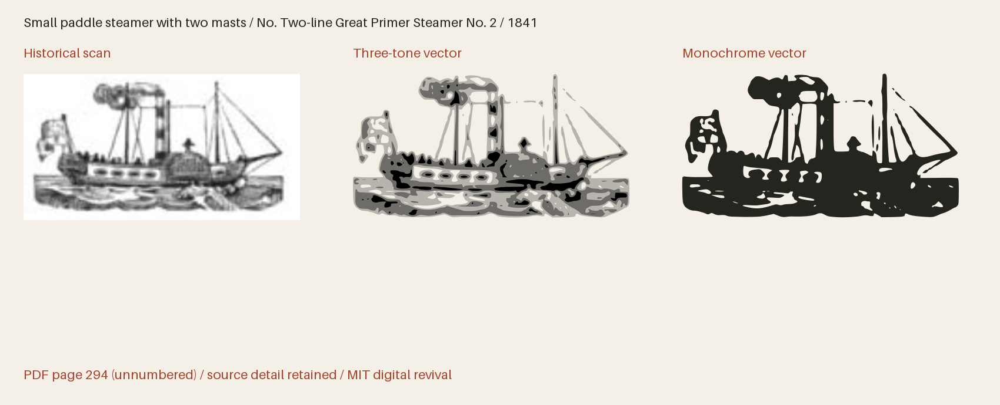

# Caslon Cuts 1841

Pictorial engravings, heraldic cuts, chess pieces, framed labels, pointing hands and incidental illustrations from the H. Caslon specimen of 1841.



**201 icon(s) · Version 1.000 · Artwork: MIT · Fonts: MIT or SIL OFL 1.1**

[SVG files](svg/) · [SVG sprite](web/icons.svg) · [OTF](fonts/CaslonCuts1841-Regular.otf) · [TTF](fonts/CaslonCuts1841-Regular.ttf) · [WOFF2](web/CaslonCuts1841-Regular.woff2) · [Comparison and size proof](specimens/specimen.pdf) · [Icon manifest](icons.json) · [Changes](CHANGELOG.md)

[Three-tone SVGs](svg/multitone/) · [Three-tone sprite](web/icons-multitone.svg) · [Transparent three-tone PNGs](png/multitone/)

## Use in HTML

[Download all web bundle parts](#web-bundle-parts), unzip it, and place
the extracted `collection` folder beside your HTML file. Keep its subfolders
together. The examples below then work as written; adjust the paths if you move
the folder elsewhere. The bundle contains SVGs, PNGs, fonts, CSS, instructions
and license notices. No JavaScript or font installation is needed for SVG use.

### Three-tone image — works from disk too

The individual SVG displays all three tones at their default strengths, with a
transparent background. Change `height` to resize it; the proportions are retained.

```html

```

An `` has its own colour context: page CSS cannot recolour its internal
regions. For a decorative image beside a text label, use `alt=""` instead.

### Three-tone sprite — customise every tone

Copy `web/icons-multitone.svg` and use the following complete example on an
HTTP(S) page served from the same origin as the sprite. It draws dark primary ink
and two strengths of red. Each colour and opacity can be changed independently.

```html
<style>
  .revival-cut {
    display: inline-block;
    font-size: 96px;
    height: 1em;
    width: 0.941406em;
    vertical-align: middle;
    --fr-primary-color: #24251f;
    --fr-secondary-color: #a5422c;
    --fr-tertiary-color: #a5422c;
    --fr-primary-opacity: 1;
    --fr-secondary-opacity: 0.55;
    --fr-tertiary-opacity: 0.25;
  }
</style>
<svg class="revival-cut" role="img" aria-label="Small paddle steamer with two masts">
  <use href="collection/caslon-cuts-1841/web/icons-multitone.svg#caslon-1841-p293-steamer-2"></use>
</svg>
```

Use the same secondary and tertiary colour and opacity for a two-tone appearance.
The defaults are primary 100%, secondary 55% and tertiary 25%; these are separate
vector regions, not a gradient. The tone assignments interpret the historical
impression. A transparent PNG of the default tones is also provided.

External SVG sprites can be blocked on `file://` pages. To customise tones on a
page opened from disk, open the individual SVG in a text editor, copy its complete
`<svg>…</svg>` markup into your HTML, and add `class="revival-cut"` to that SVG.
The same CSS above then applies to its inline paths. Keep its `viewBox` and paths.
The gallery itself uses inline SVG so its previews work directly from disk.

### Monochrome icon font

Copy the whole `web/` folder, including CSS and webfonts. Standard icon fonts show
the solid artwork; use the SVG examples above for three-tone artwork.

```html
<link rel="stylesheet" href="collection/caslon-cuts-1841/web/icons.css">
<span class="fr-icon fr-caslon-1841-p293-steamer-2" aria-hidden="true"
      style="font-size:96px;color:#a5422c"></span>
<span>Small paddle steamer with two masts</span>
```

The example hides a decorative icon from screen readers and supplies visible
text. For an icon that conveys meaning on its own, use `role="img"` and an
`aria-label` instead of `aria-hidden`. Font size and colour use ordinary CSS.

Install the OTF or TTF for desktop use. The manifest lists each icon's Private Use
codepoint and recommended minimum display size. These codepoints are not ordinary
text characters; IDs and codepoints are permanent within this collection.
The example above uses U+E000 and is recommended from
64 px. The 16–192 pt proofs show how detail holds up at different sizes.
Keep the included LICENSE with redistributed assets.

The fonts and editable font source data are available under your choice of the [MIT License](LICENSE) or [SIL Open Font License 1.1](OFL.txt) (`MIT OR OFL-1.1`), with no Reserved Font Names. See [font licensing](FONT-LICENSES.txt) for the scope and notices. Other original project files, including standalone artwork, code and documentation, use MIT.

## Evidence and editing

**Foundry:** H. Caslon, London

**Designer:** Individual engravers unidentified in the specimen

**Observed:** 201 complete historical designs. Source inventory records distinct engravings, repeated impressions, assembled settings and existing canonical designs.

**Interpreted or new:** No invented pictorial content. Recorded exclusions remove neighbouring sorts, captions and isolated scan specks. Measured rotation and recorded quadrilateral corrections straighten scan geometry; uniform scaling preserves historical proportions.

- [Specimen of printing types, H. Caslon (1841), unpaginated PDF page 294, archive leaf 293](https://archive.org/details/bub_gb_LVsJAAAAQAAJ/page/n293/mode/1up) — 1841 British publication, public domain by age. The Internet Archive record marks the historical work with Public Domain Mark 1.0. [Rights basis](https://archive.org/details/bub_gb_LVsJAAAAQAAJ).
- [Specimen of printing types, H. Caslon (1841), unpaginated PDF page 295, archive leaf 294](https://archive.org/details/bub_gb_LVsJAAAAQAAJ/page/n294/mode/1up) — 1841 British publication, public domain by age. The Internet Archive record marks the historical work with Public Domain Mark 1.0. [Rights basis](https://archive.org/details/bub_gb_LVsJAAAAQAAJ).
- [Specimen of printing types, H. Caslon (1841), unpaginated PDF page 296, archive leaf 295](https://archive.org/details/bub_gb_LVsJAAAAQAAJ/page/n295/mode/1up) — 1841 British publication, public domain by age. The Internet Archive record marks the historical work with Public Domain Mark 1.0. [Rights basis](https://archive.org/details/bub_gb_LVsJAAAAQAAJ).
- [Specimen of printing types, H. Caslon (1841), unpaginated PDF page 297, archive leaf 296](https://archive.org/details/bub_gb_LVsJAAAAQAAJ/page/n296/mode/1up) — 1841 British publication, public domain by age. The Internet Archive record marks the historical work with Public Domain Mark 1.0. [Rights basis](https://archive.org/details/bub_gb_LVsJAAAAQAAJ).
- [Specimen of printing types, H. Caslon (1841), unpaginated PDF page 299, archive leaf 298](https://archive.org/details/bub_gb_LVsJAAAAQAAJ/page/n298/mode/1up) — 1841 British publication, public domain by age. The Internet Archive record marks the historical work with Public Domain Mark 1.0. [Rights basis](https://archive.org/details/bub_gb_LVsJAAAAQAAJ).
- [Specimen of printing types, H. Caslon (1841), unpaginated PDF page 285, archive leaf 284](https://archive.org/details/bub_gb_LVsJAAAAQAAJ/page/n284/mode/1up) — 1841 British publication, public domain by age. The Internet Archive record marks the historical work with Public Domain Mark 1.0. [Rights basis](https://archive.org/details/bub_gb_LVsJAAAAQAAJ).
- [Specimen of printing types, H. Caslon (1841), unpaginated PDF page 286, archive leaf 285](https://archive.org/details/bub_gb_LVsJAAAAQAAJ/page/n285/mode/1up) — 1841 British publication, public domain by age. The Internet Archive record marks the historical work with Public Domain Mark 1.0. [Rights basis](https://archive.org/details/bub_gb_LVsJAAAAQAAJ).
- [Specimen of printing types, H. Caslon (1841), unpaginated PDF page 301, archive leaf 300](https://archive.org/details/bub_gb_LVsJAAAAQAAJ/page/n300/mode/1up) — 1841 British publication, public domain by age. The Internet Archive record marks the historical work with Public Domain Mark 1.0. [Rights basis](https://archive.org/details/bub_gb_LVsJAAAAQAAJ).
- [Specimen of printing types, H. Caslon (1841), unpaginated PDF page 337, archive leaf 336](https://archive.org/details/bub_gb_LVsJAAAAQAAJ/page/n336/mode/1up) — 1841 British publication, public domain by age. The Internet Archive record marks the historical work with Public Domain Mark 1.0. [Rights basis](https://archive.org/details/bub_gb_LVsJAAAAQAAJ).
- [Specimen of printing types, H. Caslon (1841), unpaginated PDF page 353, archive leaf 352](https://archive.org/details/bub_gb_LVsJAAAAQAAJ/page/n352/mode/1up) — 1841 British publication, public domain by age. The Internet Archive record marks the historical work with Public Domain Mark 1.0. [Rights basis](https://archive.org/details/bub_gb_LVsJAAAAQAAJ).
- [Specimen of printing types, H. Caslon (1841), unpaginated PDF page 354, archive leaf 353](https://archive.org/details/bub_gb_LVsJAAAAQAAJ/page/n353/mode/1up) — 1841 British publication, public domain by age. The Internet Archive record marks the historical work with Public Domain Mark 1.0. [Rights basis](https://archive.org/details/bub_gb_LVsJAAAAQAAJ).
- [Specimen of printing types, H. Caslon (1841), unpaginated PDF page 355, archive leaf 354](https://archive.org/details/bub_gb_LVsJAAAAQAAJ/page/n354/mode/1up) — 1841 British publication, public domain by age. The Internet Archive record marks the historical work with Public Domain Mark 1.0. [Rights basis](https://archive.org/details/bub_gb_LVsJAAAAQAAJ).
- [Specimen of printing types, H. Caslon (1841), unpaginated PDF page 356, archive leaf 355](https://archive.org/details/bub_gb_LVsJAAAAQAAJ/page/n355/mode/1up) — 1841 British publication, public domain by age. The Internet Archive record marks the historical work with Public Domain Mark 1.0. [Rights basis](https://archive.org/details/bub_gb_LVsJAAAAQAAJ).
- [Specimen of printing types, H. Caslon (1841), unpaginated PDF page 358, archive leaf 357](https://archive.org/details/bub_gb_LVsJAAAAQAAJ/page/n357/mode/1up) — 1841 British publication, public domain by age. The Internet Archive record marks the historical work with Public Domain Mark 1.0. [Rights basis](https://archive.org/details/bub_gb_LVsJAAAAQAAJ).
- [Specimen of printing types, H. Caslon (1841), unpaginated PDF page 360, archive leaf 359](https://archive.org/details/bub_gb_LVsJAAAAQAAJ/page/n359/mode/1up) — 1841 British publication, public domain by age. The Internet Archive record marks the historical work with Public Domain Mark 1.0. [Rights basis](https://archive.org/details/bub_gb_LVsJAAAAQAAJ).
- [Specimen of printing types, H. Caslon (1841), unpaginated PDF page 361, archive leaf 360](https://archive.org/details/bub_gb_LVsJAAAAQAAJ/page/n360/mode/1up) — 1841 British publication, public domain by age. The Internet Archive record marks the historical work with Public Domain Mark 1.0. [Rights basis](https://archive.org/details/bub_gb_LVsJAAAAQAAJ).
- [Specimen of printing types, H. Caslon (1841), unpaginated PDF page 362, archive leaf 361](https://archive.org/details/bub_gb_LVsJAAAAQAAJ/page/n361/mode/1up) — 1841 British publication, public domain by age. The Internet Archive record marks the historical work with Public Domain Mark 1.0. [Rights basis](https://archive.org/details/bub_gb_LVsJAAAAQAAJ).
- [Specimen of printing types, H. Caslon (1841), unpaginated PDF page 363, archive leaf 362](https://archive.org/details/bub_gb_LVsJAAAAQAAJ/page/n362/mode/1up) — 1841 British publication, public domain by age. The Internet Archive record marks the historical work with Public Domain Mark 1.0. [Rights basis](https://archive.org/details/bub_gb_LVsJAAAAQAAJ).
- [Specimen of printing types, H. Caslon (1841), unpaginated PDF page 364, archive leaf 363](https://archive.org/details/bub_gb_LVsJAAAAQAAJ/page/n363/mode/1up) — 1841 British publication, public domain by age. The Internet Archive record marks the historical work with Public Domain Mark 1.0. [Rights basis](https://archive.org/details/bub_gb_LVsJAAAAQAAJ).
- [Specimen of printing types, H. Caslon (1841), unpaginated PDF page 365, archive leaf 364](https://archive.org/details/bub_gb_LVsJAAAAQAAJ/page/n364/mode/1up) — 1841 British publication, public domain by age. The Internet Archive record marks the historical work with Public Domain Mark 1.0. [Rights basis](https://archive.org/details/bub_gb_LVsJAAAAQAAJ).
- [Specimen of printing types, H. Caslon (1841), unpaginated PDF page 366, archive leaf 365](https://archive.org/details/bub_gb_LVsJAAAAQAAJ/page/n365/mode/1up) — 1841 British publication, public domain by age. The Internet Archive record marks the historical work with Public Domain Mark 1.0. [Rights basis](https://archive.org/details/bub_gb_LVsJAAAAQAAJ).
- [Specimen of printing types, H. Caslon (1841), unpaginated PDF page 367, archive leaf 366](https://archive.org/details/bub_gb_LVsJAAAAQAAJ/page/n366/mode/1up) — 1841 British publication, public domain by age. The Internet Archive record marks the historical work with Public Domain Mark 1.0. [Rights basis](https://archive.org/details/bub_gb_LVsJAAAAQAAJ).
- [Specimen of printing types, H. Caslon (1841), unpaginated PDF page 368, archive leaf 367](https://archive.org/details/bub_gb_LVsJAAAAQAAJ/page/n367/mode/1up) — 1841 British publication, public domain by age. The Internet Archive record marks the historical work with Public Domain Mark 1.0. [Rights basis](https://archive.org/details/bub_gb_LVsJAAAAQAAJ).
- [Specimen of printing types, H. Caslon (1841), unpaginated PDF page 370, archive leaf 369](https://archive.org/details/bub_gb_LVsJAAAAQAAJ/page/n369/mode/1up) — 1841 British publication, public domain by age. The Internet Archive record marks the historical work with Public Domain Mark 1.0. [Rights basis](https://archive.org/details/bub_gb_LVsJAAAAQAAJ).
- [Specimen of printing types, H. Caslon (1841), unpaginated PDF page 371, archive leaf 370](https://archive.org/details/bub_gb_LVsJAAAAQAAJ/page/n370/mode/1up) — 1841 British publication, public domain by age. The Internet Archive record marks the historical work with Public Domain Mark 1.0. [Rights basis](https://archive.org/details/bub_gb_LVsJAAAAQAAJ).
- [Specimen of printing types, H. Caslon (1841), unpaginated PDF page 372, archive leaf 371](https://archive.org/details/bub_gb_LVsJAAAAQAAJ/page/n371/mode/1up) — 1841 British publication, public domain by age. The Internet Archive record marks the historical work with Public Domain Mark 1.0. [Rights basis](https://archive.org/details/bub_gb_LVsJAAAAQAAJ).
- [Specimen of printing types, H. Caslon (1841), unpaginated PDF page 374, archive leaf 373](https://archive.org/details/bub_gb_LVsJAAAAQAAJ/page/n373/mode/1up) — 1841 British publication, public domain by age. The Internet Archive record marks the historical work with Public Domain Mark 1.0. [Rights basis](https://archive.org/details/bub_gb_LVsJAAAAQAAJ).
- [Specimen of printing types, H. Caslon (1841), unpaginated PDF page 375, archive leaf 374](https://archive.org/details/bub_gb_LVsJAAAAQAAJ/page/n374/mode/1up) — 1841 British publication, public domain by age. The Internet Archive record marks the historical work with Public Domain Mark 1.0. [Rights basis](https://archive.org/details/bub_gb_LVsJAAAAQAAJ).
- [Specimen of printing types, H. Caslon (1841), unpaginated PDF page 377, archive leaf 376](https://archive.org/details/bub_gb_LVsJAAAAQAAJ/page/n376/mode/1up) — 1841 British publication, public domain by age. The Internet Archive record marks the historical work with Public Domain Mark 1.0. [Rights basis](https://archive.org/details/bub_gb_LVsJAAAAQAAJ).
- [Specimen of printing types, H. Caslon (1841), unpaginated PDF page 378, archive leaf 377](https://archive.org/details/bub_gb_LVsJAAAAQAAJ/page/n377/mode/1up) — 1841 British publication, public domain by age. The Internet Archive record marks the historical work with Public Domain Mark 1.0. [Rights basis](https://archive.org/details/bub_gb_LVsJAAAAQAAJ).
- [Specimen of printing types, H. Caslon (1841), unpaginated PDF page 379, archive leaf 378](https://archive.org/details/bub_gb_LVsJAAAAQAAJ/page/n378/mode/1up) — 1841 British publication, public domain by age. The Internet Archive record marks the historical work with Public Domain Mark 1.0. [Rights basis](https://archive.org/details/bub_gb_LVsJAAAAQAAJ).
- [Specimen of printing types, H. Caslon (1841), unpaginated PDF page 380, archive leaf 379](https://archive.org/details/bub_gb_LVsJAAAAQAAJ/page/n379/mode/1up) — 1841 British publication, public domain by age. The Internet Archive record marks the historical work with Public Domain Mark 1.0. [Rights basis](https://archive.org/details/bub_gb_LVsJAAAAQAAJ).
- [Specimen of printing types, H. Caslon (1841), unpaginated PDF page 381, archive leaf 380](https://archive.org/details/bub_gb_LVsJAAAAQAAJ/page/n380/mode/1up) — 1841 British publication, public domain by age. The Internet Archive record marks the historical work with Public Domain Mark 1.0. [Rights basis](https://archive.org/details/bub_gb_LVsJAAAAQAAJ).
- [Specimen of printing types, H. Caslon (1841), unpaginated PDF page 383, archive leaf 382](https://archive.org/details/bub_gb_LVsJAAAAQAAJ/page/n382/mode/1up) — 1841 British publication, public domain by age. The Internet Archive record marks the historical work with Public Domain Mark 1.0. [Rights basis](https://archive.org/details/bub_gb_LVsJAAAAQAAJ).
- [Specimen of printing types, H. Caslon (1841), unpaginated PDF page 384, archive leaf 383](https://archive.org/details/bub_gb_LVsJAAAAQAAJ/page/n383/mode/1up) — 1841 British publication, public domain by age. The Internet Archive record marks the historical work with Public Domain Mark 1.0. [Rights basis](https://archive.org/details/bub_gb_LVsJAAAAQAAJ).
- [Specimen of printing types, H. Caslon (1841), unpaginated PDF page 385, archive leaf 384](https://archive.org/details/bub_gb_LVsJAAAAQAAJ/page/n384/mode/1up) — 1841 British publication, public domain by age. The Internet Archive record marks the historical work with Public Domain Mark 1.0. [Rights basis](https://archive.org/details/bub_gb_LVsJAAAAQAAJ).
- [Specimen of printing types, H. Caslon (1841), unpaginated PDF page 386, archive leaf 385](https://archive.org/details/bub_gb_LVsJAAAAQAAJ/page/n385/mode/1up) — 1841 British publication, public domain by age. The Internet Archive record marks the historical work with Public Domain Mark 1.0. [Rights basis](https://archive.org/details/bub_gb_LVsJAAAAQAAJ).
- [Specimen of printing types, H. Caslon (1841), unpaginated PDF page 293, archive leaf 292](https://archive.org/details/bub_gb_LVsJAAAAQAAJ/page/n292/mode/1up) — 1841 British publication, public domain by age. The Internet Archive record marks the historical work with Public Domain Mark 1.0. [Rights basis](https://archive.org/details/bub_gb_LVsJAAAAQAAJ).
- [Specimen of printing types, H. Caslon (1841), unpaginated PDF page 288, archive leaf 287](https://archive.org/details/bub_gb_LVsJAAAAQAAJ/page/n287/mode/1up) — 1841 British publication, public domain by age. The Internet Archive record marks the historical work with Public Domain Mark 1.0. [Rights basis](https://archive.org/details/bub_gb_LVsJAAAAQAAJ).

Copyright (c) 2026 Harold Lehmann. Historical public-domain material retains its status.
Read [the method](source/METHOD.md), [inventory](source/inventory.json) and
[icon workflow](../../docs/ICONS.md). The canonical master is `source/font.ttx`;
SVGs, sprite, fonts and manifests are generated from it with glyph edits applied.

```sh
python scripts/fontrevival.py build caslon-cuts-1841
python scripts/fontrevival.py sizecheck caslon-cuts-1841
python scripts/fontrevival.py check caslon-cuts-1841
python scripts/fontrevival.py glyph caslon-cuts-1841 uniE000
```

## Sprite files

The sprites span numbered SVG files in `web/`. Each icon’s manifest entry and gallery example names the file containing it. Keep all sprite files together when distributing the collection.

## Detailed icon fonts

The densest engravings use default OpenType `ccmp` shaping to assemble registered outline pieces. Each icon keeps one character code and its original advance width. This retains fine engraved detail while keeping each piece within renderer limits. Keep OpenType shaping enabled. Software that draws glyphs without shaping uses a simplified compatibility outline; use the SVG for full detail in those applications. The source manifest records each piece and the canonical drawing it belongs to.

## Web bundle parts

Download every part and extract them into the same folder.

- [ZIP part 1](downloads/caslon-cuts-1841-web.zip) — 85.7 MB
- [ZIP part 2](downloads/caslon-cuts-1841-web-2.zip) — 62.0 MB
