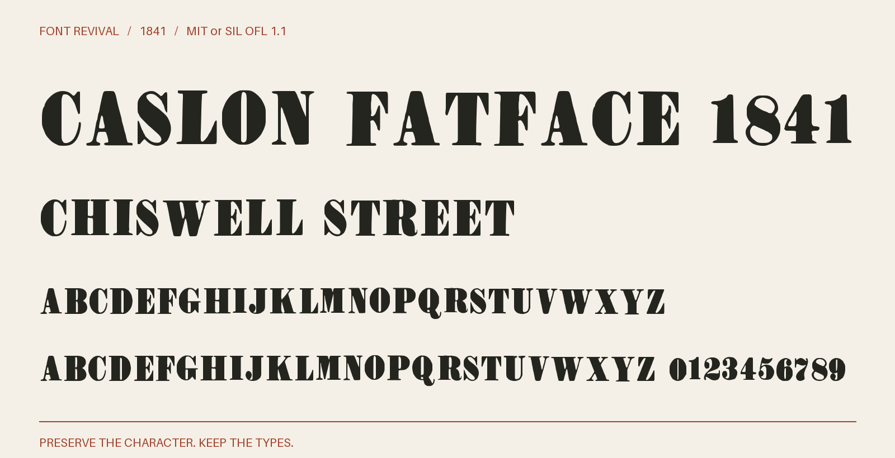

# Caslon Fatface 1841

Heavy narrow display capitals with very fine hairlines and tight vertical counters.



**1841 · Regular · Version 1.000 · 68 characters · Capitals only · MIT or SIL OFL 1.1**

[OTF](fonts/CaslonFatface1841-Regular.otf) · [TTF](fonts/CaslonFatface1841-Regular.ttf) · [WOFF2](web/CaslonFatface1841-Regular.woff2) · [PDF specimen](specimens/specimen.pdf) · [Changes](CHANGELOG.md)

## Use

Install either desktop format. For websites, copy `web/`, include `font.css`,
and use `font-family: "Caslon Fatface 1841"`. Designed for display sizes.

## Design

**Designer:** Unidentified in the historical specimen

**Foundry:** Henry Caslon, London

**Observed:** Complete capitals, figures, pound sign, ampersand and AE/OE ligatures from Two-Line Long Primer No.4.

**Reconstructed:** No inferred visible characters. Spaces and digital spacing are new; lowercase input aliases the corresponding capitals.

## Sources

1. [Specimen of printing types, Henry Caslon (1841), archive leaf 16, PDF page 17](https://archive.org/details/bub_gb_LVsJAAAAQAAJ/page/n16/mode/1up) — 1841 British publication, public domain by age. Internet Archive metadata supplies Public Domain Mark 1.0; historical scan retained. [Rights basis](https://archive.org/details/bub_gb_LVsJAAAAQAAJ).

Source images are in `reference/`; the source record is [font.json](font.json).
Historical reference material retains the rights status recorded there.
Copyright (c) 2026 Harold Lehmann. The fonts and editable font source data are available under your choice of the [MIT License](LICENSE) or [SIL Open Font License 1.1](OFL.txt) (`MIT OR OFL-1.1`), with no Reserved Font Names. See [font licensing](FONT-LICENSES.txt) for the scope and notices. Other original project files, including standalone artwork, code and documentation, use MIT.

## Build or improve

From the repository root:

```sh
python scripts/fontrevival.py build caslon-fatface-1841
python scripts/fontrevival.py check caslon-fatface-1841
```

Edit `source/font.ttx` or export an individual glyph with
`python scripts/fontrevival.py glyph caslon-fatface-1841 j`.
Follow the shared [revival workflow](../../docs/WORKFLOW.md) for additions and revisions.
