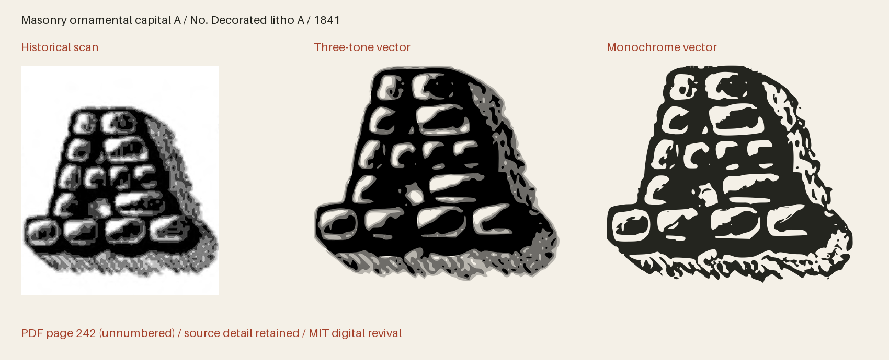

# Caslon Initials 1841

Masonry, curled plain and shaded, and flourished blackletter initials from the H. Caslon specimen of 1841.



**88 icon(s) · Version 1.000 · Artwork: MIT · Fonts: MIT or SIL OFL 1.1**

[SVG files](svg/) · [SVG sprite](web/icons.svg) · [OTF](fonts/CaslonInitials1841-Regular.otf) · [TTF](fonts/CaslonInitials1841-Regular.ttf) · [WOFF2](web/CaslonInitials1841-Regular.woff2) · [Comparison and size proof](specimens/specimen.pdf) · [Icon manifest](icons.json) · [Changes](CHANGELOG.md)

[Three-tone SVGs](svg/multitone/) · [Three-tone sprite](web/icons-multitone.svg) · [Transparent three-tone PNGs](png/multitone/)

## Use in HTML

[Download the web bundle (ZIP)](downloads/caslon-initials-1841-web.zip), unzip it, and place
the extracted `collection` folder beside your HTML file. Keep its subfolders
together. The examples below then work as written; adjust the paths if you move
the folder elsewhere. The bundle contains SVGs, PNGs, fonts, CSS, instructions
and license notices. No JavaScript or font installation is needed for SVG use.

### Three-tone image — works from disk too

The individual SVG displays all three tones at their default strengths, with a
transparent background. Change `height` to resize it; the proportions are retained.

```html

```

An `` has its own colour context: page CSS cannot recolour its internal
regions. For a decorative image beside a text label, use `alt=""` instead.

### Three-tone sprite — customise every tone

Copy `web/icons-multitone.svg` and use the following complete example on an
HTTP(S) page served from the same origin as the sprite. It draws dark primary ink
and two strengths of red. Each colour and opacity can be changed independently.

```html
<style>
  .revival-cut {
    display: inline-block;
    font-size: 96px;
    height: 1em;
    width: 0.941406em;
    vertical-align: middle;
    --fr-primary-color: #24251f;
    --fr-secondary-color: #a5422c;
    --fr-tertiary-color: #a5422c;
    --fr-primary-opacity: 1;
    --fr-secondary-opacity: 0.55;
    --fr-tertiary-opacity: 0.25;
  }
</style>
<svg class="revival-cut" role="img" aria-label="Masonry ornamental capital A">
  <use href="collection/caslon-initials-1841/web/icons-multitone.svg#caslon-1841-p241-litho-a"></use>
</svg>
```

Use the same secondary and tertiary colour and opacity for a two-tone appearance.
The defaults are primary 100%, secondary 55% and tertiary 25%; these are separate
vector regions, not a gradient. The tone assignments interpret the historical
impression. A transparent PNG of the default tones is also provided.

External SVG sprites can be blocked on `file://` pages. To customise tones on a
page opened from disk, open the individual SVG in a text editor, copy its complete
`<svg>…</svg>` markup into your HTML, and add `class="revival-cut"` to that SVG.
The same CSS above then applies to its inline paths. Keep its `viewBox` and paths.
The gallery itself uses inline SVG so its previews work directly from disk.

### Monochrome icon font

Copy the whole `web/` folder, including CSS and webfonts. Standard icon fonts show
the solid artwork; use the SVG examples above for three-tone artwork.

```html
<link rel="stylesheet" href="collection/caslon-initials-1841/web/icons.css">
<span class="fr-icon fr-caslon-1841-p241-litho-a" aria-hidden="true"
      style="font-size:96px;color:#a5422c"></span>
<span>Masonry ornamental capital A</span>
```

The example hides a decorative icon from screen readers and supplies visible
text. For an icon that conveys meaning on its own, use `role="img"` and an
`aria-label` instead of `aria-hidden`. Font size and colour use ordinary CSS.

Install the OTF or TTF for desktop use. The manifest lists each icon's Private Use
codepoint and recommended minimum display size. These codepoints are not ordinary
text characters; IDs and codepoints are permanent within this collection.
The example above uses U+E000 and is recommended from
64 px. The 16–192 pt proofs show how detail holds up at different sizes.
Keep the included LICENSE with redistributed assets.

The fonts and editable font source data are available under your choice of the [MIT License](LICENSE) or [SIL Open Font License 1.1](OFL.txt) (`MIT OR OFL-1.1`), with no Reserved Font Names. See [font licensing](FONT-LICENSES.txt) for the scope and notices. Other original project files, including standalone artwork, code and documentation, use MIT.

## Evidence and editing

**Foundry:** H. Caslon, London

**Designer:** Individual engravers unidentified in the specimen

**Observed:** 88 complete historical designs. Source inventory records distinct engravings, repeated impressions, assembled settings and existing canonical designs. Standalone illustrated letters, not an incomplete text font.

**Interpreted or new:** No invented pictorial content. Recorded exclusions remove neighbouring sorts, captions and isolated scan specks. Measured rotation and recorded quadrilateral corrections straighten scan geometry; uniform scaling preserves historical proportions.

- [Specimen of printing types, H. Caslon (1841), unpaginated PDF page 242, archive leaf 241](https://archive.org/details/bub_gb_LVsJAAAAQAAJ/page/n241/mode/1up) — 1841 British publication, public domain by age. The Internet Archive record marks the historical work with Public Domain Mark 1.0. [Rights basis](https://archive.org/details/bub_gb_LVsJAAAAQAAJ).
- [Specimen of printing types, H. Caslon (1841), unpaginated PDF page 243, archive leaf 242](https://archive.org/details/bub_gb_LVsJAAAAQAAJ/page/n242/mode/1up) — 1841 British publication, public domain by age. The Internet Archive record marks the historical work with Public Domain Mark 1.0. [Rights basis](https://archive.org/details/bub_gb_LVsJAAAAQAAJ).
- [Specimen of printing types, H. Caslon (1841), unpaginated PDF page 244, archive leaf 243](https://archive.org/details/bub_gb_LVsJAAAAQAAJ/page/n243/mode/1up) — 1841 British publication, public domain by age. The Internet Archive record marks the historical work with Public Domain Mark 1.0. [Rights basis](https://archive.org/details/bub_gb_LVsJAAAAQAAJ).
- [Specimen of printing types, H. Caslon (1841), unpaginated PDF page 241, archive leaf 240](https://archive.org/details/bub_gb_LVsJAAAAQAAJ/page/n240/mode/1up) — 1841 British publication, public domain by age. The Internet Archive record marks the historical work with Public Domain Mark 1.0. [Rights basis](https://archive.org/details/bub_gb_LVsJAAAAQAAJ).
- [Specimen of printing types, H. Caslon (1841), unpaginated PDF page 240, archive leaf 239](https://archive.org/details/bub_gb_LVsJAAAAQAAJ/page/n239/mode/1up) — 1841 British publication, public domain by age. The Internet Archive record marks the historical work with Public Domain Mark 1.0. [Rights basis](https://archive.org/details/bub_gb_LVsJAAAAQAAJ).
- [Specimen of printing types, H. Caslon (1841), unpaginated PDF page 246, archive leaf 245](https://archive.org/details/bub_gb_LVsJAAAAQAAJ/page/n245/mode/1up) — 1841 British publication, public domain by age. The Internet Archive record marks the historical work with Public Domain Mark 1.0. [Rights basis](https://archive.org/details/bub_gb_LVsJAAAAQAAJ).

Copyright (c) 2026 Harold Lehmann. Historical public-domain material retains its status.
Read [the method](source/METHOD.md), [inventory](source/inventory.json) and
[icon workflow](../../docs/ICONS.md). The canonical master is `source/font.ttx`;
SVGs, sprite, fonts and manifests are generated from it with glyph edits applied.

```sh
python scripts/fontrevival.py build caslon-initials-1841
python scripts/fontrevival.py sizecheck caslon-initials-1841
python scripts/fontrevival.py check caslon-initials-1841
python scripts/fontrevival.py glyph caslon-initials-1841 uniE000
```

## Sprite files

The sprites span numbered SVG files in `web/`. Each icon’s manifest entry and gallery example names the file containing it. Keep all sprite files together when distributing the collection.
