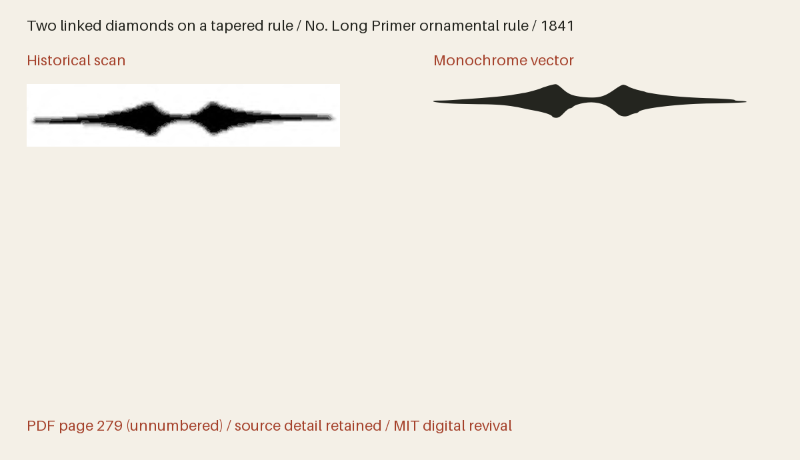

# Caslon Ornaments 1841

Ornamental rules, reusable floral components, border repeats, corners, emblems and flourishes from the H. Caslon specimen of 1841.



**706 icon(s) · Version 1.000 · Artwork: MIT · Fonts: MIT or SIL OFL 1.1**

[SVG files](svg/) · [SVG sprite](web/icons.svg) · [OTF](fonts/CaslonOrnaments1841-Regular.otf) · [TTF](fonts/CaslonOrnaments1841-Regular.ttf) · [WOFF2](web/CaslonOrnaments1841-Regular.woff2) · [Comparison and size proof](specimens/specimen.pdf) · [Icon manifest](icons.json) · [Changes](CHANGELOG.md)

[Three-tone SVGs](svg/multitone/) · [Three-tone sprite](web/icons-multitone.svg) · [Transparent three-tone PNGs](png/multitone/)

## Use in HTML

[Download all web bundle parts](#web-bundle-parts), unzip it, and place
the extracted `collection` folder beside your HTML file. Keep its subfolders
together. The examples below then work as written; adjust the paths if you move
the folder elsewhere. The bundle contains SVGs, PNGs, fonts, CSS, instructions
and license notices. No JavaScript or font installation is needed for SVG use.

### Three-tone image — works from disk too

The individual SVG displays all three tones at their default strengths, with a
transparent background. Change `height` to resize it; the proportions are retained.

```html

```

An `` has its own colour context: page CSS cannot recolour its internal
regions. For a decorative image beside a text label, use `alt=""` instead.

### Three-tone sprite — customise every tone

Copy `web/icons-multitone.svg` and use the following complete example on an
HTTP(S) page served from the same origin as the sprite. It draws dark primary ink
and two strengths of red. Each colour and opacity can be changed independently.

```html
<style>
  .revival-cut {
    display: inline-block;
    font-size: 96px;
    height: 1em;
    width: 0.941406em;
    vertical-align: middle;
    --fr-primary-color: #24251f;
    --fr-secondary-color: #a5422c;
    --fr-tertiary-color: #a5422c;
    --fr-primary-opacity: 1;
    --fr-secondary-opacity: 0.55;
    --fr-tertiary-opacity: 0.25;
  }
</style>
<svg class="revival-cut" role="img" aria-label="Two linked diamonds on a tapered rule">
  <use href="collection/caslon-ornaments-1841/web/icons.svg#caslon-1841-p278-long-primer-2"></use>
</svg>
```

Use the same secondary and tertiary colour and opacity for a two-tone appearance.
The defaults are primary 100%, secondary 55% and tertiary 25%; these are separate
vector regions, not a gradient. The tone assignments interpret the historical
impression. A transparent PNG of the default tones is also provided.

External SVG sprites can be blocked on `file://` pages. To customise tones on a
page opened from disk, open the individual SVG in a text editor, copy its complete
`<svg>…</svg>` markup into your HTML, and add `class="revival-cut"` to that SVG.
The same CSS above then applies to its inline paths. Keep its `viewBox` and paths.
The gallery itself uses inline SVG so its previews work directly from disk.

### Monochrome icon font

Copy the whole `web/` folder, including CSS and webfonts. Standard icon fonts show
the solid artwork; use the SVG examples above for three-tone artwork.

```html
<link rel="stylesheet" href="collection/caslon-ornaments-1841/web/icons.css">
<span class="fr-icon fr-caslon-1841-p278-long-primer-2" aria-hidden="true"
      style="font-size:96px;color:#a5422c"></span>
<span>Two linked diamonds on a tapered rule</span>
```

The example hides a decorative icon from screen readers and supplies visible
text. For an icon that conveys meaning on its own, use `role="img"` and an
`aria-label` instead of `aria-hidden`. Font size and colour use ordinary CSS.

Install the OTF or TTF for desktop use. The manifest lists each icon's Private Use
codepoint and recommended minimum display size. These codepoints are not ordinary
text characters; IDs and codepoints are permanent within this collection.
The example above uses U+E000 and is recommended from
64 px. The 16–192 pt proofs show how detail holds up at different sizes.
Keep the included LICENSE with redistributed assets.

The fonts and editable font source data are available under your choice of the [MIT License](LICENSE) or [SIL Open Font License 1.1](OFL.txt) (`MIT OR OFL-1.1`), with no Reserved Font Names. See [font licensing](FONT-LICENSES.txt) for the scope and notices. Other original project files, including standalone artwork, code and documentation, use MIT.

## Evidence and editing

**Foundry:** H. Caslon, London

**Designer:** Individual engravers unidentified in the specimen

**Observed:** 706 complete historical designs. Source inventory records distinct engravings, repeated impressions, assembled settings and existing canonical designs.

**Interpreted or new:** No invented pictorial content. Recorded exclusions remove neighbouring sorts, captions and isolated scan specks. Measured rotation and recorded quadrilateral corrections straighten scan geometry; uniform scaling preserves historical proportions.

- [Specimen of printing types, H. Caslon (1841), unpaginated PDF page 279, archive leaf 278](https://archive.org/details/bub_gb_LVsJAAAAQAAJ/page/n278/mode/1up) — 1841 British publication, public domain by age. The Internet Archive record marks the historical work with Public Domain Mark 1.0. [Rights basis](https://archive.org/details/bub_gb_LVsJAAAAQAAJ).
- [Specimen of printing types, H. Caslon (1841), unpaginated PDF page 280, archive leaf 279](https://archive.org/details/bub_gb_LVsJAAAAQAAJ/page/n279/mode/1up) — 1841 British publication, public domain by age. The Internet Archive record marks the historical work with Public Domain Mark 1.0. [Rights basis](https://archive.org/details/bub_gb_LVsJAAAAQAAJ).
- [Specimen of printing types, H. Caslon (1841), unpaginated PDF page 285, archive leaf 284](https://archive.org/details/bub_gb_LVsJAAAAQAAJ/page/n284/mode/1up) — 1841 British publication, public domain by age. The Internet Archive record marks the historical work with Public Domain Mark 1.0. [Rights basis](https://archive.org/details/bub_gb_LVsJAAAAQAAJ).
- [Specimen of printing types, H. Caslon (1841), unpaginated PDF page 286, archive leaf 285](https://archive.org/details/bub_gb_LVsJAAAAQAAJ/page/n285/mode/1up) — 1841 British publication, public domain by age. The Internet Archive record marks the historical work with Public Domain Mark 1.0. [Rights basis](https://archive.org/details/bub_gb_LVsJAAAAQAAJ).
- [Specimen of printing types, H. Caslon (1841), unpaginated PDF page 288, archive leaf 287](https://archive.org/details/bub_gb_LVsJAAAAQAAJ/page/n287/mode/1up) — 1841 British publication, public domain by age. The Internet Archive record marks the historical work with Public Domain Mark 1.0. [Rights basis](https://archive.org/details/bub_gb_LVsJAAAAQAAJ).
- [Specimen of printing types, H. Caslon (1841), unpaginated PDF page 283, archive leaf 282](https://archive.org/details/bub_gb_LVsJAAAAQAAJ/page/n282/mode/1up) — 1841 British publication, public domain by age. The Internet Archive record marks the historical work with Public Domain Mark 1.0. [Rights basis](https://archive.org/details/bub_gb_LVsJAAAAQAAJ).
- [Specimen of printing types, H. Caslon (1841), unpaginated PDF page 289, archive leaf 288](https://archive.org/details/bub_gb_LVsJAAAAQAAJ/page/n288/mode/1up) — 1841 British publication, public domain by age. The Internet Archive record marks the historical work with Public Domain Mark 1.0. [Rights basis](https://archive.org/details/bub_gb_LVsJAAAAQAAJ).
- [Specimen of printing types, H. Caslon (1841), unpaginated PDF page 290, archive leaf 289](https://archive.org/details/bub_gb_LVsJAAAAQAAJ/page/n289/mode/1up) — 1841 British publication, public domain by age. The Internet Archive record marks the historical work with Public Domain Mark 1.0. [Rights basis](https://archive.org/details/bub_gb_LVsJAAAAQAAJ).
- [Specimen of printing types, H. Caslon (1841), unpaginated PDF page 291, archive leaf 290](https://archive.org/details/bub_gb_LVsJAAAAQAAJ/page/n290/mode/1up) — 1841 British publication, public domain by age. The Internet Archive record marks the historical work with Public Domain Mark 1.0. [Rights basis](https://archive.org/details/bub_gb_LVsJAAAAQAAJ).
- [Specimen of printing types, H. Caslon (1841), unpaginated PDF page 292, archive leaf 291](https://archive.org/details/bub_gb_LVsJAAAAQAAJ/page/n291/mode/1up) — 1841 British publication, public domain by age. The Internet Archive record marks the historical work with Public Domain Mark 1.0. [Rights basis](https://archive.org/details/bub_gb_LVsJAAAAQAAJ).
- [Specimen of printing types, H. Caslon (1841), unpaginated PDF page 293, archive leaf 292](https://archive.org/details/bub_gb_LVsJAAAAQAAJ/page/n292/mode/1up) — 1841 British publication, public domain by age. The Internet Archive record marks the historical work with Public Domain Mark 1.0. [Rights basis](https://archive.org/details/bub_gb_LVsJAAAAQAAJ).
- [Specimen of printing types, H. Caslon (1841), unpaginated PDF page 294, archive leaf 293](https://archive.org/details/bub_gb_LVsJAAAAQAAJ/page/n293/mode/1up) — 1841 British publication, public domain by age. The Internet Archive record marks the historical work with Public Domain Mark 1.0. [Rights basis](https://archive.org/details/bub_gb_LVsJAAAAQAAJ).
- [Specimen of printing types, H. Caslon (1841), unpaginated PDF page 295, archive leaf 294](https://archive.org/details/bub_gb_LVsJAAAAQAAJ/page/n294/mode/1up) — 1841 British publication, public domain by age. The Internet Archive record marks the historical work with Public Domain Mark 1.0. [Rights basis](https://archive.org/details/bub_gb_LVsJAAAAQAAJ).
- [Specimen of printing types, H. Caslon (1841), unpaginated PDF page 296, archive leaf 295](https://archive.org/details/bub_gb_LVsJAAAAQAAJ/page/n295/mode/1up) — 1841 British publication, public domain by age. The Internet Archive record marks the historical work with Public Domain Mark 1.0. [Rights basis](https://archive.org/details/bub_gb_LVsJAAAAQAAJ).
- [Specimen of printing types, H. Caslon (1841), unpaginated PDF page 304, archive leaf 303](https://archive.org/details/bub_gb_LVsJAAAAQAAJ/page/n303/mode/1up) — 1841 British publication, public domain by age. The Internet Archive record marks the historical work with Public Domain Mark 1.0. [Rights basis](https://archive.org/details/bub_gb_LVsJAAAAQAAJ).
- [Specimen of printing types, H. Caslon (1841), unpaginated PDF page 303, archive leaf 302](https://archive.org/details/bub_gb_LVsJAAAAQAAJ/page/n302/mode/1up) — 1841 British publication, public domain by age. The Internet Archive record marks the historical work with Public Domain Mark 1.0. [Rights basis](https://archive.org/details/bub_gb_LVsJAAAAQAAJ).
- [Specimen of printing types, H. Caslon (1841), unpaginated PDF page 305, archive leaf 304](https://archive.org/details/bub_gb_LVsJAAAAQAAJ/page/n304/mode/1up) — 1841 British publication, public domain by age. The Internet Archive record marks the historical work with Public Domain Mark 1.0. [Rights basis](https://archive.org/details/bub_gb_LVsJAAAAQAAJ).
- [Specimen of printing types, H. Caslon (1841), unpaginated PDF page 307, archive leaf 306](https://archive.org/details/bub_gb_LVsJAAAAQAAJ/page/n306/mode/1up) — 1841 British publication, public domain by age. The Internet Archive record marks the historical work with Public Domain Mark 1.0. [Rights basis](https://archive.org/details/bub_gb_LVsJAAAAQAAJ).
- [Specimen of printing types, H. Caslon (1841), unpaginated PDF page 308, archive leaf 307](https://archive.org/details/bub_gb_LVsJAAAAQAAJ/page/n307/mode/1up) — 1841 British publication, public domain by age. The Internet Archive record marks the historical work with Public Domain Mark 1.0. [Rights basis](https://archive.org/details/bub_gb_LVsJAAAAQAAJ).
- [Specimen of printing types, H. Caslon (1841), unpaginated PDF page 309, archive leaf 308](https://archive.org/details/bub_gb_LVsJAAAAQAAJ/page/n308/mode/1up) — 1841 British publication, public domain by age. The Internet Archive record marks the historical work with Public Domain Mark 1.0. [Rights basis](https://archive.org/details/bub_gb_LVsJAAAAQAAJ).
- [Specimen of printing types, H. Caslon (1841), unpaginated PDF page 311, archive leaf 310](https://archive.org/details/bub_gb_LVsJAAAAQAAJ/page/n310/mode/1up) — 1841 British publication, public domain by age. The Internet Archive record marks the historical work with Public Domain Mark 1.0. [Rights basis](https://archive.org/details/bub_gb_LVsJAAAAQAAJ).
- [Specimen of printing types, H. Caslon (1841), unpaginated PDF page 312, archive leaf 311](https://archive.org/details/bub_gb_LVsJAAAAQAAJ/page/n311/mode/1up) — 1841 British publication, public domain by age. The Internet Archive record marks the historical work with Public Domain Mark 1.0. [Rights basis](https://archive.org/details/bub_gb_LVsJAAAAQAAJ).
- [Specimen of printing types, H. Caslon (1841), unpaginated PDF page 314, archive leaf 313](https://archive.org/details/bub_gb_LVsJAAAAQAAJ/page/n313/mode/1up) — 1841 British publication, public domain by age. The Internet Archive record marks the historical work with Public Domain Mark 1.0. [Rights basis](https://archive.org/details/bub_gb_LVsJAAAAQAAJ).
- [Specimen of printing types, H. Caslon (1841), unpaginated PDF page 315, archive leaf 314](https://archive.org/details/bub_gb_LVsJAAAAQAAJ/page/n314/mode/1up) — 1841 British publication, public domain by age. The Internet Archive record marks the historical work with Public Domain Mark 1.0. [Rights basis](https://archive.org/details/bub_gb_LVsJAAAAQAAJ).
- [Specimen of printing types, H. Caslon (1841), unpaginated PDF page 316, archive leaf 315](https://archive.org/details/bub_gb_LVsJAAAAQAAJ/page/n315/mode/1up) — 1841 British publication, public domain by age. The Internet Archive record marks the historical work with Public Domain Mark 1.0. [Rights basis](https://archive.org/details/bub_gb_LVsJAAAAQAAJ).
- [Specimen of printing types, H. Caslon (1841), unpaginated PDF page 317, archive leaf 316](https://archive.org/details/bub_gb_LVsJAAAAQAAJ/page/n316/mode/1up) — 1841 British publication, public domain by age. The Internet Archive record marks the historical work with Public Domain Mark 1.0. [Rights basis](https://archive.org/details/bub_gb_LVsJAAAAQAAJ).
- [Specimen of printing types, H. Caslon (1841), unpaginated PDF page 318, archive leaf 317](https://archive.org/details/bub_gb_LVsJAAAAQAAJ/page/n317/mode/1up) — 1841 British publication, public domain by age. The Internet Archive record marks the historical work with Public Domain Mark 1.0. [Rights basis](https://archive.org/details/bub_gb_LVsJAAAAQAAJ).
- [Specimen of printing types, H. Caslon (1841), unpaginated PDF page 319, archive leaf 318](https://archive.org/details/bub_gb_LVsJAAAAQAAJ/page/n318/mode/1up) — 1841 British publication, public domain by age. The Internet Archive record marks the historical work with Public Domain Mark 1.0. [Rights basis](https://archive.org/details/bub_gb_LVsJAAAAQAAJ).
- [Specimen of printing types, H. Caslon (1841), unpaginated PDF page 320, archive leaf 319](https://archive.org/details/bub_gb_LVsJAAAAQAAJ/page/n319/mode/1up) — 1841 British publication, public domain by age. The Internet Archive record marks the historical work with Public Domain Mark 1.0. [Rights basis](https://archive.org/details/bub_gb_LVsJAAAAQAAJ).
- [Specimen of printing types, H. Caslon (1841), unpaginated PDF page 321, archive leaf 320](https://archive.org/details/bub_gb_LVsJAAAAQAAJ/page/n320/mode/1up) — 1841 British publication, public domain by age. The Internet Archive record marks the historical work with Public Domain Mark 1.0. [Rights basis](https://archive.org/details/bub_gb_LVsJAAAAQAAJ).
- [Specimen of printing types, H. Caslon (1841), unpaginated PDF page 322, archive leaf 321](https://archive.org/details/bub_gb_LVsJAAAAQAAJ/page/n321/mode/1up) — 1841 British publication, public domain by age. The Internet Archive record marks the historical work with Public Domain Mark 1.0. [Rights basis](https://archive.org/details/bub_gb_LVsJAAAAQAAJ).
- [Specimen of printing types, H. Caslon (1841), unpaginated PDF page 323, archive leaf 322](https://archive.org/details/bub_gb_LVsJAAAAQAAJ/page/n322/mode/1up) — 1841 British publication, public domain by age. The Internet Archive record marks the historical work with Public Domain Mark 1.0. [Rights basis](https://archive.org/details/bub_gb_LVsJAAAAQAAJ).
- [Specimen of printing types, H. Caslon (1841), unpaginated PDF page 324, archive leaf 323](https://archive.org/details/bub_gb_LVsJAAAAQAAJ/page/n323/mode/1up) — 1841 British publication, public domain by age. The Internet Archive record marks the historical work with Public Domain Mark 1.0. [Rights basis](https://archive.org/details/bub_gb_LVsJAAAAQAAJ).
- [Specimen of printing types, H. Caslon (1841), unpaginated PDF page 325, archive leaf 324](https://archive.org/details/bub_gb_LVsJAAAAQAAJ/page/n324/mode/1up) — 1841 British publication, public domain by age. The Internet Archive record marks the historical work with Public Domain Mark 1.0. [Rights basis](https://archive.org/details/bub_gb_LVsJAAAAQAAJ).
- [Specimen of printing types, H. Caslon (1841), unpaginated PDF page 326, archive leaf 325](https://archive.org/details/bub_gb_LVsJAAAAQAAJ/page/n325/mode/1up) — 1841 British publication, public domain by age. The Internet Archive record marks the historical work with Public Domain Mark 1.0. [Rights basis](https://archive.org/details/bub_gb_LVsJAAAAQAAJ).
- [Specimen of printing types, H. Caslon (1841), unpaginated PDF page 327, archive leaf 326](https://archive.org/details/bub_gb_LVsJAAAAQAAJ/page/n326/mode/1up) — 1841 British publication, public domain by age. The Internet Archive record marks the historical work with Public Domain Mark 1.0. [Rights basis](https://archive.org/details/bub_gb_LVsJAAAAQAAJ).
- [Specimen of printing types, H. Caslon (1841), unpaginated PDF page 328, archive leaf 327](https://archive.org/details/bub_gb_LVsJAAAAQAAJ/page/n327/mode/1up) — 1841 British publication, public domain by age. The Internet Archive record marks the historical work with Public Domain Mark 1.0. [Rights basis](https://archive.org/details/bub_gb_LVsJAAAAQAAJ).
- [Specimen of printing types, H. Caslon (1841), unpaginated PDF page 329, archive leaf 328](https://archive.org/details/bub_gb_LVsJAAAAQAAJ/page/n328/mode/1up) — 1841 British publication, public domain by age. The Internet Archive record marks the historical work with Public Domain Mark 1.0. [Rights basis](https://archive.org/details/bub_gb_LVsJAAAAQAAJ).
- [Specimen of printing types, H. Caslon (1841), unpaginated PDF page 330, archive leaf 329](https://archive.org/details/bub_gb_LVsJAAAAQAAJ/page/n329/mode/1up) — 1841 British publication, public domain by age. The Internet Archive record marks the historical work with Public Domain Mark 1.0. [Rights basis](https://archive.org/details/bub_gb_LVsJAAAAQAAJ).
- [Specimen of printing types, H. Caslon (1841), unpaginated PDF page 331, archive leaf 330](https://archive.org/details/bub_gb_LVsJAAAAQAAJ/page/n330/mode/1up) — 1841 British publication, public domain by age. The Internet Archive record marks the historical work with Public Domain Mark 1.0. [Rights basis](https://archive.org/details/bub_gb_LVsJAAAAQAAJ).
- [Specimen of printing types, H. Caslon (1841), unpaginated PDF page 332, archive leaf 331](https://archive.org/details/bub_gb_LVsJAAAAQAAJ/page/n331/mode/1up) — 1841 British publication, public domain by age. The Internet Archive record marks the historical work with Public Domain Mark 1.0. [Rights basis](https://archive.org/details/bub_gb_LVsJAAAAQAAJ).
- [Specimen of printing types, H. Caslon (1841), unpaginated PDF page 333, archive leaf 332](https://archive.org/details/bub_gb_LVsJAAAAQAAJ/page/n332/mode/1up) — 1841 British publication, public domain by age. The Internet Archive record marks the historical work with Public Domain Mark 1.0. [Rights basis](https://archive.org/details/bub_gb_LVsJAAAAQAAJ).
- [Specimen of printing types, H. Caslon (1841), unpaginated PDF page 334, archive leaf 333](https://archive.org/details/bub_gb_LVsJAAAAQAAJ/page/n333/mode/1up) — 1841 British publication, public domain by age. The Internet Archive record marks the historical work with Public Domain Mark 1.0. [Rights basis](https://archive.org/details/bub_gb_LVsJAAAAQAAJ).
- [Specimen of printing types, H. Caslon (1841), unpaginated PDF page 335, archive leaf 334](https://archive.org/details/bub_gb_LVsJAAAAQAAJ/page/n334/mode/1up) — 1841 British publication, public domain by age. The Internet Archive record marks the historical work with Public Domain Mark 1.0. [Rights basis](https://archive.org/details/bub_gb_LVsJAAAAQAAJ).
- [Specimen of printing types, H. Caslon (1841), unpaginated PDF page 336, archive leaf 335](https://archive.org/details/bub_gb_LVsJAAAAQAAJ/page/n335/mode/1up) — 1841 British publication, public domain by age. The Internet Archive record marks the historical work with Public Domain Mark 1.0. [Rights basis](https://archive.org/details/bub_gb_LVsJAAAAQAAJ).
- [Specimen of printing types, H. Caslon (1841), unpaginated PDF page 337, archive leaf 336](https://archive.org/details/bub_gb_LVsJAAAAQAAJ/page/n336/mode/1up) — 1841 British publication, public domain by age. The Internet Archive record marks the historical work with Public Domain Mark 1.0. [Rights basis](https://archive.org/details/bub_gb_LVsJAAAAQAAJ).
- [Specimen of printing types, H. Caslon (1841), unpaginated PDF page 338, archive leaf 337](https://archive.org/details/bub_gb_LVsJAAAAQAAJ/page/n337/mode/1up) — 1841 British publication, public domain by age. The Internet Archive record marks the historical work with Public Domain Mark 1.0. [Rights basis](https://archive.org/details/bub_gb_LVsJAAAAQAAJ).
- [Specimen of printing types, H. Caslon (1841), unpaginated PDF page 339, archive leaf 338](https://archive.org/details/bub_gb_LVsJAAAAQAAJ/page/n338/mode/1up) — 1841 British publication, public domain by age. The Internet Archive record marks the historical work with Public Domain Mark 1.0. [Rights basis](https://archive.org/details/bub_gb_LVsJAAAAQAAJ).
- [Specimen of printing types, H. Caslon (1841), unpaginated PDF page 340, archive leaf 339](https://archive.org/details/bub_gb_LVsJAAAAQAAJ/page/n339/mode/1up) — 1841 British publication, public domain by age. The Internet Archive record marks the historical work with Public Domain Mark 1.0. [Rights basis](https://archive.org/details/bub_gb_LVsJAAAAQAAJ).
- [Specimen of printing types, H. Caslon (1841), unpaginated PDF page 341, archive leaf 340](https://archive.org/details/bub_gb_LVsJAAAAQAAJ/page/n340/mode/1up) — 1841 British publication, public domain by age. The Internet Archive record marks the historical work with Public Domain Mark 1.0. [Rights basis](https://archive.org/details/bub_gb_LVsJAAAAQAAJ).
- [Specimen of printing types, H. Caslon (1841), unpaginated PDF page 342, archive leaf 341](https://archive.org/details/bub_gb_LVsJAAAAQAAJ/page/n341/mode/1up) — 1841 British publication, public domain by age. The Internet Archive record marks the historical work with Public Domain Mark 1.0. [Rights basis](https://archive.org/details/bub_gb_LVsJAAAAQAAJ).
- [Specimen of printing types, H. Caslon (1841), unpaginated PDF page 343, archive leaf 342](https://archive.org/details/bub_gb_LVsJAAAAQAAJ/page/n342/mode/1up) — 1841 British publication, public domain by age. The Internet Archive record marks the historical work with Public Domain Mark 1.0. [Rights basis](https://archive.org/details/bub_gb_LVsJAAAAQAAJ).
- [Specimen of printing types, H. Caslon (1841), unpaginated PDF page 344, archive leaf 343](https://archive.org/details/bub_gb_LVsJAAAAQAAJ/page/n343/mode/1up) — 1841 British publication, public domain by age. The Internet Archive record marks the historical work with Public Domain Mark 1.0. [Rights basis](https://archive.org/details/bub_gb_LVsJAAAAQAAJ).
- [Specimen of printing types, H. Caslon (1841), unpaginated PDF page 346, archive leaf 345](https://archive.org/details/bub_gb_LVsJAAAAQAAJ/page/n345/mode/1up) — 1841 British publication, public domain by age. The Internet Archive record marks the historical work with Public Domain Mark 1.0. [Rights basis](https://archive.org/details/bub_gb_LVsJAAAAQAAJ).
- [Specimen of printing types, H. Caslon (1841), unpaginated PDF page 350, archive leaf 349](https://archive.org/details/bub_gb_LVsJAAAAQAAJ/page/n349/mode/1up) — 1841 British publication, public domain by age. The Internet Archive record marks the historical work with Public Domain Mark 1.0. [Rights basis](https://archive.org/details/bub_gb_LVsJAAAAQAAJ).
- [Specimen of printing types, H. Caslon (1841), unpaginated PDF page 352, archive leaf 351](https://archive.org/details/bub_gb_LVsJAAAAQAAJ/page/n351/mode/1up) — 1841 British publication, public domain by age. The Internet Archive record marks the historical work with Public Domain Mark 1.0. [Rights basis](https://archive.org/details/bub_gb_LVsJAAAAQAAJ).
- [Specimen of printing types, H. Caslon (1841), unpaginated PDF page 275, archive leaf 274](https://archive.org/details/bub_gb_LVsJAAAAQAAJ/page/n274/mode/1up) — 1841 British publication, public domain by age. The Internet Archive record marks the historical work with Public Domain Mark 1.0. [Rights basis](https://archive.org/details/bub_gb_LVsJAAAAQAAJ).
- [Specimen of printing types, H. Caslon (1841), unpaginated PDF page 5, archive leaf 4](https://archive.org/details/bub_gb_LVsJAAAAQAAJ/page/n4/mode/1up) — 1841 British publication, public domain by age. The Internet Archive record marks the historical work with Public Domain Mark 1.0. [Rights basis](https://archive.org/details/bub_gb_LVsJAAAAQAAJ).
- [Specimen of printing types, H. Caslon (1841), unpaginated PDF page 248, archive leaf 247](https://archive.org/details/bub_gb_LVsJAAAAQAAJ/page/n247/mode/1up) — 1841 British publication, public domain by age. The Internet Archive record marks the historical work with Public Domain Mark 1.0. [Rights basis](https://archive.org/details/bub_gb_LVsJAAAAQAAJ).
- [Specimen of printing types, H. Caslon (1841), unpaginated PDF page 273, archive leaf 272](https://archive.org/details/bub_gb_LVsJAAAAQAAJ/page/n272/mode/1up) — 1841 British publication, public domain by age. The Internet Archive record marks the historical work with Public Domain Mark 1.0. [Rights basis](https://archive.org/details/bub_gb_LVsJAAAAQAAJ).
- [Specimen of printing types, H. Caslon (1841), unpaginated PDF page 313, archive leaf 312](https://archive.org/details/bub_gb_LVsJAAAAQAAJ/page/n312/mode/1up) — 1841 British publication, public domain by age. The Internet Archive record marks the historical work with Public Domain Mark 1.0. [Rights basis](https://archive.org/details/bub_gb_LVsJAAAAQAAJ).

Copyright (c) 2026 Harold Lehmann. Historical public-domain material retains its status.
Read [the method](source/METHOD.md), [inventory](source/inventory.json) and
[icon workflow](../../docs/ICONS.md). The canonical master is `source/font.ttx`;
SVGs, sprite, fonts and manifests are generated from it with glyph edits applied.

```sh
python scripts/fontrevival.py build caslon-ornaments-1841
python scripts/fontrevival.py sizecheck caslon-ornaments-1841
python scripts/fontrevival.py check caslon-ornaments-1841
python scripts/fontrevival.py glyph caslon-ornaments-1841 uniE000
```

## Sprite files

The sprites span numbered SVG files in `web/`. Each icon’s manifest entry and gallery example names the file containing it. Keep all sprite files together when distributing the collection.

## Web bundle parts

Download every part and extract them into the same folder.

- [ZIP part 1](downloads/caslon-ornaments-1841-web.zip) — 88.6 MB
- [ZIP part 2](downloads/caslon-ornaments-1841-web-2.zip) — 3.0 MB
