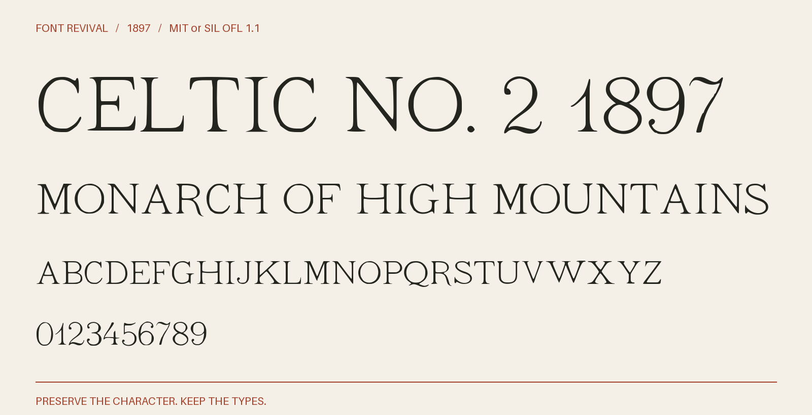

# Celtic No. 2 1897

Light serif capitals and flowing figures from the twelve-point Celtic No. 2 cut, with gently bowed crossbars and a sweeping Q tail.



**1897 · Regular · Version 1.001 · 39 characters · Capitals only · MIT or SIL OFL 1.1**

[OTF](fonts/CelticNo21897-Regular.otf) · [TTF](fonts/CelticNo21897-Regular.ttf) · [WOFF2](web/CelticNo21897-Regular.woff2) · [PDF specimen](specimens/specimen.pdf) · [Changes](CHANGELOG.md)

## Use

Install either desktop format. For websites, copy `web/`, include `font.css`,
and use `font-family: "Celtic No. 2 1897"`. Designed for display sizes.

## Design

**Designer:** Unidentified in the consulted historical specimens

**Foundry:** Farmer, as credited in the Government Printing Office document specimen

**Observed:** All 26 capitals, ten figures and period are directly observed in the labelled twelve-point Celtic No. 2 cut. The 1897 GPO specimen supplies QUVWXYZ; the 1900 census specimen supplies A–P and all ten figures; the 1904 document specimen supplies RST and period, and explicitly attributes the cut to Farmer. Exact crops, comparisons and measurements accompany the sources. The assembled business card on job-room printed page39 (archive leaf55) supplies the ampersand; matching native letter construction and measured physical size identify the twelve-point setting.

**Reconstructed:** No letter or figure forms are invented. Spacing, digital metrics, paper illumination correction and measured scan rotation are modern preparation choices.

## Sources

1. [Specimens of the job division type, Government Printing Office (1897), Celtic No. 2; printed p. 25, archive leaf 59](https://archive.org/details/specimensofjobdi00unit/page/n59/mode/1up) — 1897 United States publication, public domain by age. Library of Congress scan hosted by Internet Archive; institutional metadata and exact historical JP2 retained. No modern digital typeface was traced. [Rights basis](https://archive.org/metadata/specimensofjobdi00unit).
2. [Specimens of type faces, brass, rule, etc (1900), Celtic No. 2; printed p. 1, archive leaf 3](https://archive.org/details/specimensoftypef00unit_0/page/n3/mode/1up) — 1900 United States publication, public domain by age. Library of Congress scan hosted by Internet Archive; institutional metadata and exact historical JP2 retained. No modern digital typeface was traced. [Rights basis](https://archive.org/metadata/specimensoftypef00unit_0).
3. [Specimen book of type (1904), Celtic No. 2; printed p. 39, archive leaf 83](https://archive.org/details/specimenbookofty00unit_0/page/n83/mode/1up) — 1904 United States publication, public domain by age. Library of Congress scan hosted by Internet Archive; institutional metadata and exact historical JP2 retained. No modern digital typeface was traced. [Rights basis](https://archive.org/metadata/specimenbookofty00unit_0).
4. [Job room type faces (1904), Celtic No. 2; printed p.39, archive leaf55; assembled card ampersand](https://archive.org/details/123459_1904/page/n55/mode/1up) — 1904 United States publication, public domain by age. Historical native scan retained for comparison; no modern digital typeface used. [Rights basis](https://archive.org/metadata/123459_1904).

Source images are in `reference/`; the source record is [font.json](font.json).
Historical reference material retains the rights status recorded there.
Copyright (c) 2026 Harold Lehmann. The fonts and editable font source data are available under your choice of the [MIT License](LICENSE) or [SIL Open Font License 1.1](OFL.txt) (`MIT OR OFL-1.1`), with no Reserved Font Names. See [font licensing](FONT-LICENSES.txt) for the scope and notices. Other original project files, including standalone artwork, code and documentation, use MIT.

## Build or improve

From the repository root:

```sh
python scripts/fontrevival.py build celtic-no2-1897
python scripts/fontrevival.py check celtic-no2-1897
```

Edit `source/font.ttx` or export an individual glyph with
`python scripts/fontrevival.py glyph celtic-no2-1897 j`.
Follow the shared [revival workflow](../../docs/WORKFLOW.md) for additions and revisions.
