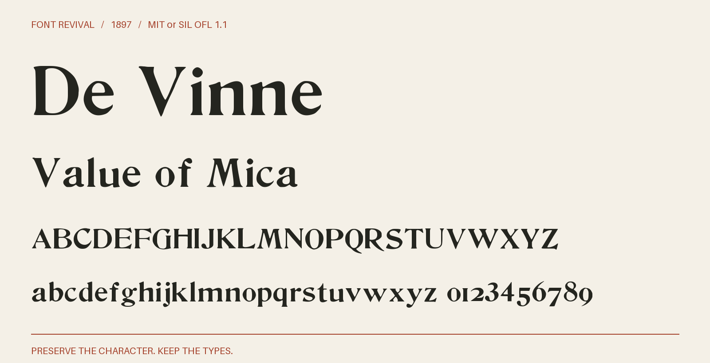

# De Vinne

De Vinne with complete observed alphabets and figures, retained historical details, and source-supported companions. Scalable at any text size.



**1897 · Regular · Version 1.005 · 82 characters · MIT or SIL OFL 1.1**

[OTF](fonts/DeVinne-Regular.otf) · [TTF](fonts/DeVinne-Regular.ttf) · [WOFF2](web/DeVinne-Regular.woff2) · [PDF specimen](specimens/specimen.pdf) · [Changes](CHANGELOG.md)

## Use

Install either desktop format. For websites, copy `web/`, include `font.css`,
and use `font-family: "De Vinne"`. Designed for display sizes.

## Design

**Designer:** Unidentified in the retained source pages

**Foundry:** Shown by the United States Government Printing Office; 1897 stock mark Keystone–10

**Observed:** The 1897 specimen supplies both complete eighteen-point alphabets and a figure 2. Matching eighteen-point census and job-room impressions supply clearer selected letters, figures and punctuation. The census sets lowercase j before i; the recorded selections follow their actual shapes. The 1904 poster and figure page supply four punctuation characters and a lining set. Existing 3, 4, 6 and 8 serve both figure settings. The intact GPO tall zero supersedes the softer matching Handy impression; the short job-room zero remains the default. Matching ATF fraction assortments provide nine whole diagonal fractions, cent and percent; intact New York, Handy and BYU impressions are selected at one physical scale per source page. The NYPL 1898 Desk Book shows descending 3 and 4 beside text at the same optical size; whole impressions supply optional oldstyle forms. The consolidated offering also retains — from separately documented source-size witnesses; see source/consolidation.json.

**Reconstructed:** No visible glyph is invented. The default alphabet and its selected alternates remain unchanged. Supplementary whole glyphs retain their donor outlines, advances and existing 1000-unit coordinates; the donor specimen sizes are recorded explicitly. Modern spacing and placement conventions remain documented in the source methods. No missing character is reconstructed.

## Sources

1. [Government Printing Office specimen (1897), De Vinne eighteen point; printed page 50, archive leaf 109](https://archive.org/details/specimensofjobdi00unit/page/n109/mode/1up) — Historical United States Government Printing Office publication; public domain by age. Native printed forms only. [Rights basis](https://archive.org/metadata/specimensofjobdi00unit).
2. [Government Printing Office specimen (1900), De Vinne eighteen point; printed page 18, archive leaf 37](https://archive.org/details/specimensoftypef00unit_0/page/n37/mode/1up) — Historical United States Government Printing Office publication; public domain by age. Native printed forms only. [Rights basis](https://archive.org/metadata/specimensoftypef00unit_0).
3. [Government Printing Office specimen (1904), De Vinne eighteen point; printed page 68, archive leaf 84](https://archive.org/details/123459_1904/page/n84/mode/1up) — Historical United States Government Printing Office publication; public domain by age. Native printed forms only. [Rights basis](https://archive.org/metadata/123459_1904).
4. [American Type Founders Company, Handy Book of Specimens (1897), Poster De Vinne eighteen point, printed page 338, archive leaf 357](https://archive.org/details/cu31924014559730/page/n357/mode/1up) — Public-domain United States specimen published in 1897. [Rights basis](https://archive.org/metadata/cu31924014559730).
5. [Government Printing Office specimen (1904), De Vinne eighteen point; printed page 120, archive leaf 136; matched poster capitals and observed punctuation](https://archive.org/details/123459_1904/page/n136/mode/1up) — Historical United States Government Printing Office publication; public domain by age. Native printed forms only. [Rights basis](https://archive.org/metadata/123459_1904).
6. [Government Printing Office specimen (1904), De Vinne eighteen point; printed page 124, archive leaf 140; complete lining-figure source and sharper tall zero](https://archive.org/details/123459_1904/page/n140/mode/1up) — Historical United States Government Printing Office publication; public domain by age. Native printed forms only. [Rights basis](https://archive.org/metadata/123459_1904).
7. [Handy Book of Specimens (1897), De Vinne fraction assortment; printed page 40, archive leaf 59](https://archive.org/details/cu31924014559730/page/n59/mode/1up) — Published in the United States in1897; the historical specimen and type impressions are in the public domain. [Rights basis](https://archive.org/details/cu31924014559730/page/n59/mode/1up).
8. [ATF New York specimen (1897), De Vinne fraction assortment; printed page 436, archive leaf 506](https://archive.org/details/specimensofprint00amerrich/page/n506/mode/1up) — Published in the United States in1897; the historical specimen and type impressions are in the public domain. [Rights basis](https://archive.org/details/specimensofprint00amerrich/page/n506/mode/1up).
9. [ATF specimen, BYU copy (1897), De Vinne fraction assortment; printed page 637, archive leaf 639](https://archive.org/details/specimensoftypeb00amer/page/n639/mode/1up) — Published in the United States in1897; the historical specimen and type impressions are in the public domain. [Rights basis](https://archive.org/details/specimensoftypeb00amer/page/n639/mode/1up).
10. [American Type Founders Desk Book (1898), NYPL copy, Poster De Vinne eighteen point; printed page 523, archive leaf 540](https://archive.org/details/ATF1898DeskBook/page/n540/mode/1up) — Historical United States specimen published in 1898; public domain by age. [Rights basis](https://archive.org/metadata/ATF1898DeskBook).
11. [Government Printing Office specimen (1904), De Vinne ten point; printed page 69, archive leaf 85](https://archive.org/details/123459_1904/page/n85/mode/1up) — Historical United States Government Printing Office publication; public domain by age. Native printed forms only. [Rights basis](https://archive.org/metadata/123459_1904).

Source images are in `reference/`; the source record is [font.json](font.json).
Historical reference material retains the rights status recorded there.
Copyright (c) 2026 Harold Lehmann. The fonts and editable font source data are available under your choice of the [MIT License](LICENSE) or [SIL Open Font License 1.1](OFL.txt) (`MIT OR OFL-1.1`), with no Reserved Font Names. See [font licensing](FONT-LICENSES.txt) for the scope and notices. Other original project files, including standalone artwork, code and documentation, use MIT.

## Build or improve

From the repository root:

```sh
python scripts/fontrevival.py build de-vinne-1897
python scripts/fontrevival.py check de-vinne-1897
```

Edit `source/font.ttx` or export an individual glyph with
`python scripts/fontrevival.py glyph de-vinne-1897 j`.
Follow the shared [revival workflow](../../docs/WORKFLOW.md) for additions and revisions.
