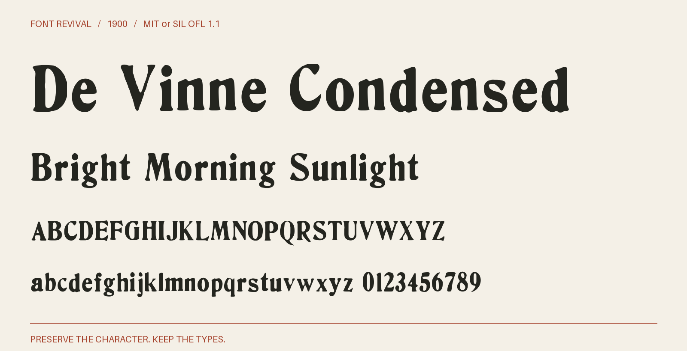

# De Vinne Condensed

De Vinne Condensed with complete observed alphabets and figures, retained historical details, and source-supported companions. Scalable at any text size.



**1900 · Regular · Version 1.005 · 79 characters · MIT or SIL OFL 1.1**

[OTF](fonts/DeVinneCondensed-Regular.otf) · [TTF](fonts/DeVinneCondensed-Regular.ttf) · [WOFF2](web/DeVinneCondensed-Regular.woff2) · [PDF specimen](specimens/specimen.pdf) · [Changes](CHANGELOG.md)

## Use

Install either desktop format. For websites, copy `web/`, include `font.css`,
and use `font-family: "De Vinne Condensed"`. Designed for display sizes.

## Design

**Designer:** Unidentified in the retained source pages

**Foundry:** Shown by the United States Government Printing Office and American Type Founders; the collective ATF page credits Central Type Foundry, St. Louis, for the design

**Observed:** The census specimen shows both complete 8-point alphabets and all ten figures. Matching ATF impressions supply clearer letters and figures. Eleven retained native pages document repeated samples and source-quality comparisons. The matching eight- and ten-point Poster De Vinne Condensed samples in the 1897 Handy Book, printed page 341, supply observed punctuation at the corresponding size. Whole stacked fractions come from the matching Handy Book poster (printed page 341) and fraction chart (printed page 40). The 1898 Desk Book and 1906 American Line fraction pages are retained as quality comparisons. The consolidated offering also retains ’, ⅞ from separately documented source-size witnesses; see source/consolidation.json.

**Reconstructed:** No visible glyph is invented. The default alphabet and its selected alternates remain unchanged. Supplementary whole glyphs retain their donor outlines, advances and existing 1000-unit coordinates; the donor specimen sizes are recorded explicitly. Modern spacing and placement conventions remain documented in the source methods. No missing character is reconstructed.

## Sources

1. [gpo-census-1900: De Vinne Condensed, printed page 16, archive leaf 33](https://archive.org/details/specimensoftypef00unit_0/page/n33/mode/1up) — Historical United States Government Printing Office publication; public domain by age. Native printed forms only. [Rights basis](https://archive.org/metadata/specimensoftypef00unit_0).
2. [atf-new-york-1897: De Vinne Condensed, printed page 329, archive leaf 397](https://archive.org/details/specimensofprint00amerrich/page/n397/mode/1up) — 1897 United States publication, public domain by age. The historical scan supplies the observed forms. [Rights basis](https://archive.org/metadata/specimensofprint00amerrich).
3. [atf-handy-byu-1897: De Vinne Condensed, printed page 359, archive leaf 361](https://archive.org/details/specimensoftypeb00amer/page/n361/mode/1up) — 1897 United States publication, public domain by age. The historical scan supplies the observed forms. [Rights basis](https://archive.org/metadata/specimensoftypeb00amer).
4. [atf-pacific-1896: De Vinne Condensed, printed page 418, archive leaf 422](https://archive.org/details/pacificcoastblue00amerrich/page/n422/mode/1up) — 1896 United States publication, public domain by age. The historical scan supplies the observed forms. [Rights basis](https://archive.org/metadata/pacificcoastblue00amerrich).
5. [atf-handy-1897: De Vinne Condensed, printed page 191, archive leaf 210](https://archive.org/details/cu31924014559730/page/n210/mode/1up) — 1897 United States publication, public domain by age. The historical scan supplies the observed forms. [Rights basis](https://archive.org/metadata/cu31924014559730).
6. [atf-desk-nypl-1898: De Vinne Condensed, printed page 297, archive leaf 310](https://archive.org/details/ATF1898DeskBook/page/n310/mode/1up) — 1898 United States publication, public domain by age. The historical scan supplies the observed forms. [Rights basis](https://archive.org/metadata/ATF1898DeskBook).
7. [atf-collective-1896: De Vinne Condensed, printed page 281, part 16, PDF page 1](https://www.circuitousroot.com/images/artifice/letters/press/noncomptype/typography/atf/atf-collective-specimen-garland-badscan/atf-1896-specimens-of-type-garland-1981-part-16-devinne-etc-publicdomain.pdf) — 1896 United States publication, public domain by age. The historical scan supplies the observed forms. [Rights basis](https://www.circuitousroot.com/images/artifice/letters/press/noncomptype/typography/atf/atf-collective-specimen-garland-badscan/atf-1896-specimens-of-type-garland-1981-part-16-devinne-etc-publicdomain.pdf).
8. [American Type Founders Handy Book (1897), Poster De Vinne Condensed 8 point; printed page341, archive leaf360](https://archive.org/details/cu31924014559730/page/n360/mode/1up) — 1897 United States publication, public domain by age. Historical printed forms only. [Rights basis](https://archive.org/metadata/cu31924014559730).
9. [atf-handy-1897: De Vinne fractions, printed page 40, archive leaf 59; traced fractions and matching whole-fraction comparison](https://archive.org/details/cu31924014559730/page/n59/mode/1up) — 1897 United States publication; public domain by age. Historical printed forms only. [Rights basis](https://archive.org/metadata/cu31924014559730).
10. [atf-american-line-1906: De Vinne fractions, printed page 698, archive leaf 646; fraction source-quality comparison only; no outlines selected](https://archive.org/details/americanlinetype00daysrich/page/n646/mode/1up) — 1906 United States publication; public domain by age. Historical printed forms only. [Rights basis](https://archive.org/metadata/americanlinetype00daysrich).
11. [atf-desk-nypl-1898: De Vinne fractions, printed page 568, archive leaf 587; fraction source-quality comparison only; no outlines selected](https://archive.org/details/ATF1898DeskBook/page/n587/mode/1up) — 1898 United States publication; public domain by age. Historical printed forms only. [Rights basis](https://archive.org/metadata/ATF1898DeskBook).
12. [American Type Founders Handy Book (1897), Poster De Vinne Condensed 10 point; printed page341, archive leaf360](https://archive.org/details/cu31924014559730/page/n360/mode/1up) — 1897 United States publication, public domain by age. Historical printed forms only. [Rights basis](https://archive.org/metadata/cu31924014559730).

Source images are in `reference/`; the source record is [font.json](font.json).
Historical reference material retains the rights status recorded there.
Copyright (c) 2026 Harold Lehmann. The fonts and editable font source data are available under your choice of the [MIT License](LICENSE) or [SIL Open Font License 1.1](OFL.txt) (`MIT OR OFL-1.1`), with no Reserved Font Names. See [font licensing](FONT-LICENSES.txt) for the scope and notices. Other original project files, including standalone artwork, code and documentation, use MIT.

## Build or improve

From the repository root:

```sh
python scripts/fontrevival.py build de-vinne-condensed-1900
python scripts/fontrevival.py check de-vinne-condensed-1900
```

Edit `source/font.ttx` or export an individual glyph with
`python scripts/fontrevival.py glyph de-vinne-condensed-1900 j`.
Follow the shared [revival workflow](../../docs/WORKFLOW.md) for additions and revisions.
