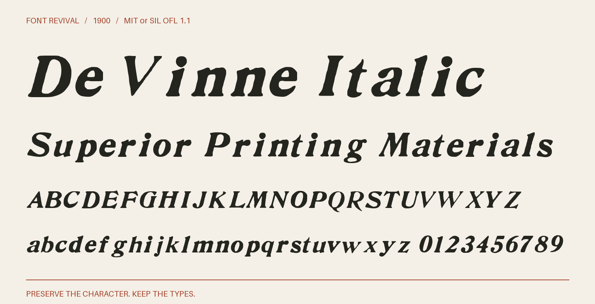

# De Vinne Italic

De Vinne Italic with complete observed alphabets and figures, retained historical details, and source-supported companions. Scalable at any text size.



**1900 · Regular · Version 1.005 · 64 characters · MIT or SIL OFL 1.1**

[OTF](fonts/DeVinne-Italic.otf) · [TTF](fonts/DeVinne-Italic.ttf) · [WOFF2](web/DeVinne-Italic.woff2) · [PDF specimen](specimens/specimen.pdf) · [Changes](CHANGELOG.md)

## Use

Install either desktop format. For websites, copy `web/`, include `font.css`,
and use `font-family: "De Vinne Italic"`. Designed for display sizes.

## Design

**Designer:** Unidentified in the retained source pages

**Foundry:** Shown by the United States Government Printing Office and American Type Founders; the collective ATF page credits Central Type Foundry for the design

**Observed:** The census specimen shows both complete eight-point alphabets and all ten figures. Matching New York and BYU ATF impressions supply clearer letters and figures. Other retained ATF pages document repeated samples and source-quality comparisons. The John Ryan Foundry 1894 specimen, printed page 69, supplies a clearer whole eight-point g from Tumbling. The consolidated offering also retains $ from separately documented source-size witnesses; see source/consolidation.json.

**Reconstructed:** No visible glyph is invented. The default alphabet and its selected alternates remain unchanged. Supplementary whole glyphs retain their donor outlines, advances and existing 1000-unit coordinates; the donor specimen sizes are recorded explicitly. Modern spacing and placement conventions remain documented in the source methods. No missing character is reconstructed.

## Sources

1. [gpo-census-1900: De Vinne Italic, printed page 15, archive leaf 31](https://archive.org/details/specimensoftypef00unit_0/page/n31/mode/1up) — Historical United States Government Printing Office publication; public domain by age. Native printed forms only. [Rights basis](https://archive.org/metadata/specimensoftypef00unit_0).
2. [atf-new-york-1897: De Vinne Italic, printed page 335, archive leaf 403](https://archive.org/details/specimensofprint00amerrich/page/n403/mode/1up) — 1897 United States publication, public domain by age. The historical scan supplies the observed forms. [Rights basis](https://archive.org/metadata/specimensofprint00amerrich).
3. [atf-handy-byu-1897: De Vinne Italic, printed page 365, archive leaf 367](https://archive.org/details/specimensoftypeb00amer/page/n367/mode/1up) — 1897 United States publication, public domain by age. The historical scan supplies the observed forms. [Rights basis](https://archive.org/metadata/specimensoftypeb00amer).
4. [atf-pacific-1896: De Vinne Italic, printed page 429, archive leaf 433](https://archive.org/details/pacificcoastblue00amerrich/page/n433/mode/1up) — 1896 United States publication, public domain by age. The historical scan supplies the observed forms. [Rights basis](https://archive.org/metadata/pacificcoastblue00amerrich).
5. [atf-handy-1897: De Vinne Italic, printed page 197, archive leaf 216](https://archive.org/details/cu31924014559730/page/n216/mode/1up) — 1897 United States publication, public domain by age. The historical scan supplies the observed forms. [Rights basis](https://archive.org/metadata/cu31924014559730).
6. [atf-desk-nypl-1898: De Vinne Italic, printed page 303, archive leaf 316](https://archive.org/details/ATF1898DeskBook/page/n316/mode/1up) — 1898 United States publication, public domain by age. The historical scan supplies the observed forms. [Rights basis](https://archive.org/metadata/ATF1898DeskBook).
7. [atf-collective-1896: De Vinne Italic, printed page 286, part 16, PDF page 6](https://www.circuitousroot.com/images/artifice/letters/press/noncomptype/typography/atf/atf-collective-specimen-garland-badscan/atf-1896-specimens-of-type-garland-1981-part-16-devinne-etc-publicdomain.pdf) — 1896 United States publication, public domain by age. The historical scan supplies the observed forms. [Rights basis](https://www.circuitousroot.com/images/artifice/letters/press/noncomptype/typography/atf/atf-collective-specimen-garland-badscan/atf-1896-specimens-of-type-garland-1981-part-16-devinne-etc-publicdomain.pdf).
8. [John Ryan Foundry, Latest and standard faces in type (1894), De Vinne Italic 8 point, printed page 69, archive leaf 75](https://archive.org/details/lateststandardfa00ryan/page/n75/mode/1up) — John Ryan Foundry, Baltimore, United States, Latest and standard faces in type, printers tools and machinery, published 1894; historical publication in the public domain by age. [Rights basis](https://archive.org/metadata/lateststandardfa00ryan).
9. [American Type Founders Desk Book (1898), De Vinne Italic 6 point, printed page 349, archive leaf 357](https://archive.org/details/deskbookofprinti00amer/page/n357/mode/1up) — Historical American Type Founders specimen published in the United States in 1898; public domain by age. [Rights basis](https://archive.org/metadata/deskbookofprinti00amer).

Source images are in `reference/`; the source record is [font.json](font.json).
Historical reference material retains the rights status recorded there.
Copyright (c) 2026 Harold Lehmann. The fonts and editable font source data are available under your choice of the [MIT License](LICENSE) or [SIL Open Font License 1.1](OFL.txt) (`MIT OR OFL-1.1`), with no Reserved Font Names. See [font licensing](FONT-LICENSES.txt) for the scope and notices. Other original project files, including standalone artwork, code and documentation, use MIT.

## Build or improve

From the repository root:

```sh
python scripts/fontrevival.py build de-vinne-italic-1900
python scripts/fontrevival.py check de-vinne-italic-1900
```

Edit `source/font.ttx` or export an individual glyph with
`python scripts/fontrevival.py glyph de-vinne-italic-1900 j`.
Follow the shared [revival workflow](../../docs/WORKFLOW.md) for additions and revisions.
