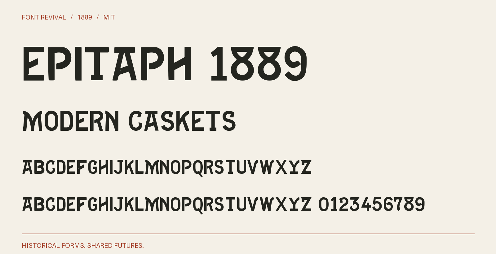

# Epitaph 1889

Angular display capitals with rising crossbars, bowed M stems and sharply cut terminals.



**1889 · Regular · Version 1.000 · 104 characters · Capitals only · MIT**

[OTF](fonts/Epitaph1889-Regular.otf) · [TTF](fonts/Epitaph1889-Regular.ttf) · [WOFF2](web/Epitaph1889-Regular.woff2) · [PDF specimen](specimens/specimen.pdf) · [Changes](CHANGELOG.md)

## Use

Install either desktop format. For websites, copy `web/`, include `font.css`,
and use `font-family: "Epitaph 1889"`. Designed for display sizes.

## Design

**Designer:** Unidentified in the consulted historical specimen

**Foundry:** Boston and Central Type Foundries

**Observed:** Directly sampled characters: 2345789ABCDEFGHIKLMNOPRSTUVWYZ. The source is printed page 172, PDF page 178. Larger sizes anchor the master and smaller impressions supply missing sorts.

**Reconstructed:** Inferred companion letters and figures: JQX016. Punctuation and remaining symbols are new project drawings. Lowercase input aliases capitals. Spacing and harmonisation of optical sizes are modern choices. The 1889 suffix dates the source, not a claim of first release.

## Sources

1. [Specimen book from the Boston type foundry (1889), Epitaph; printed p. 172, one-based PDF page 178, Internet Archive leaf 178](https://archive.org/details/specimenbookfrom00unse/page/n178/mode/1up) — 1889 US publication, public domain under the maximum historical 95-year term. Library of Congress scan hosted by Internet Archive; retained institutional metadata says the Library is unaware of copyright restrictions. Original native JP2 leaf; no modern digital typeface used. [Rights basis](https://archive.org/metadata/specimenbookfrom00unse).

Source images are in `reference/`; the source record is [font.json](font.json).
Historical reference material retains the rights status recorded there.
Copyright (c) 2026 Harold Lehmann. The digital revival is released under the included [MIT License](LICENSE).

## Build or improve

From the repository root:

```sh
python scripts/fontrevival.py build epitaph-1889
python scripts/fontrevival.py check epitaph-1889
```

Edit `source/font.ttx` or export an individual glyph with
`python scripts/fontrevival.py glyph epitaph-1889 j`.
Follow the shared [revival workflow](../../docs/WORKFLOW.md) for additions and revisions.
