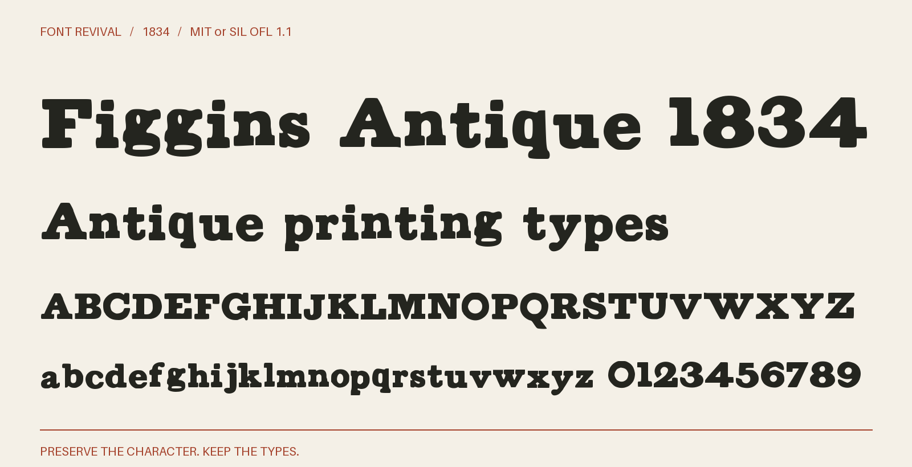

# Figgins Antique 1834

Heavy slab-serif letters with round bowls, broad capitals and a complete historical lowercase, from the 1834 Figgins specimen.



**1834 · Regular · Version 1.000 · 74 characters · MIT or SIL OFL 1.1**

[OTF](fonts/FigginsAntique1834-Regular.otf) · [TTF](fonts/FigginsAntique1834-Regular.ttf) · [WOFF2](web/FigginsAntique1834-Regular.woff2) · [PDF specimen](specimens/specimen.pdf) · [Changes](CHANGELOG.md)

## Use

Install either desktop format. For websites, copy `web/`, include `font.css`,
and use `font-family: "Figgins Antique 1834"`. Designed for display sizes.

## Design

**Designer:** Unidentified in the historical specimen

**Foundry:** V. Figgins, London

**Observed:** Complete capitals, figures and 23 lowercase letters from Double Pica Antique on leaf161; matching heavy Long Primer Antique on leaf163 supplies g, j and q. Pound sign, ampersand, ligatures and punctuation are observed.

**Reconstructed:** No inferred visible characters. Spaces and digital spacing are new; ASCII quotation mark aliases the observed closing double quote.

## Sources

1. [Specimen of printing types, V. Figgins (1834), Antique types, unpaginated PDF page 161, archive leaf 161](https://archive.org/details/b2874231x/page/n161/mode/1up) — 1834 British publication, public domain by age. The Wellcome Library archive record marks the historical work with the Public Domain Mark 1.0. [Rights basis](https://archive.org/details/b2874231x).
2. [Specimen of printing types, V. Figgins (1834), Antique types, unpaginated PDF page 163, archive leaf 163](https://archive.org/details/b2874231x/page/n163/mode/1up) — 1834 British publication, public domain by age. The Wellcome Library archive record marks the historical work with the Public Domain Mark 1.0. [Rights basis](https://archive.org/details/b2874231x).

Source images are in `reference/`; the source record is [font.json](font.json).
Historical reference material retains the rights status recorded there.
Copyright (c) 2026 Harold Lehmann. The fonts and editable font source data are available under your choice of the [MIT License](LICENSE) or [SIL Open Font License 1.1](OFL.txt) (`MIT OR OFL-1.1`), with no Reserved Font Names. See [font licensing](FONT-LICENSES.txt) for the scope and notices. Other original project files, including standalone artwork, code and documentation, use MIT.

## Build or improve

From the repository root:

```sh
python scripts/fontrevival.py build figgins-antique-1834
python scripts/fontrevival.py check figgins-antique-1834
```

Edit `source/font.ttx` or export an individual glyph with
`python scripts/fontrevival.py glyph figgins-antique-1834 j`.
Follow the shared [revival workflow](../../docs/WORKFLOW.md) for additions and revisions.
