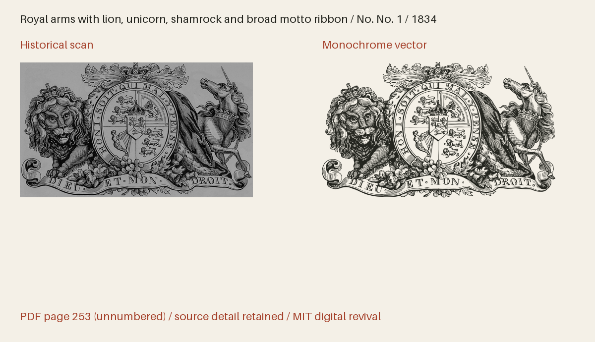

# Figgins Cuts 1834

Pictorial cuts, engraved emblems, decorative frames, labels and pointing hands from the 1834 V. Figgins specimen.



**143 icon(s) · Version 1.000 · Artwork: MIT · Fonts: MIT or SIL OFL 1.1**

[SVG files](svg/) · [SVG sprite](web/icons.svg) · [OTF](fonts/FigginsCuts1834-Regular.otf) · [TTF](fonts/FigginsCuts1834-Regular.ttf) · [WOFF2](web/FigginsCuts1834-Regular.woff2) · [Comparison and size proof](specimens/specimen.pdf) · [Icon manifest](icons.json) · [Changes](CHANGELOG.md)


## Use in HTML

[Download the web bundle (ZIP)](downloads/figgins-cuts-1834-web.zip), unzip it, and place
the extracted `collection` folder beside your HTML file. Keep its subfolders
together. The examples below then work as written; adjust the paths if you move
the folder elsewhere. The bundle contains SVGs, PNGs, fonts, CSS, instructions
and license notices. No JavaScript or font installation is needed for SVG use.

### Three-tone image — works from disk too

The individual SVG displays all three tones at their default strengths, with a
transparent background. Change `height` to resize it; the proportions are retained.

```html

```

An `` has its own colour context: page CSS cannot recolour its internal
regions. For a decorative image beside a text label, use `alt=""` instead.

### Three-tone sprite — customise every tone

Copy `web/icons-multitone.svg` and use the following complete example on an
HTTP(S) page served from the same origin as the sprite. It draws dark primary ink
and two strengths of red. Each colour and opacity can be changed independently.

```html
<style>
  .revival-cut {
    display: inline-block;
    font-size: 96px;
    height: 1em;
    width: 0.941406em;
    vertical-align: middle;
    --fr-primary-color: #24251f;
    --fr-secondary-color: #a5422c;
    --fr-tertiary-color: #a5422c;
    --fr-primary-opacity: 1;
    --fr-secondary-opacity: 0.55;
    --fr-tertiary-opacity: 0.25;
  }
</style>
<svg class="revival-cut" role="img" aria-label="Royal arms with lion, unicorn, shamrock and broad motto ribbon">
  <use href="collection/figgins-cuts-1834/web/icons.svg#figgins-1834-p253-cut-1"></use>
</svg>
```

Use the same secondary and tertiary colour and opacity for a two-tone appearance.
The defaults are primary 100%, secondary 55% and tertiary 25%; these are separate
vector regions, not a gradient. The tone assignments interpret the historical
impression. A transparent PNG of the default tones is also provided.

External SVG sprites can be blocked on `file://` pages. To customise tones on a
page opened from disk, open the individual SVG in a text editor, copy its complete
`<svg>…</svg>` markup into your HTML, and add `class="revival-cut"` to that SVG.
The same CSS above then applies to its inline paths. Keep its `viewBox` and paths.
The gallery itself uses inline SVG so its previews work directly from disk.

### Monochrome icon font

Copy the whole `web/` folder, including CSS and webfonts. Standard icon fonts show
the solid artwork; use the SVG examples above for three-tone artwork.

```html
<link rel="stylesheet" href="collection/figgins-cuts-1834/web/icons.css">
<span class="fr-icon fr-figgins-1834-p253-cut-1" aria-hidden="true"
      style="font-size:96px;color:#a5422c"></span>
<span>Royal arms with lion, unicorn, shamrock and broad motto ribbon</span>
```

The example hides a decorative icon from screen readers and supplies visible
text. For an icon that conveys meaning on its own, use `role="img"` and an
`aria-label` instead of `aria-hidden`. Font size and colour use ordinary CSS.

Install the OTF or TTF for desktop use. The manifest lists each icon's Private Use
codepoint and recommended minimum display size. These codepoints are not ordinary
text characters; IDs and codepoints are permanent within this collection.
The example above uses U+E000 and is recommended from
64 px. The 16–192 pt proofs show how detail holds up at different sizes.
Keep the included LICENSE with redistributed assets.

The fonts and editable font source data are available under your choice of the [MIT License](LICENSE) or [SIL Open Font License 1.1](OFL.txt) (`MIT OR OFL-1.1`), with no Reserved Font Names. See [font licensing](FONT-LICENSES.txt) for the scope and notices. Other original project files, including standalone artwork, code and documentation, use MIT.

## Evidence and editing

**Foundry:** V. Figgins, London

**Designer:** Individual engravers unidentified in the specimen

**Observed:** 143 complete historical designs. Separate source settings, repeated impressions, compositions and matches to existing collection items are documented in the inventory.

**Interpreted or new:** No invented pictorial content. Recorded erasures exclude adjacent ink and captions. Small isolated scan specks are removed. Measured rotations and, for recorded rectangular frames, quadrilateral rectification correct scan geometry; uniform final scaling preserves proportions.

- [Specimen of printing types, V. Figgins (1834), unpaginated PDF page 253, archive leaf 253](https://archive.org/details/b2874231x/page/n253/mode/1up) — 1834 British publication, public domain by age. The Wellcome Library archive record marks the historical work with the Public Domain Mark 1.0. [Rights basis](https://archive.org/details/b2874231x).
- [Specimen of printing types, V. Figgins (1834), unpaginated PDF page 255, archive leaf 255](https://archive.org/details/b2874231x/page/n255/mode/1up) — 1834 British publication, public domain by age. The Wellcome Library archive record marks the historical work with the Public Domain Mark 1.0. [Rights basis](https://archive.org/details/b2874231x).
- [Specimen of printing types, V. Figgins (1834), unpaginated PDF page 257, archive leaf 257](https://archive.org/details/b2874231x/page/n257/mode/1up) — 1834 British publication, public domain by age. The Wellcome Library archive record marks the historical work with the Public Domain Mark 1.0. [Rights basis](https://archive.org/details/b2874231x).
- [Specimen of printing types, V. Figgins (1834), unpaginated PDF page 259, archive leaf 259](https://archive.org/details/b2874231x/page/n259/mode/1up) — 1834 British publication, public domain by age. The Wellcome Library archive record marks the historical work with the Public Domain Mark 1.0. [Rights basis](https://archive.org/details/b2874231x).
- [Specimen of printing types, V. Figgins (1834), unpaginated PDF page 261, archive leaf 261](https://archive.org/details/b2874231x/page/n261/mode/1up) — 1834 British publication, public domain by age. The Wellcome Library archive record marks the historical work with the Public Domain Mark 1.0. [Rights basis](https://archive.org/details/b2874231x).
- [Specimen of printing types, V. Figgins (1834), unpaginated PDF page 263, archive leaf 263](https://archive.org/details/b2874231x/page/n263/mode/1up) — 1834 British publication, public domain by age. The Wellcome Library archive record marks the historical work with the Public Domain Mark 1.0. [Rights basis](https://archive.org/details/b2874231x).
- [Specimen of printing types, V. Figgins (1834), unpaginated PDF page 265, archive leaf 265](https://archive.org/details/b2874231x/page/n265/mode/1up) — 1834 British publication, public domain by age. The Wellcome Library archive record marks the historical work with the Public Domain Mark 1.0. [Rights basis](https://archive.org/details/b2874231x).
- [Specimen of printing types, V. Figgins (1834), unpaginated PDF page 267, archive leaf 267](https://archive.org/details/b2874231x/page/n267/mode/1up) — 1834 British publication, public domain by age. The Wellcome Library archive record marks the historical work with the Public Domain Mark 1.0. [Rights basis](https://archive.org/details/b2874231x).
- [Specimen of printing types, V. Figgins (1834), unpaginated PDF page 269, archive leaf 269](https://archive.org/details/b2874231x/page/n269/mode/1up) — 1834 British publication, public domain by age. The Wellcome Library archive record marks the historical work with the Public Domain Mark 1.0. [Rights basis](https://archive.org/details/b2874231x).
- [Specimen of printing types, V. Figgins (1834), unpaginated PDF page 271, archive leaf 271](https://archive.org/details/b2874231x/page/n271/mode/1up) — 1834 British publication, public domain by age. The Wellcome Library archive record marks the historical work with the Public Domain Mark 1.0. [Rights basis](https://archive.org/details/b2874231x).
- [Specimen of printing types, V. Figgins (1834), unpaginated PDF page 273, archive leaf 273](https://archive.org/details/b2874231x/page/n273/mode/1up) — 1834 British publication, public domain by age. The Wellcome Library archive record marks the historical work with the Public Domain Mark 1.0. [Rights basis](https://archive.org/details/b2874231x).
- [Specimen of printing types, V. Figgins (1834), unpaginated PDF page 275, archive leaf 275](https://archive.org/details/b2874231x/page/n275/mode/1up) — 1834 British publication, public domain by age. The Wellcome Library archive record marks the historical work with the Public Domain Mark 1.0. [Rights basis](https://archive.org/details/b2874231x).
- [Specimen of printing types, V. Figgins (1834), unpaginated PDF page 277, archive leaf 277](https://archive.org/details/b2874231x/page/n277/mode/1up) — 1834 British publication, public domain by age. The Wellcome Library archive record marks the historical work with the Public Domain Mark 1.0. [Rights basis](https://archive.org/details/b2874231x).
- [Specimen of printing types, V. Figgins (1834), unpaginated PDF page 279, archive leaf 279](https://archive.org/details/b2874231x/page/n279/mode/1up) — 1834 British publication, public domain by age. The Wellcome Library archive record marks the historical work with the Public Domain Mark 1.0. [Rights basis](https://archive.org/details/b2874231x).
- [Specimen of printing types, V. Figgins (1834), unpaginated PDF page 281, archive leaf 281](https://archive.org/details/b2874231x/page/n281/mode/1up) — 1834 British publication, public domain by age. The Wellcome Library archive record marks the historical work with the Public Domain Mark 1.0. [Rights basis](https://archive.org/details/b2874231x).
- [Specimen of printing types, V. Figgins (1834), unpaginated PDF page 283, archive leaf 283](https://archive.org/details/b2874231x/page/n283/mode/1up) — 1834 British publication, public domain by age. The Wellcome Library archive record marks the historical work with the Public Domain Mark 1.0. [Rights basis](https://archive.org/details/b2874231x).
- [Specimen of printing types, V. Figgins (1834), unpaginated PDF page 285, archive leaf 285](https://archive.org/details/b2874231x/page/n285/mode/1up) — 1834 British publication, public domain by age. The Wellcome Library archive record marks the historical work with the Public Domain Mark 1.0. [Rights basis](https://archive.org/details/b2874231x).
- [Specimen of printing types, V. Figgins (1834), unpaginated PDF page 287, archive leaf 287](https://archive.org/details/b2874231x/page/n287/mode/1up) — 1834 British publication, public domain by age. The Wellcome Library archive record marks the historical work with the Public Domain Mark 1.0. [Rights basis](https://archive.org/details/b2874231x).
- [Specimen of printing types, V. Figgins (1834), unpaginated PDF page 289, archive leaf 289](https://archive.org/details/b2874231x/page/n289/mode/1up) — 1834 British publication, public domain by age. The Wellcome Library archive record marks the historical work with the Public Domain Mark 1.0. [Rights basis](https://archive.org/details/b2874231x).
- [Specimen of printing types, V. Figgins (1834), unpaginated PDF page 291, archive leaf 291](https://archive.org/details/b2874231x/page/n291/mode/1up) — 1834 British publication, public domain by age. The Wellcome Library archive record marks the historical work with the Public Domain Mark 1.0. [Rights basis](https://archive.org/details/b2874231x).
- [Specimen of printing types, V. Figgins (1834), unpaginated PDF page 293, archive leaf 293](https://archive.org/details/b2874231x/page/n293/mode/1up) — 1834 British publication, public domain by age. The Wellcome Library archive record marks the historical work with the Public Domain Mark 1.0. [Rights basis](https://archive.org/details/b2874231x).
- [Specimen of printing types, V. Figgins (1834), unpaginated PDF page 295, archive leaf 295](https://archive.org/details/b2874231x/page/n295/mode/1up) — 1834 British publication, public domain by age. The Wellcome Library archive record marks the historical work with the Public Domain Mark 1.0. [Rights basis](https://archive.org/details/b2874231x).
- [Specimen of printing types, V. Figgins (1834), unpaginated PDF page 297, archive leaf 297](https://archive.org/details/b2874231x/page/n297/mode/1up) — 1834 British publication, public domain by age. The Wellcome Library archive record marks the historical work with the Public Domain Mark 1.0. [Rights basis](https://archive.org/details/b2874231x).
- [Specimen of printing types, V. Figgins (1834), unpaginated PDF page 299, archive leaf 299](https://archive.org/details/b2874231x/page/n299/mode/1up) — 1834 British publication, public domain by age. The Wellcome Library archive record marks the historical work with the Public Domain Mark 1.0. [Rights basis](https://archive.org/details/b2874231x).
- [Specimen of printing types, V. Figgins (1834), unpaginated PDF page 31, archive leaf 31](https://archive.org/details/b2874231x/page/n31/mode/1up) — 1834 British publication, public domain by age. The Wellcome Library archive record marks the historical work with the Public Domain Mark 1.0. [Rights basis](https://archive.org/details/b2874231x).

Copyright (c) 2026 Harold Lehmann. Historical public-domain material retains its status.
Read [the method](source/METHOD.md), [inventory](source/inventory.json) and
[icon workflow](../../docs/ICONS.md). The canonical master is `source/font.ttx`;
SVGs, sprite, fonts and manifests are generated from it with glyph edits applied.

```sh
python scripts/fontrevival.py build figgins-cuts-1834
python scripts/fontrevival.py sizecheck figgins-cuts-1834
python scripts/fontrevival.py check figgins-cuts-1834
python scripts/fontrevival.py glyph figgins-cuts-1834 uniE000
```

## Sprite files

The sprites span numbered SVG files in `web/`. Each icon’s manifest entry and gallery example names the file containing it. Keep all sprite files together when distributing the collection.

## Detailed icon fonts

The densest engravings use default OpenType `ccmp` shaping to assemble registered outline pieces. Each icon keeps one character code and its original advance width. This retains fine engraved detail while keeping each piece within renderer limits. Keep OpenType shaping enabled. Software that draws glyphs without shaping uses a simplified compatibility outline; use the SVG for full detail in those applications. The source manifest records each piece and the canonical drawing it belongs to.
