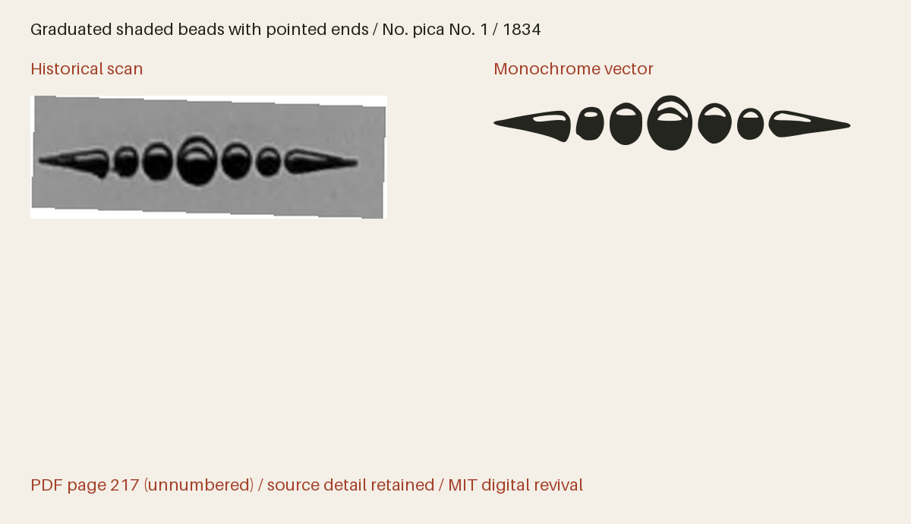

# Figgins Ornaments 1834

Ornamental rules, dashes, emblems, border repeats, corners and German-text flourishes from the 1834 V. Figgins specimen.



**288 icon(s) · Version 1.000 · Artwork: MIT · Fonts: MIT or SIL OFL 1.1**

[SVG files](svg/) · [SVG sprite](web/icons.svg) · [OTF](fonts/FigginsOrnaments1834-Regular.otf) · [TTF](fonts/FigginsOrnaments1834-Regular.ttf) · [WOFF2](web/FigginsOrnaments1834-Regular.woff2) · [Comparison and size proof](specimens/specimen.pdf) · [Icon manifest](icons.json) · [Changes](CHANGELOG.md)


## Use in HTML

[Download the web bundle (ZIP)](downloads/figgins-ornaments-1834-web.zip), unzip it, and place
the extracted `collection` folder beside your HTML file. Keep its subfolders
together. The examples below then work as written; adjust the paths if you move
the folder elsewhere. The bundle contains SVGs, PNGs, fonts, CSS, instructions
and license notices. No JavaScript or font installation is needed for SVG use.

### Three-tone image — works from disk too

The individual SVG displays all three tones at their default strengths, with a
transparent background. Change `height` to resize it; the proportions are retained.

```html

```

An `` has its own colour context: page CSS cannot recolour its internal
regions. For a decorative image beside a text label, use `alt=""` instead.

### Three-tone sprite — customise every tone

Copy `web/icons-multitone.svg` and use the following complete example on an
HTTP(S) page served from the same origin as the sprite. It draws dark primary ink
and two strengths of red. Each colour and opacity can be changed independently.

```html
<style>
  .revival-cut {
    display: inline-block;
    font-size: 96px;
    height: 1em;
    width: 0.941406em;
    vertical-align: middle;
    --fr-primary-color: #24251f;
    --fr-secondary-color: #a5422c;
    --fr-tertiary-color: #a5422c;
    --fr-primary-opacity: 1;
    --fr-secondary-opacity: 0.55;
    --fr-tertiary-opacity: 0.25;
  }
</style>
<svg class="revival-cut" role="img" aria-label="Graduated shaded beads with pointed ends">
  <use href="collection/figgins-ornaments-1834/web/icons.svg#figgins-1834-p217-pica-1"></use>
</svg>
```

Use the same secondary and tertiary colour and opacity for a two-tone appearance.
The defaults are primary 100%, secondary 55% and tertiary 25%; these are separate
vector regions, not a gradient. The tone assignments interpret the historical
impression. A transparent PNG of the default tones is also provided.

External SVG sprites can be blocked on `file://` pages. To customise tones on a
page opened from disk, open the individual SVG in a text editor, copy its complete
`<svg>…</svg>` markup into your HTML, and add `class="revival-cut"` to that SVG.
The same CSS above then applies to its inline paths. Keep its `viewBox` and paths.
The gallery itself uses inline SVG so its previews work directly from disk.

### Monochrome icon font

Copy the whole `web/` folder, including CSS and webfonts. Standard icon fonts show
the solid artwork; use the SVG examples above for three-tone artwork.

```html
<link rel="stylesheet" href="collection/figgins-ornaments-1834/web/icons.css">
<span class="fr-icon fr-figgins-1834-p217-pica-1" aria-hidden="true"
      style="font-size:96px;color:#a5422c"></span>
<span>Graduated shaded beads with pointed ends</span>
```

The example hides a decorative icon from screen readers and supplies visible
text. For an icon that conveys meaning on its own, use `role="img"` and an
`aria-label` instead of `aria-hidden`. Font size and colour use ordinary CSS.

Install the OTF or TTF for desktop use. The manifest lists each icon's Private Use
codepoint and recommended minimum display size. These codepoints are not ordinary
text characters; IDs and codepoints are permanent within this collection.
The example above uses U+E000 and is recommended from
64 px. The 16–192 pt proofs show how detail holds up at different sizes.
Keep the included LICENSE with redistributed assets.

The fonts and editable font source data are available under your choice of the [MIT License](LICENSE) or [SIL Open Font License 1.1](OFL.txt) (`MIT OR OFL-1.1`), with no Reserved Font Names. See [font licensing](FONT-LICENSES.txt) for the scope and notices. Other original project files, including standalone artwork, code and documentation, use MIT.

## Evidence and editing

**Foundry:** V. Figgins, London

**Designer:** Individual engravers unidentified in the specimen

**Observed:** 288 complete historical designs. Separate source settings, repeated impressions, compositions and matches to existing collection items are documented in the inventory.

**Interpreted or new:** No invented pictorial content. Recorded erasures exclude adjacent ink and captions. Small isolated scan specks are removed. Measured rotations and, for recorded rectangular frames, quadrilateral rectification correct scan geometry; uniform final scaling preserves proportions.

- [Specimen of printing types, V. Figgins (1834), unpaginated PDF page 217, archive leaf 217](https://archive.org/details/b2874231x/page/n217/mode/1up) — 1834 British publication, public domain by age. The Wellcome Library archive record marks the historical work with the Public Domain Mark 1.0. [Rights basis](https://archive.org/details/b2874231x).
- [Specimen of printing types, V. Figgins (1834), unpaginated PDF page 219, archive leaf 219](https://archive.org/details/b2874231x/page/n219/mode/1up) — 1834 British publication, public domain by age. The Wellcome Library archive record marks the historical work with the Public Domain Mark 1.0. [Rights basis](https://archive.org/details/b2874231x).
- [Specimen of printing types, V. Figgins (1834), unpaginated PDF page 221, archive leaf 221](https://archive.org/details/b2874231x/page/n221/mode/1up) — 1834 British publication, public domain by age. The Wellcome Library archive record marks the historical work with the Public Domain Mark 1.0. [Rights basis](https://archive.org/details/b2874231x).
- [Specimen of printing types, V. Figgins (1834), unpaginated PDF page 215, archive leaf 215](https://archive.org/details/b2874231x/page/n215/mode/1up) — 1834 British publication, public domain by age. The Wellcome Library archive record marks the historical work with the Public Domain Mark 1.0. [Rights basis](https://archive.org/details/b2874231x).
- [Specimen of printing types, V. Figgins (1834), unpaginated PDF page 213, archive leaf 213](https://archive.org/details/b2874231x/page/n213/mode/1up) — 1834 British publication, public domain by age. The Wellcome Library archive record marks the historical work with the Public Domain Mark 1.0. [Rights basis](https://archive.org/details/b2874231x).
- [Specimen of printing types, V. Figgins (1834), unpaginated PDF page 223, archive leaf 223](https://archive.org/details/b2874231x/page/n223/mode/1up) — 1834 British publication, public domain by age. The Wellcome Library archive record marks the historical work with the Public Domain Mark 1.0. [Rights basis](https://archive.org/details/b2874231x).
- [Specimen of printing types, V. Figgins (1834), unpaginated PDF page 225, archive leaf 225](https://archive.org/details/b2874231x/page/n225/mode/1up) — 1834 British publication, public domain by age. The Wellcome Library archive record marks the historical work with the Public Domain Mark 1.0. [Rights basis](https://archive.org/details/b2874231x).
- [Specimen of printing types, V. Figgins (1834), unpaginated PDF page 227, archive leaf 227](https://archive.org/details/b2874231x/page/n227/mode/1up) — 1834 British publication, public domain by age. The Wellcome Library archive record marks the historical work with the Public Domain Mark 1.0. [Rights basis](https://archive.org/details/b2874231x).
- [Specimen of printing types, V. Figgins (1834), unpaginated PDF page 229, archive leaf 229](https://archive.org/details/b2874231x/page/n229/mode/1up) — 1834 British publication, public domain by age. The Wellcome Library archive record marks the historical work with the Public Domain Mark 1.0. [Rights basis](https://archive.org/details/b2874231x).
- [Specimen of printing types, V. Figgins (1834), unpaginated PDF page 231, archive leaf 231](https://archive.org/details/b2874231x/page/n231/mode/1up) — 1834 British publication, public domain by age. The Wellcome Library archive record marks the historical work with the Public Domain Mark 1.0. [Rights basis](https://archive.org/details/b2874231x).
- [Specimen of printing types, V. Figgins (1834), unpaginated PDF page 233, archive leaf 233](https://archive.org/details/b2874231x/page/n233/mode/1up) — 1834 British publication, public domain by age. The Wellcome Library archive record marks the historical work with the Public Domain Mark 1.0. [Rights basis](https://archive.org/details/b2874231x).
- [Specimen of printing types, V. Figgins (1834), unpaginated PDF page 235, archive leaf 235](https://archive.org/details/b2874231x/page/n235/mode/1up) — 1834 British publication, public domain by age. The Wellcome Library archive record marks the historical work with the Public Domain Mark 1.0. [Rights basis](https://archive.org/details/b2874231x).
- [Specimen of printing types, V. Figgins (1834), unpaginated PDF page 237, archive leaf 237](https://archive.org/details/b2874231x/page/n237/mode/1up) — 1834 British publication, public domain by age. The Wellcome Library archive record marks the historical work with the Public Domain Mark 1.0. [Rights basis](https://archive.org/details/b2874231x).
- [Specimen of printing types, V. Figgins (1834), unpaginated PDF page 239, archive leaf 239](https://archive.org/details/b2874231x/page/n239/mode/1up) — 1834 British publication, public domain by age. The Wellcome Library archive record marks the historical work with the Public Domain Mark 1.0. [Rights basis](https://archive.org/details/b2874231x).
- [Specimen of printing types, V. Figgins (1834), unpaginated PDF page 241, archive leaf 241](https://archive.org/details/b2874231x/page/n241/mode/1up) — 1834 British publication, public domain by age. The Wellcome Library archive record marks the historical work with the Public Domain Mark 1.0. [Rights basis](https://archive.org/details/b2874231x).
- [Specimen of printing types, V. Figgins (1834), unpaginated PDF page 243, archive leaf 243](https://archive.org/details/b2874231x/page/n243/mode/1up) — 1834 British publication, public domain by age. The Wellcome Library archive record marks the historical work with the Public Domain Mark 1.0. [Rights basis](https://archive.org/details/b2874231x).
- [Specimen of printing types, V. Figgins (1834), unpaginated PDF page 245, archive leaf 245](https://archive.org/details/b2874231x/page/n245/mode/1up) — 1834 British publication, public domain by age. The Wellcome Library archive record marks the historical work with the Public Domain Mark 1.0. [Rights basis](https://archive.org/details/b2874231x).
- [Specimen of printing types, V. Figgins (1834), unpaginated PDF page 247, archive leaf 247](https://archive.org/details/b2874231x/page/n247/mode/1up) — 1834 British publication, public domain by age. The Wellcome Library archive record marks the historical work with the Public Domain Mark 1.0. [Rights basis](https://archive.org/details/b2874231x).
- [Specimen of printing types, V. Figgins (1834), unpaginated PDF page 249, archive leaf 249](https://archive.org/details/b2874231x/page/n249/mode/1up) — 1834 British publication, public domain by age. The Wellcome Library archive record marks the historical work with the Public Domain Mark 1.0. [Rights basis](https://archive.org/details/b2874231x).
- [Specimen of printing types, V. Figgins (1834), unpaginated PDF page 251, archive leaf 251](https://archive.org/details/b2874231x/page/n251/mode/1up) — 1834 British publication, public domain by age. The Wellcome Library archive record marks the historical work with the Public Domain Mark 1.0. [Rights basis](https://archive.org/details/b2874231x).
- [Specimen of printing types, V. Figgins (1834), unpaginated PDF page 197, archive leaf 197](https://archive.org/details/b2874231x/page/n197/mode/1up) — 1834 British publication, public domain by age. The Wellcome Library archive record marks the historical work with the Public Domain Mark 1.0. [Rights basis](https://archive.org/details/b2874231x).

Copyright (c) 2026 Harold Lehmann. Historical public-domain material retains its status.
Read [the method](source/METHOD.md), [inventory](source/inventory.json) and
[icon workflow](../../docs/ICONS.md). The canonical master is `source/font.ttx`;
SVGs, sprite, fonts and manifests are generated from it with glyph edits applied.

```sh
python scripts/fontrevival.py build figgins-ornaments-1834
python scripts/fontrevival.py sizecheck figgins-ornaments-1834
python scripts/fontrevival.py check figgins-ornaments-1834
python scripts/fontrevival.py glyph figgins-ornaments-1834 uniE000
```
