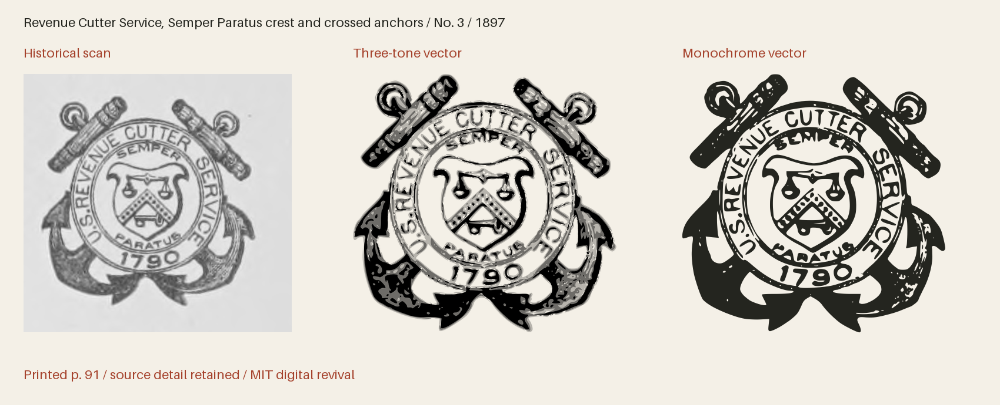

# GPO Cuts 1897

Distinct historical seals and emblems from the Government Printing Office specimen of 1897.



**14 icon(s) · Version 1.000 · Artwork: MIT · Fonts: MIT or SIL OFL 1.1**

[SVG files](svg/) · [SVG sprite](web/icons.svg) · [OTF](fonts/GPOCuts1897-Regular.otf) · [TTF](fonts/GPOCuts1897-Regular.ttf) · [WOFF2](web/GPOCuts1897-Regular.woff2) · [Comparison and size proof](specimens/specimen.pdf) · [Icon manifest](icons.json) · [Changes](CHANGELOG.md)

[Three-tone SVGs](svg/multitone/) · [Three-tone sprite](web/icons-multitone.svg) · [Transparent three-tone PNGs](png/multitone/)

## Use in HTML

[Download the web bundle (ZIP)](downloads/gpo-cuts-1897-web.zip), unzip it, and place
the extracted `collection` folder beside your HTML file. Keep its subfolders
together. The examples below then work as written; adjust the paths if you move
the folder elsewhere. The bundle contains SVGs, PNGs, fonts, CSS, instructions
and license notices. No JavaScript or font installation is needed for SVG use.

### Three-tone image — works from disk too

The individual SVG displays all three tones at their default strengths, with a
transparent background. Change `height` to resize it; the proportions are retained.

```html

```

An `` has its own colour context: page CSS cannot recolour its internal
regions. For a decorative image beside a text label, use `alt=""` instead.

### Three-tone sprite — customise every tone

Copy `web/icons-multitone.svg` and use the following complete example on an
HTTP(S) page served from the same origin as the sprite. It draws dark primary ink
and two strengths of red. Each colour and opacity can be changed independently.

```html
<style>
  .revival-cut {
    display: inline-block;
    font-size: 96px;
    height: 1em;
    width: 0.941406em;
    vertical-align: middle;
    --fr-primary-color: #24251f;
    --fr-secondary-color: #a5422c;
    --fr-tertiary-color: #a5422c;
    --fr-primary-opacity: 1;
    --fr-secondary-opacity: 0.55;
    --fr-tertiary-opacity: 0.25;
  }
</style>
<svg class="revival-cut" role="img" aria-label="Revenue Cutter Service, Semper Paratus crest and crossed anchors">
  <use href="collection/gpo-cuts-1897/web/icons-multitone.svg#gpo-1897-seal-3"></use>
</svg>
```

Use the same secondary and tertiary colour and opacity for a two-tone appearance.
The defaults are primary 100%, secondary 55% and tertiary 25%; these are separate
vector regions, not a gradient. The tone assignments interpret the historical
impression. A transparent PNG of the default tones is also provided.

External SVG sprites can be blocked on `file://` pages. To customise tones on a
page opened from disk, open the individual SVG in a text editor, copy its complete
`<svg>…</svg>` markup into your HTML, and add `class="revival-cut"` to that SVG.
The same CSS above then applies to its inline paths. Keep its `viewBox` and paths.
The gallery itself uses inline SVG so its previews work directly from disk.

### Monochrome icon font

Copy the whole `web/` folder, including CSS and webfonts. Standard icon fonts show
the solid artwork; use the SVG examples above for three-tone artwork.

```html
<link rel="stylesheet" href="collection/gpo-cuts-1897/web/icons.css">
<span class="fr-icon fr-gpo-1897-seal-3" aria-hidden="true"
      style="font-size:96px;color:#a5422c"></span>
<span>Revenue Cutter Service, Semper Paratus crest and crossed anchors</span>
```

The example hides a decorative icon from screen readers and supplies visible
text. For an icon that conveys meaning on its own, use `role="img"` and an
`aria-label` instead of `aria-hidden`. Font size and colour use ordinary CSS.

Install the OTF or TTF for desktop use. The manifest lists each icon's Private Use
codepoint and recommended minimum display size. These codepoints are not ordinary
text characters; IDs and codepoints are permanent within this collection.
The example above uses U+E000 and is recommended from
128 px. The 16–192 pt proofs show how detail holds up at different sizes.
Keep the included LICENSE with redistributed assets.

The fonts and editable font source data are available under your choice of the [MIT License](LICENSE) or [SIL Open Font License 1.1](OFL.txt) (`MIT OR OFL-1.1`), with no Reserved Font Names. See [font licensing](FONT-LICENSES.txt) for the scope and notices. Other original project files, including standalone artwork, code and documentation, use MIT.

## Evidence and editing

**Foundry:** U.S. Government Printing Office; original cut suppliers not specified

**Designer:** Historical engravers unidentified except for signatures retained in the impressions

**Observed:** Fourteen complete compositions from the 1897 seal pages. The inventory also records twenty-two witnesses of existing GPO designs and one repeated Agriculture seal.

**Interpreted or new:** No new pictorial content. Native crops, measured caption and paper-speck removal, curve fitting and uniform scaling interpret the historical impressions. Three tonal regions interpret scanned ink strength. Names, tags, Private Use assignments, bearings and a blank space are new project work.

- [Specimens of job and display types in use in the Government Printing Office (1897), printed page 91; PDF page 189, Internet Archive leaf 189](https://archive.org/details/specimensofjobdi00unit/page/n189/mode/1up) — 1897 United States historical publication, public domain by age. Exact period scan retained; no modern digital artwork traced. [Rights basis](https://archive.org/details/specimensofjobdi00unit).
- [Specimens of job and display types in use in the Government Printing Office (1897), printed page 92; PDF page 191, Internet Archive leaf 191](https://archive.org/details/specimensofjobdi00unit/page/n191/mode/1up) — 1897 United States historical publication, public domain by age. Exact period scan retained; no modern digital artwork traced. [Rights basis](https://archive.org/details/specimensofjobdi00unit).
- [Specimens of job and display types in use in the Government Printing Office (1897), printed page 93; PDF page 193, Internet Archive leaf 193](https://archive.org/details/specimensofjobdi00unit/page/n193/mode/1up) — 1897 United States historical publication, public domain by age. Exact period scan retained; no modern digital artwork traced. [Rights basis](https://archive.org/details/specimensofjobdi00unit).
- [Specimens of job and display types in use in the Government Printing Office (1897), printed page 94; PDF page 195, Internet Archive leaf 195](https://archive.org/details/specimensofjobdi00unit/page/n195/mode/1up) — 1897 United States historical publication, public domain by age. Exact period scan retained; no modern digital artwork traced. [Rights basis](https://archive.org/details/specimensofjobdi00unit).

Copyright (c) 2026 Harold Lehmann. Historical public-domain material retains its status.
Read [the method](source/METHOD.md), [inventory](source/inventory.json) and
[icon workflow](../../docs/ICONS.md). The canonical master is `source/font.ttx`;
SVGs, sprite, fonts and manifests are generated from it with glyph edits applied.

```sh
python scripts/fontrevival.py build gpo-cuts-1897
python scripts/fontrevival.py sizecheck gpo-cuts-1897
python scripts/fontrevival.py check gpo-cuts-1897
python scripts/fontrevival.py glyph gpo-cuts-1897 uniE000
```

## Sprite files

The sprites span numbered SVG files in `web/`. Each icon’s manifest entry and gallery example names the file containing it. Keep all sprite files together when distributing the collection.

## Detailed engravings and font limits

SVG and the editable CFF master retain the full outlines. The OTF, TTF and webfonts use reviewed approximations for outlines exceeding font renderer limits. Their measurements and master fingerprints are recorded in `source/truetype-glyphs/`; see `source/METHOD.md` for display-size review.
