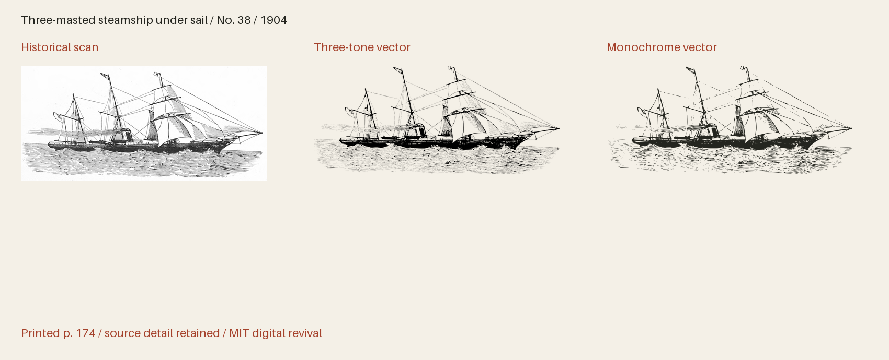

# GPO Cuts 1904

Historical pictorial cuts, seals, ornamental wordmarks, borders, binding ornaments, brass rules and technical signs from Government Printing Office specimens of 1897, 1900 and 1904.



**597 icon(s) · Version 1.001 · Artwork: MIT · Fonts: MIT or SIL OFL 1.1**

[SVG files](svg/) · [SVG sprite](web/icons.svg) · [OTF](fonts/GPOCuts1904-Regular.otf) · [TTF](fonts/GPOCuts1904-Regular.ttf) · [WOFF2](web/GPOCuts1904-Regular.woff2) · [Comparison and size proof](specimens/specimen.pdf) · [Icon manifest](icons.json) · [Changes](CHANGELOG.md)

[Three-tone SVGs](svg/multitone/) · [Three-tone sprite](web/icons-multitone.svg) · [Transparent three-tone PNGs](png/multitone/)

## Use in HTML

[Download all web bundle parts](#web-bundle-parts), unzip it, and place
the extracted `collection` folder beside your HTML file. Keep its subfolders
together. The examples below then work as written; adjust the paths if you move
the folder elsewhere. The bundle contains SVGs, PNGs, fonts, CSS, instructions
and license notices. No JavaScript or font installation is needed for SVG use.

### Three-tone image — works from disk too

The individual SVG displays all three tones at their default strengths, with a
transparent background. Change `height` to resize it; the proportions are retained.

```html

```

An `` has its own colour context: page CSS cannot recolour its internal
regions. For a decorative image beside a text label, use `alt=""` instead.

### Three-tone sprite — customise every tone

Copy `web/icons-multitone.svg` and use the following complete example on an
HTTP(S) page served from the same origin as the sprite. It draws dark primary ink
and two strengths of red. Each colour and opacity can be changed independently.

```html
<style>
  .revival-cut {
    display: inline-block;
    font-size: 96px;
    height: 1em;
    width: 0.941406em;
    vertical-align: middle;
    --fr-primary-color: #24251f;
    --fr-secondary-color: #a5422c;
    --fr-tertiary-color: #a5422c;
    --fr-primary-opacity: 1;
    --fr-secondary-opacity: 0.55;
    --fr-tertiary-opacity: 0.25;
  }
</style>
<svg class="revival-cut" role="img" aria-label="Three-masted steamship under sail">
  <use href="collection/gpo-cuts-1904/web/icons-multitone.svg#gpo-1904-38"></use>
</svg>
```

Use the same secondary and tertiary colour and opacity for a two-tone appearance.
The defaults are primary 100%, secondary 55% and tertiary 25%; these are separate
vector regions, not a gradient. The tone assignments interpret the historical
impression. A transparent PNG of the default tones is also provided.

External SVG sprites can be blocked on `file://` pages. To customise tones on a
page opened from disk, open the individual SVG in a text editor, copy its complete
`<svg>…</svg>` markup into your HTML, and add `class="revival-cut"` to that SVG.
The same CSS above then applies to its inline paths. Keep its `viewBox` and paths.
The gallery itself uses inline SVG so its previews work directly from disk.

### Monochrome icon font

Copy the whole `web/` folder, including CSS and webfonts. Standard icon fonts show
the solid artwork; use the SVG examples above for three-tone artwork.

```html
<link rel="stylesheet" href="collection/gpo-cuts-1904/web/icons.css">
<span class="fr-icon fr-gpo-1904-38" aria-hidden="true"
      style="font-size:96px;color:#a5422c"></span>
<span>Three-masted steamship under sail</span>
```

The example hides a decorative icon from screen readers and supplies visible
text. For an icon that conveys meaning on its own, use `role="img"` and an
`aria-label` instead of `aria-hidden`. Font size and colour use ordinary CSS.

Install the OTF or TTF for desktop use. The manifest lists each icon's Private Use
codepoint and recommended minimum display size. These codepoints are not ordinary
text characters; IDs and codepoints are permanent within this collection.
The example above uses U+E000 and is recommended from
64 px. The 16–192 pt proofs show how detail holds up at different sizes.
Keep the included LICENSE with redistributed assets.

The fonts and editable font source data are available under your choice of the [MIT License](LICENSE) or [SIL Open Font License 1.1](OFL.txt) (`MIT OR OFL-1.1`), with no Reserved Font Names. See [font licensing](FONT-LICENSES.txt) for the scope and notices. Other original project files, including standalone artwork, code and documentation, use MIT.

## Evidence and editing

**Foundry:** U.S. Government Printing Office, Job Room; original cut suppliers not specified

**Designer:** Historical engravers unidentified except for signatures retained in the impressions

**Observed:** Complete historical compositions and measured border components, with repeated and existing-design witnesses recorded individually. Exact native source pages, measured crops and source identification evidence are retained.

**Interpreted or new:** No new pictorial content. Crop selection, noise removal, quarter-turn orientation, curve fitting and font-unit rounding interpret the historical impressions. Three tonal regions interpret scanned ink strength, not separate historical inks. Names, tags, Private Use assignments, bearings and a blank space are new project work.

- [Job room type faces (Government Printing Office, 1904), printed page 174; PDF page 190, Internet Archive leaf 190](https://archive.org/details/123459_1904/page/n190/mode/1up) — 1904 United States historical publication, public domain by age. Scan contributed and sponsored by the U.S. Government Printing Office. The archive metadata note about a title-page copyright is retained; no copyright claim is inferred to survive for this 1904 publication. No modern digital artwork was traced. [Rights basis](https://www.govinfo.gov/app/details/GOVPUB-GP-d2c787aba0ecc03f4689c5244878f48f).
- [Job room type faces (Government Printing Office, 1904), printed page 175; PDF page 191, Internet Archive leaf 191](https://archive.org/details/123459_1904/page/n191/mode/1up) — 1904 United States historical publication, public domain by age. Scan contributed and sponsored by the U.S. Government Printing Office. The archive metadata note about a title-page copyright is retained; no copyright claim is inferred to survive for this 1904 publication. No modern digital artwork was traced. [Rights basis](https://www.govinfo.gov/app/details/GOVPUB-GP-d2c787aba0ecc03f4689c5244878f48f).
- [Job room type faces (Government Printing Office, 1904), printed page 176; PDF page 192, Internet Archive leaf 192](https://archive.org/details/123459_1904/page/n192/mode/1up) — 1904 United States historical publication, public domain by age. Scan contributed and sponsored by the U.S. Government Printing Office. The archive metadata note about a title-page copyright is retained; no copyright claim is inferred to survive for this 1904 publication. No modern digital artwork was traced. [Rights basis](https://www.govinfo.gov/app/details/GOVPUB-GP-d2c787aba0ecc03f4689c5244878f48f).
- [Job room type faces (Government Printing Office, 1904), printed page 177; PDF page 193, Internet Archive leaf 193](https://archive.org/details/123459_1904/page/n193/mode/1up) — 1904 United States historical publication, public domain by age. Scan contributed and sponsored by the U.S. Government Printing Office. The archive metadata note about a title-page copyright is retained; no copyright claim is inferred to survive for this 1904 publication. No modern digital artwork was traced. [Rights basis](https://www.govinfo.gov/app/details/GOVPUB-GP-d2c787aba0ecc03f4689c5244878f48f).
- [Job room type faces (Government Printing Office, 1904), printed page 165; PDF page 181, Internet Archive leaf 181](https://archive.org/details/123459_1904/page/n181/mode/1up) — 1904 United States historical publication, public domain by age. Scan contributed and sponsored by the U.S. Government Printing Office. The archive metadata note about a title-page copyright is retained; no copyright claim is inferred to survive for this 1904 publication. No modern digital artwork was traced. [Rights basis](https://www.govinfo.gov/app/details/GOVPUB-GP-d2c787aba0ecc03f4689c5244878f48f).
- [Job room type faces (Government Printing Office, 1904), printed page 166; PDF page 182, Internet Archive leaf 182](https://archive.org/details/123459_1904/page/n182/mode/1up) — 1904 United States historical publication, public domain by age. Scan contributed and sponsored by the U.S. Government Printing Office. The archive metadata note about a title-page copyright is retained; no copyright claim is inferred to survive for this 1904 publication. No modern digital artwork was traced. [Rights basis](https://www.govinfo.gov/app/details/GOVPUB-GP-d2c787aba0ecc03f4689c5244878f48f).
- [Job room type faces (Government Printing Office, 1904), printed page 167; PDF page 183, Internet Archive leaf 183](https://archive.org/details/123459_1904/page/n183/mode/1up) — 1904 United States historical publication, public domain by age. Scan contributed and sponsored by the U.S. Government Printing Office. The archive metadata note about a title-page copyright is retained; no copyright claim is inferred to survive for this 1904 publication. No modern digital artwork was traced. [Rights basis](https://www.govinfo.gov/app/details/GOVPUB-GP-d2c787aba0ecc03f4689c5244878f48f).
- [Job room type faces (Government Printing Office, 1904), printed page 168; PDF page 184, Internet Archive leaf 184](https://archive.org/details/123459_1904/page/n184/mode/1up) — 1904 United States historical publication, public domain by age. Scan contributed and sponsored by the U.S. Government Printing Office. The archive metadata note about a title-page copyright is retained; no copyright claim is inferred to survive for this 1904 publication. No modern digital artwork was traced. [Rights basis](https://www.govinfo.gov/app/details/GOVPUB-GP-d2c787aba0ecc03f4689c5244878f48f).
- [Job room type faces (Government Printing Office, 1904), printed page 169; PDF page 185, Internet Archive leaf 185](https://archive.org/details/123459_1904/page/n185/mode/1up) — 1904 United States historical publication, public domain by age. Scan contributed and sponsored by the U.S. Government Printing Office. The archive metadata note about a title-page copyright is retained; no copyright claim is inferred to survive for this 1904 publication. No modern digital artwork was traced. [Rights basis](https://www.govinfo.gov/app/details/GOVPUB-GP-d2c787aba0ecc03f4689c5244878f48f).
- [Job room type faces (Government Printing Office, 1904), printed page 170; PDF page 186, Internet Archive leaf 186](https://archive.org/details/123459_1904/page/n186/mode/1up) — 1904 United States historical publication, public domain by age. Scan contributed and sponsored by the U.S. Government Printing Office. The archive metadata note about a title-page copyright is retained; no copyright claim is inferred to survive for this 1904 publication. No modern digital artwork was traced. [Rights basis](https://www.govinfo.gov/app/details/GOVPUB-GP-d2c787aba0ecc03f4689c5244878f48f).
- [Job room type faces (Government Printing Office, 1904), printed page 171; PDF page 187, Internet Archive leaf 187](https://archive.org/details/123459_1904/page/n187/mode/1up) — 1904 United States historical publication, public domain by age. Scan contributed and sponsored by the U.S. Government Printing Office. The archive metadata note about a title-page copyright is retained; no copyright claim is inferred to survive for this 1904 publication. No modern digital artwork was traced. [Rights basis](https://www.govinfo.gov/app/details/GOVPUB-GP-d2c787aba0ecc03f4689c5244878f48f).
- [Job room type faces (Government Printing Office, 1904), printed page 172; PDF page 188, Internet Archive leaf 188](https://archive.org/details/123459_1904/page/n188/mode/1up) — 1904 United States historical publication, public domain by age. Scan contributed and sponsored by the U.S. Government Printing Office. The archive metadata note about a title-page copyright is retained; no copyright claim is inferred to survive for this 1904 publication. No modern digital artwork was traced. [Rights basis](https://www.govinfo.gov/app/details/GOVPUB-GP-d2c787aba0ecc03f4689c5244878f48f).
- [Job room type faces (Government Printing Office, 1904), printed page 173; PDF page 189, Internet Archive leaf 189](https://archive.org/details/123459_1904/page/n189/mode/1up) — 1904 United States historical publication, public domain by age. Scan contributed and sponsored by the U.S. Government Printing Office. The archive metadata note about a title-page copyright is retained; no copyright claim is inferred to survive for this 1904 publication. No modern digital artwork was traced. [Rights basis](https://www.govinfo.gov/app/details/GOVPUB-GP-d2c787aba0ecc03f4689c5244878f48f).
- [Job room type faces (Government Printing Office, 1904), unnumbered frontispiece; PDF page 15, Internet Archive leaf 15](https://archive.org/details/123459_1904/page/n15/mode/1up) — 1904 United States historical publication, public domain by age. Scan contributed and sponsored by the U.S. Government Printing Office. The archive metadata note about a title-page copyright is retained; no copyright claim is inferred to survive for this 1904 publication. No modern digital artwork was traced. [Rights basis](https://www.govinfo.gov/app/details/GOVPUB-GP-d2c787aba0ecc03f4689c5244878f48f).
- [Job room type faces (Government Printing Office, 1904), printed page 160; PDF page 176, Internet Archive leaf 176](https://archive.org/details/123459_1904/page/n176/mode/1up) — 1904 United States historical publication, public domain by age. Scan contributed and sponsored by the U.S. Government Printing Office. The archive metadata note about a title-page copyright is retained; no copyright claim is inferred to survive for this 1904 publication. No modern digital artwork was traced. [Rights basis](https://www.govinfo.gov/app/details/GOVPUB-GP-d2c787aba0ecc03f4689c5244878f48f).
- [Job room type faces (Government Printing Office, 1904), printed page 161; PDF page 177, Internet Archive leaf 177](https://archive.org/details/123459_1904/page/n177/mode/1up) — 1904 United States historical publication, public domain by age. Scan contributed and sponsored by the U.S. Government Printing Office. The archive metadata note about a title-page copyright is retained; no copyright claim is inferred to survive for this 1904 publication. No modern digital artwork was traced. [Rights basis](https://www.govinfo.gov/app/details/GOVPUB-GP-d2c787aba0ecc03f4689c5244878f48f).
- [Job room type faces (Government Printing Office, 1904), printed page 164; PDF page 180, Internet Archive leaf 180](https://archive.org/details/123459_1904/page/n180/mode/1up) — 1904 United States historical publication, public domain by age. Scan contributed and sponsored by the U.S. Government Printing Office. The archive metadata note about a title-page copyright is retained; no copyright claim is inferred to survive for this 1904 publication. No modern digital artwork was traced. [Rights basis](https://www.govinfo.gov/app/details/GOVPUB-GP-d2c787aba0ecc03f4689c5244878f48f).
- [Job room type faces (Government Printing Office,1904), printed page 178; PDF page 194, Internet Archive leaf 194](https://archive.org/details/123459_1904/page/n194/mode/1up) — 1904 United States historical publication, public domain by age. Scan contributed and sponsored by the U.S. Government Printing Office. The archive metadata note about a title-page copyright is retained; no copyright claim is inferred to survive for this 1904 publication. No modern digital artwork was traced. [Rights basis](https://www.govinfo.gov/app/details/GOVPUB-GP-d2c787aba0ecc03f4689c5244878f48f).
- [Job room type faces (Government Printing Office,1904), printed page 179; PDF page 195, Internet Archive leaf 195](https://archive.org/details/123459_1904/page/n195/mode/1up) — 1904 United States historical publication, public domain by age. Scan contributed and sponsored by the U.S. Government Printing Office. The archive metadata note about a title-page copyright is retained; no copyright claim is inferred to survive for this 1904 publication. No modern digital artwork was traced. [Rights basis](https://www.govinfo.gov/app/details/GOVPUB-GP-d2c787aba0ecc03f4689c5244878f48f).
- [Job room type faces (Government Printing Office,1904), printed page 180; PDF page 196, Internet Archive leaf 196](https://archive.org/details/123459_1904/page/n196/mode/1up) — 1904 United States historical publication, public domain by age. Scan contributed and sponsored by the U.S. Government Printing Office. The archive metadata note about a title-page copyright is retained; no copyright claim is inferred to survive for this 1904 publication. No modern digital artwork was traced. [Rights basis](https://www.govinfo.gov/app/details/GOVPUB-GP-d2c787aba0ecc03f4689c5244878f48f).
- [Job room type faces (Government Printing Office,1904), printed page 181; PDF page 197, Internet Archive leaf 197](https://archive.org/details/123459_1904/page/n197/mode/1up) — 1904 United States historical publication, public domain by age. Scan contributed and sponsored by the U.S. Government Printing Office. The archive metadata note about a title-page copyright is retained; no copyright claim is inferred to survive for this 1904 publication. No modern digital artwork was traced. [Rights basis](https://www.govinfo.gov/app/details/GOVPUB-GP-d2c787aba0ecc03f4689c5244878f48f).
- [Job room type faces (Government Printing Office, 1904), printed page 162; PDF page 178, Internet Archive leaf 178](https://archive.org/details/123459_1904/page/n178/mode/1up) — 1904 United States historical publication, public domain by age. Scan contributed and sponsored by the U.S. Government Printing Office. The archive metadata note about a title-page copyright is retained; no copyright claim is inferred to survive for this 1904 publication. No modern digital artwork was traced. [Rights basis](https://www.govinfo.gov/app/details/GOVPUB-GP-d2c787aba0ecc03f4689c5244878f48f).
- [Job room type faces (Government Printing Office, 1904), printed page 163; PDF page 179, Internet Archive leaf 179](https://archive.org/details/123459_1904/page/n179/mode/1up) — 1904 United States historical publication, public domain by age. Scan contributed and sponsored by the U.S. Government Printing Office. The archive metadata note about a title-page copyright is retained; no copyright claim is inferred to survive for this 1904 publication. No modern digital artwork was traced. [Rights basis](https://www.govinfo.gov/app/details/GOVPUB-GP-d2c787aba0ecc03f4689c5244878f48f).
- [Job room type faces (Government Printing Office, 1904), printed page 153; PDF page 169, Internet Archive leaf 169](https://archive.org/details/123459_1904/page/n169/mode/1up) — 1904 United States historical publication, public domain by age. Scan contributed and sponsored by the U.S. Government Printing Office. The archive metadata note about a title-page copyright is retained; no copyright claim is inferred to survive for this 1904 publication. No modern digital artwork was traced. [Rights basis](https://www.govinfo.gov/app/details/GOVPUB-GP-d2c787aba0ecc03f4689c5244878f48f).
- [Job room type faces (Government Printing Office, 1904), printed page 154; PDF page 170, Internet Archive leaf 170](https://archive.org/details/123459_1904/page/n170/mode/1up) — 1904 United States historical publication, public domain by age. Scan contributed and sponsored by the U.S. Government Printing Office. The archive metadata note about a title-page copyright is retained; no copyright claim is inferred to survive for this 1904 publication. No modern digital artwork was traced. [Rights basis](https://www.govinfo.gov/app/details/GOVPUB-GP-d2c787aba0ecc03f4689c5244878f48f).
- [Job room type faces (Government Printing Office, 1904), printed page 155; PDF page 171, Internet Archive leaf 171](https://archive.org/details/123459_1904/page/n171/mode/1up) — 1904 United States historical publication, public domain by age. Scan contributed and sponsored by the U.S. Government Printing Office. The archive metadata note about a title-page copyright is retained; no copyright claim is inferred to survive for this 1904 publication. No modern digital artwork was traced. [Rights basis](https://www.govinfo.gov/app/details/GOVPUB-GP-d2c787aba0ecc03f4689c5244878f48f).
- [Job room type faces (Government Printing Office, 1904), printed page 156; PDF page 172, Internet Archive leaf 172](https://archive.org/details/123459_1904/page/n172/mode/1up) — 1904 United States historical publication, public domain by age. Scan contributed and sponsored by the U.S. Government Printing Office. The archive metadata note about a title-page copyright is retained; no copyright claim is inferred to survive for this 1904 publication. No modern digital artwork was traced. [Rights basis](https://www.govinfo.gov/app/details/GOVPUB-GP-d2c787aba0ecc03f4689c5244878f48f).
- [Job room type faces (Government Printing Office, 1904), printed page 157; PDF page 173, Internet Archive leaf 173](https://archive.org/details/123459_1904/page/n173/mode/1up) — 1904 United States historical publication, public domain by age. Scan contributed and sponsored by the U.S. Government Printing Office. The archive metadata note about a title-page copyright is retained; no copyright claim is inferred to survive for this 1904 publication. No modern digital artwork was traced. [Rights basis](https://www.govinfo.gov/app/details/GOVPUB-GP-d2c787aba0ecc03f4689c5244878f48f).
- [Job room type faces (Government Printing Office, 1904), printed page 158; PDF page 174, Internet Archive leaf 174](https://archive.org/details/123459_1904/page/n174/mode/1up) — 1904 United States historical publication, public domain by age. Scan contributed and sponsored by the U.S. Government Printing Office. The archive metadata note about a title-page copyright is retained; no copyright claim is inferred to survive for this 1904 publication. No modern digital artwork was traced. [Rights basis](https://www.govinfo.gov/app/details/GOVPUB-GP-d2c787aba0ecc03f4689c5244878f48f).
- [Job room type faces (Government Printing Office, 1904), printed page 159; PDF page 175, Internet Archive leaf 175](https://archive.org/details/123459_1904/page/n175/mode/1up) — 1904 United States historical publication, public domain by age. Scan contributed and sponsored by the U.S. Government Printing Office. The archive metadata note about a title-page copyright is retained; no copyright claim is inferred to survive for this 1904 publication. No modern digital artwork was traced. [Rights basis](https://www.govinfo.gov/app/details/GOVPUB-GP-d2c787aba0ecc03f4689c5244878f48f).
- [Specimens of job and display types in use in the Government Printing Office (1897), printed page 91; PDF page 189, Internet Archive leaf 189](https://archive.org/details/specimensofjobdi00unit/page/n189/mode/1up) — 1897 United States Government Printing Office publication; historical artwork is public domain by age. Exact period scan retained; no modern digital artwork traced. [Rights basis](https://archive.org/details/specimensofjobdi00unit).
- [Specimens of job and display types in use in the Government Printing Office (1897), printed page 92; PDF page 191, Internet Archive leaf 191](https://archive.org/details/specimensofjobdi00unit/page/n191/mode/1up) — 1897 United States Government Printing Office publication; historical artwork is public domain by age. Exact period scan retained; no modern digital artwork traced. [Rights basis](https://archive.org/details/specimensofjobdi00unit).
- [Specimens of job and display types in use in the Government Printing Office (1897), printed page 93; PDF page 193, Internet Archive leaf 193](https://archive.org/details/specimensofjobdi00unit/page/n193/mode/1up) — 1897 United States Government Printing Office publication; historical artwork is public domain by age. Exact period scan retained; no modern digital artwork traced. [Rights basis](https://archive.org/details/specimensofjobdi00unit).
- [Job room type faces (Government Printing Office, 1904), printed page 140; PDF page 156, Internet Archive leaf 156](https://archive.org/details/123459_1904/page/n156/mode/1up) — 1904 United States historical publication, public domain by age. Scan contributed and sponsored by the U.S. Government Printing Office. The archive metadata note about a title-page copyright is retained; no copyright claim is inferred to survive for this 1904 publication. No modern digital artwork was traced. [Rights basis](https://www.govinfo.gov/app/details/GOVPUB-GP-d2c787aba0ecc03f4689c5244878f48f).
- [Job room type faces (Government Printing Office, 1904), printed page 141; PDF page 157, Internet Archive leaf 157](https://archive.org/details/123459_1904/page/n157/mode/1up) — 1904 United States historical publication, public domain by age. Scan contributed and sponsored by the U.S. Government Printing Office. The archive metadata note about a title-page copyright is retained; no copyright claim is inferred to survive for this 1904 publication. No modern digital artwork was traced. [Rights basis](https://www.govinfo.gov/app/details/GOVPUB-GP-d2c787aba0ecc03f4689c5244878f48f).
- [Job room type faces (Government Printing Office, 1904), printed page 132; PDF page 148, Internet Archive leaf 148](https://archive.org/details/123459_1904/page/n148/mode/1up) — 1904 United States historical publication, public domain by age. Scan contributed and sponsored by the U.S. Government Printing Office. The archive metadata note about a title-page copyright is retained; no copyright claim is inferred to survive for this 1904 publication. No modern digital artwork was traced. [Rights basis](https://www.govinfo.gov/app/details/GOVPUB-GP-d2c787aba0ecc03f4689c5244878f48f).
- [Job room type faces (Government Printing Office, 1904), printed page 133; PDF page 149, Internet Archive leaf 149](https://archive.org/details/123459_1904/page/n149/mode/1up) — 1904 United States historical publication, public domain by age. Scan contributed and sponsored by the U.S. Government Printing Office. The archive metadata note about a title-page copyright is retained; no copyright claim is inferred to survive for this 1904 publication. No modern digital artwork was traced. [Rights basis](https://www.govinfo.gov/app/details/GOVPUB-GP-d2c787aba0ecc03f4689c5244878f48f).
- [Job room type faces (Government Printing Office, 1904), printed page 134; PDF page 150, Internet Archive leaf 150](https://archive.org/details/123459_1904/page/n150/mode/1up) — 1904 United States historical publication, public domain by age. Scan contributed and sponsored by the U.S. Government Printing Office. The archive metadata note about a title-page copyright is retained; no copyright claim is inferred to survive for this 1904 publication. No modern digital artwork was traced. [Rights basis](https://www.govinfo.gov/app/details/GOVPUB-GP-d2c787aba0ecc03f4689c5244878f48f).
- [Job room type faces (Government Printing Office,1904), printed page135; PDF page151, Internet Archive leaf151](https://archive.org/details/123459_1904/page/n151/mode/1up) — 1904 United States historical publication, public domain by age. Scan contributed and sponsored by the U.S. Government Printing Office. The archive metadata note about a title-page copyright is retained; no copyright claim is inferred to survive for this 1904 publication. No modern digital artwork was traced. [Rights basis](https://www.govinfo.gov/app/details/GOVPUB-GP-d2c787aba0ecc03f4689c5244878f48f).
- [Job room type faces (Government Printing Office,1904), printed page136; PDF page152, Internet Archive leaf152](https://archive.org/details/123459_1904/page/n152/mode/1up) — 1904 United States historical publication, public domain by age. Scan contributed and sponsored by the U.S. Government Printing Office. The archive metadata note about a title-page copyright is retained; no copyright claim is inferred to survive for this 1904 publication. No modern digital artwork was traced. [Rights basis](https://www.govinfo.gov/app/details/GOVPUB-GP-d2c787aba0ecc03f4689c5244878f48f).
- [Job room type faces (Government Printing Office,1904), printed page137; PDF page153, Internet Archive leaf153](https://archive.org/details/123459_1904/page/n153/mode/1up) — 1904 United States historical publication, public domain by age. Scan contributed and sponsored by the U.S. Government Printing Office. The archive metadata note about a title-page copyright is retained; no copyright claim is inferred to survive for this 1904 publication. No modern digital artwork was traced. [Rights basis](https://www.govinfo.gov/app/details/GOVPUB-GP-d2c787aba0ecc03f4689c5244878f48f).
- [Job room type faces (Government Printing Office, 1904), printed page 138; PDF page 154, Internet Archive leaf 154](https://archive.org/details/123459_1904/page/n154/mode/1up) — 1904 United States historical publication, public domain by age. Scan contributed and sponsored by the U.S. Government Printing Office. The archive metadata note about a title-page copyright is retained; no copyright claim is inferred to survive for this 1904 publication. No modern digital artwork was traced. [Rights basis](https://www.govinfo.gov/app/details/GOVPUB-GP-d2c787aba0ecc03f4689c5244878f48f).
- [Job room type faces (Government Printing Office, 1904), printed page 139; PDF page 155, Internet Archive leaf 155](https://archive.org/details/123459_1904/page/n155/mode/1up) — 1904 United States historical publication, public domain by age. Scan contributed and sponsored by the U.S. Government Printing Office. The archive metadata note about a title-page copyright is retained; no copyright claim is inferred to survive for this 1904 publication. No modern digital artwork was traced. [Rights basis](https://www.govinfo.gov/app/details/GOVPUB-GP-d2c787aba0ecc03f4689c5244878f48f).
- [Job room type faces (Government Printing Office,1904), unnumbered; PDF page 13, Internet Archive leaf 13](https://archive.org/details/123459_1904/page/n13/mode/1up) — 1904 United States historical publication, public domain by age. Scan contributed and sponsored by the U.S. Government Printing Office. The archive metadata note about a title-page copyright is retained; no copyright claim is inferred to survive for this 1904 publication. No modern digital artwork was traced. [Rights basis](https://www.govinfo.gov/app/details/GOVPUB-GP-d2c787aba0ecc03f4689c5244878f48f).
- [Job room type faces (Government Printing Office,1904), unnumbered; PDF page 14, Internet Archive leaf 14](https://archive.org/details/123459_1904/page/n14/mode/1up) — 1904 United States historical publication, public domain by age. Scan contributed and sponsored by the U.S. Government Printing Office. The archive metadata note about a title-page copyright is retained; no copyright claim is inferred to survive for this 1904 publication. No modern digital artwork was traced. [Rights basis](https://www.govinfo.gov/app/details/GOVPUB-GP-d2c787aba0ecc03f4689c5244878f48f).
- [Job room type faces (Government Printing Office,1904), unnumbered; PDF page 17, Internet Archive leaf 17](https://archive.org/details/123459_1904/page/n17/mode/1up) — 1904 United States historical publication, public domain by age. Scan contributed and sponsored by the U.S. Government Printing Office. The archive metadata note about a title-page copyright is retained; no copyright claim is inferred to survive for this 1904 publication. No modern digital artwork was traced. [Rights basis](https://www.govinfo.gov/app/details/GOVPUB-GP-d2c787aba0ecc03f4689c5244878f48f).
- [Job room type faces (Government Printing Office,1904), printed page 3; PDF page 19, Internet Archive leaf 19](https://archive.org/details/123459_1904/page/n19/mode/1up) — 1904 United States historical publication, public domain by age. Scan contributed and sponsored by the U.S. Government Printing Office. The archive metadata note about a title-page copyright is retained; no copyright claim is inferred to survive for this 1904 publication. No modern digital artwork was traced. [Rights basis](https://www.govinfo.gov/app/details/GOVPUB-GP-d2c787aba0ecc03f4689c5244878f48f).
- [Job room type faces (Government Printing Office,1904), unnumbered; PDF page 133, Internet Archive leaf 133](https://archive.org/details/123459_1904/page/n133/mode/1up) — 1904 United States historical publication, public domain by age. Scan contributed and sponsored by the U.S. Government Printing Office. The archive metadata note about a title-page copyright is retained; no copyright claim is inferred to survive for this 1904 publication. No modern digital artwork was traced. [Rights basis](https://www.govinfo.gov/app/details/GOVPUB-GP-d2c787aba0ecc03f4689c5244878f48f).
- [Job room type faces (Government Printing Office,1904), unnumbered; PDF page 141, Internet Archive leaf 141](https://archive.org/details/123459_1904/page/n141/mode/1up) — 1904 United States historical publication, public domain by age. Scan contributed and sponsored by the U.S. Government Printing Office. The archive metadata note about a title-page copyright is retained; no copyright claim is inferred to survive for this 1904 publication. No modern digital artwork was traced. [Rights basis](https://www.govinfo.gov/app/details/GOVPUB-GP-d2c787aba0ecc03f4689c5244878f48f).
- [Job room type faces (Government Printing Office,1904), unnumbered; PDF page 147, Internet Archive leaf 147](https://archive.org/details/123459_1904/page/n147/mode/1up) — 1904 United States historical publication, public domain by age. Scan contributed and sponsored by the U.S. Government Printing Office. The archive metadata note about a title-page copyright is retained; no copyright claim is inferred to survive for this 1904 publication. No modern digital artwork was traced. [Rights basis](https://www.govinfo.gov/app/details/GOVPUB-GP-d2c787aba0ecc03f4689c5244878f48f).
- [Job room type faces (Government Printing Office,1904), unnumbered; PDF page 159, Internet Archive leaf 159](https://archive.org/details/123459_1904/page/n159/mode/1up) — 1904 United States historical publication, public domain by age. Scan contributed and sponsored by the U.S. Government Printing Office. The archive metadata note about a title-page copyright is retained; no copyright claim is inferred to survive for this 1904 publication. No modern digital artwork was traced. [Rights basis](https://www.govinfo.gov/app/details/GOVPUB-GP-d2c787aba0ecc03f4689c5244878f48f).
- [Job room type faces (Government Printing Office,1904), unnumbered; PDF page 167, Internet Archive leaf 167](https://archive.org/details/123459_1904/page/n167/mode/1up) — 1904 United States historical publication, public domain by age. Scan contributed and sponsored by the U.S. Government Printing Office. The archive metadata note about a title-page copyright is retained; no copyright claim is inferred to survive for this 1904 publication. No modern digital artwork was traced. [Rights basis](https://www.govinfo.gov/app/details/GOVPUB-GP-d2c787aba0ecc03f4689c5244878f48f).
- [Job room type faces (Government Printing Office, 1904), unnumbered binding cover; PDF page 1, Internet Archive leaf 1](https://archive.org/details/123459_1904/page/n1/mode/1up) — 1904 United States historical publication, public domain by age. Scan contributed and sponsored by the U.S. Government Printing Office. The archive metadata note about a title-page copyright is retained; no copyright claim is inferred to survive for this 1904 publication. No modern digital artwork was traced. [Rights basis](https://www.govinfo.gov/app/details/GOVPUB-GP-d2c787aba0ecc03f4689c5244878f48f).
- [Job room type faces (Government Printing Office, 1904), unnumbered binding cover; PDF page 208, Internet Archive leaf 208](https://archive.org/details/123459_1904/page/n208/mode/1up) — 1904 United States historical publication, public domain by age. Scan contributed and sponsored by the U.S. Government Printing Office. The archive metadata note about a title-page copyright is retained; no copyright claim is inferred to survive for this 1904 publication. No modern digital artwork was traced. [Rights basis](https://www.govinfo.gov/app/details/GOVPUB-GP-d2c787aba0ecc03f4689c5244878f48f).
- [Job room type faces (Government Printing Office, 1904), printed page 15; PDF page 31, Internet Archive leaf 31](https://archive.org/details/123459_1904/page/n31/mode/1up) — 1904 United States historical publication, public domain by age. Scan contributed and sponsored by the U.S. Government Printing Office. The archive metadata note about a title-page copyright is retained; no copyright claim is inferred to survive for this 1904 publication. No modern digital artwork was traced. [Rights basis](https://www.govinfo.gov/app/details/GOVPUB-GP-d2c787aba0ecc03f4689c5244878f48f).
- [Job room type faces (Government Printing Office, 1904), printed page 17; PDF page 33, Internet Archive leaf 33](https://archive.org/details/123459_1904/page/n33/mode/1up) — 1904 United States historical publication, public domain by age. Scan contributed and sponsored by the U.S. Government Printing Office. The archive metadata note about a title-page copyright is retained; no copyright claim is inferred to survive for this 1904 publication. No modern digital artwork was traced. [Rights basis](https://www.govinfo.gov/app/details/GOVPUB-GP-d2c787aba0ecc03f4689c5244878f48f).
- [Job room type faces (Government Printing Office, 1904), printed page 19; PDF page 35, Internet Archive leaf 35](https://archive.org/details/123459_1904/page/n35/mode/1up) — 1904 United States historical publication, public domain by age. Scan contributed and sponsored by the U.S. Government Printing Office. The archive metadata note about a title-page copyright is retained; no copyright claim is inferred to survive for this 1904 publication. No modern digital artwork was traced. [Rights basis](https://www.govinfo.gov/app/details/GOVPUB-GP-d2c787aba0ecc03f4689c5244878f48f).
- [Job room type faces (Government Printing Office, 1904), printed page 18; PDF page 34, Internet Archive leaf 34](https://archive.org/details/123459_1904/page/n34/mode/1up) — 1904 United States historical publication, public domain by age. Scan contributed and sponsored by the U.S. Government Printing Office. The archive metadata note about a title-page copyright is retained; no copyright claim is inferred to survive for this 1904 publication. No modern digital artwork was traced. [Rights basis](https://www.govinfo.gov/app/details/GOVPUB-GP-d2c787aba0ecc03f4689c5244878f48f).
- [Specimen book of type, document divisions, Government Printing Office (1904), mathematical, commercial and other signs, printed page53; Internet Archive leaf111 and PDF page111](https://archive.org/details/specimenbookofty00unit_0/page/n111/mode/1up) — United States Government Printing Office historical publication,1904. Public domain by age. Native historical printing is retained; no modern digital font or illustration was traced. [Rights basis](https://archive.org/metadata/specimenbookofty00unit_0).
- [Job room type faces (Government Printing Office, 1904), brass rule, printed page 16; PDF page 32, Internet Archive leaf 32](https://archive.org/details/123459_1904/page/n32/mode/1up) — 1904 United States historical publication, public domain by age. Scan contributed and sponsored by the U.S. Government Printing Office. The archive metadata note about a title-page copyright is retained; no copyright claim is inferred to survive for this 1904 publication. No modern digital artwork was traced. [Rights basis](https://www.govinfo.gov/app/details/GOVPUB-GP-d2c787aba0ecc03f4689c5244878f48f).
- [Specimens of job and display types in use in the Government Printing Office (1897), brass rules, printed page 80; PDF page 167, Internet Archive leaf 167](https://archive.org/details/specimensofjobdi00unit/page/n167/mode/1up) — 1897 United States Government Printing Office publication; historical artwork is public domain by age. Exact period scan retained; no modern digital artwork traced. [Rights basis](https://archive.org/details/specimensofjobdi00unit).
- [Specimens of type faces, brass rule, etc., Census Printing Division (1900), rules and leaders; printed page 28, Internet Archive leaf 57](https://archive.org/details/specimensoftypef00unit_0/page/n57/mode/1up) — Historical United States Government Printing Office publication, 1900. Public domain by age. Exact original printing is retained as comparison evidence; no modern digital drawing or font was traced. [Rights basis](https://archive.org/metadata/specimensoftypef00unit_0).
- [Specimens of type faces, brass rule, etc., Census Printing Division (1900), rules and leaders; printed page 29, Internet Archive leaf 59](https://archive.org/details/specimensoftypef00unit_0/page/n59/mode/1up) — Historical United States Government Printing Office publication, 1900. Public domain by age. Exact original printing is retained as comparison evidence; no modern digital drawing or font was traced. [Rights basis](https://archive.org/metadata/specimensoftypef00unit_0).
- [Specimen book of the type faces in use in the Government Printing Office (1904), Document Division, brass rules and ornamental dashes; printed page 66, Internet Archive leaf 137](https://archive.org/details/specimenbookofty00unit_0/page/n137/mode/1up) — Historical United States Government Printing Office publication, 1904. Public domain by age. Retained historical printing is used as comparison evidence; no modern digital font or drawing was traced. [Rights basis](https://archive.org/metadata/specimenbookofty00unit_0).
- [Specimen book of the type faces in use in the Government Printing Office (1904), Document Division, unnumbered leaf wreath below Celtic type specimens; printed page40, Internet Archive leaf85](https://archive.org/details/specimenbookofty00unit_0/page/n85/mode/1up) — Historical United States Government Printing Office publication,1904. Public domain by age. Only the historical impression was traced; no modern digital font or artwork was used. [Rights basis](https://archive.org/metadata/specimenbookofty00unit_0).
- [Job room type faces (1904), Celtic No. 2 business-card composition and four plain rules; printed page 39, PDF page 55, archive leaf 55](https://archive.org/details/123459_1904/page/n55/mode/1up) — 1904 United States publication, public domain by age. Historical native scan retained for comparison; no modern digital typeface used. [Rights basis](https://archive.org/metadata/123459_1904).
- [A specimen of printing types, and ornaments cast in the letter-foundry of George Bruce (1828), unnumbered PDF page 255, No.452](https://hdl.handle.net/2027/nyp.33433006349736) — 1828 United States publication; historical artwork is public domain by age. New York Public Library copy digitized by Google, distributed by HathiTrust and mirrored by Circuitous Root. A faithful scan of the historical page, not a modern digital typeface. [Rights basis](https://circuitousroot.com/artifice/letters/press/noncomptype/typography/bruce/index.html).

Copyright (c) 2026 Harold Lehmann. Historical public-domain material retains its status.
Read [the method](source/METHOD.md), [inventory](source/inventory.json) and
[icon workflow](../../docs/ICONS.md). The canonical master is `source/font.ttx`;
SVGs, sprite, fonts and manifests are generated from it with glyph edits applied.

```sh
python scripts/fontrevival.py build gpo-cuts-1904
python scripts/fontrevival.py sizecheck gpo-cuts-1904
python scripts/fontrevival.py check gpo-cuts-1904
python scripts/fontrevival.py glyph gpo-cuts-1904 uniE000
```

## Sprite files

The sprites span numbered SVG files in `web/`. Each icon’s manifest entry and gallery example names the file containing it. Keep all sprite files together when distributing the collection.

## Detailed engravings and font limits

SVG and the editable CFF master retain the full outlines. The OTF, TTF and webfonts use reviewed approximations for outlines exceeding font renderer limits. Their measurements and master fingerprints are recorded in `source/truetype-glyphs/`; see `source/METHOD.md` for display-size review.

## Web bundle parts

Download every part and extract them into the same folder.

- [ZIP part 1](downloads/gpo-cuts-1904-web.zip) — 89.3 MB
- [ZIP part 2](downloads/gpo-cuts-1904-web-2.zip) — 84.8 MB
- [ZIP part 3](downloads/gpo-cuts-1904-web-3.zip) — 9.8 MB
