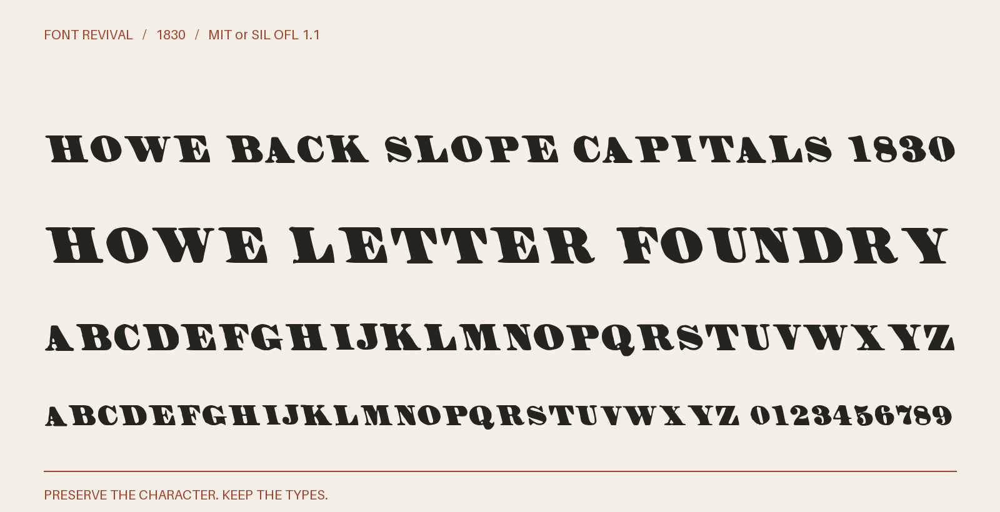

# Howe Back Slope Capitals 1830

Back Slope Capitals titling capitals and figures from the 1830 J. Howe & Co. specimen.



**1830 · Regular · Version 1.000 · 74 characters · Capitals only · MIT or SIL OFL 1.1**

[OTF](fonts/HoweBackSlopeCapitals1830-Regular.otf) · [TTF](fonts/HoweBackSlopeCapitals1830-Regular.ttf) · [WOFF2](web/HoweBackSlopeCapitals1830-Regular.woff2) · [PDF specimen](specimens/specimen.pdf) · [Changes](CHANGELOG.md)

## Use

Install either desktop format. For websites, copy `web/`, include `font.css`,
and use `font-family: "Howe Back Slope Capitals 1830"`. Designed for display sizes.

## Design

**Designer:** Unidentified in the historical specimen

**Foundry:** J. Howe & Co., Philadelphia

**Observed:** Complete A–Z capital alphabet, figures 0–9 dollar sign and printed punctuation &,.-;:’! directly sampled from Two Lines Pearl Back Slope, unnumbered PDF page 117 (archive leaf 117).

**Reconstructed:** No inferred visible characters. Lowercase input aliases the capitals; ASCII apostrophe aliases the observed closing apostrophe. Word space, metrics and digital spacing are new. The historical source-size label identifies the supplying impression; the font is freely scalable.

## Sources

1. [Specimen of printing types and ornaments, J. Howe & Co. (1830), Two Lines Pearl Back Slope, unnumbered PDF page 117](https://archive.org/details/specimenofprinti00jhow/page/n117/mode/1up) — 1830 US publication, public domain by age. Library of Congress scan; the retained archive record states that the Library is unaware of copyright restrictions. [Rights basis](https://archive.org/details/specimenofprinti00jhow).

Source images are in `reference/`; the source record is [font.json](font.json).
Historical reference material retains the rights status recorded there.
Copyright (c) 2026 Harold Lehmann. The fonts and editable font source data are available under your choice of the [MIT License](LICENSE) or [SIL Open Font License 1.1](OFL.txt) (`MIT OR OFL-1.1`), with no Reserved Font Names. See [font licensing](FONT-LICENSES.txt) for the scope and notices. Other original project files, including standalone artwork, code and documentation, use MIT.

## Build or improve

From the repository root:

```sh
python scripts/fontrevival.py build howe-back-slope-capitals-1830
python scripts/fontrevival.py check howe-back-slope-capitals-1830
```

Edit `source/font.ttx` or export an individual glyph with
`python scripts/fontrevival.py glyph howe-back-slope-capitals-1830 j`.
Follow the shared [revival workflow](../../docs/WORKFLOW.md) for additions and revisions.
