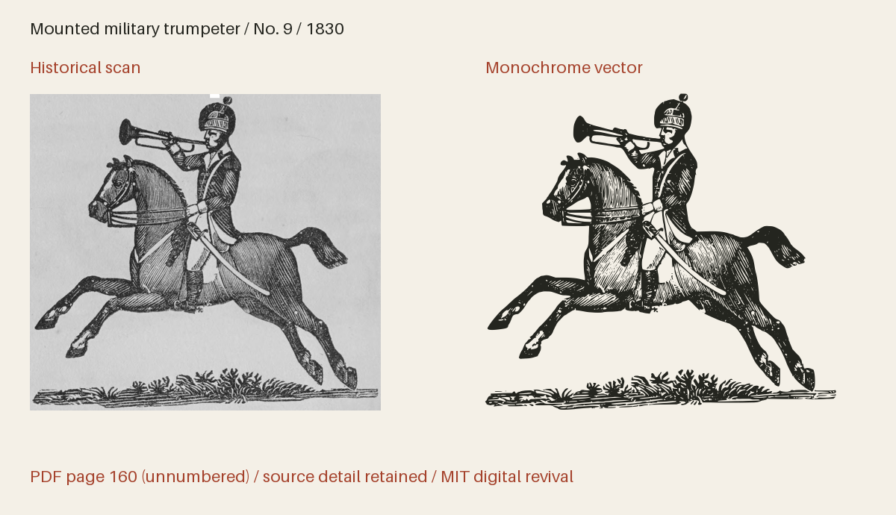

# Howe Cuts 1830

187 distinct pictorial and emblematic cuts from J. Howe & Co.’s 1830 Philadelphia specimen.



**187 icon(s) · Version 1.000 · Artwork: MIT · Fonts: MIT or SIL OFL 1.1**

[SVG files](svg/) · [SVG sprite](web/icons.svg) · [OTF](fonts/HoweCuts1830-Regular.otf) · [TTF](fonts/HoweCuts1830-Regular.ttf) · [WOFF2](web/HoweCuts1830-Regular.woff2) · [Comparison and size proof](specimens/specimen.pdf) · [Icon manifest](icons.json) · [Changes](CHANGELOG.md)


## Use in HTML

[Download the web bundle (ZIP)](downloads/howe-cuts-1830-web.zip), unzip it, and place
the extracted `collection` folder beside your HTML file. Keep its subfolders
together. The examples below then work as written; adjust the paths if you move
the folder elsewhere. The bundle contains SVGs, PNGs, fonts, CSS, instructions
and license notices. No JavaScript or font installation is needed for SVG use.

### Three-tone image — works from disk too

The individual SVG displays all three tones at their default strengths, with a
transparent background. Change `height` to resize it; the proportions are retained.

```html

```

An `` has its own colour context: page CSS cannot recolour its internal
regions. For a decorative image beside a text label, use `alt=""` instead.

### Three-tone sprite — customise every tone

Copy `web/icons-multitone.svg` and use the following complete example on an
HTTP(S) page served from the same origin as the sprite. It draws dark primary ink
and two strengths of red. Each colour and opacity can be changed independently.

```html
<style>
  .revival-cut {
    display: inline-block;
    font-size: 96px;
    height: 1em;
    width: 0.941406em;
    vertical-align: middle;
    --fr-primary-color: #24251f;
    --fr-secondary-color: #a5422c;
    --fr-tertiary-color: #a5422c;
    --fr-primary-opacity: 1;
    --fr-secondary-opacity: 0.55;
    --fr-tertiary-opacity: 0.25;
  }
</style>
<svg class="revival-cut" role="img" aria-label="Mounted military trumpeter">
  <use href="collection/howe-cuts-1830/web/icons.svg#howe-1830-p160-metal-9"></use>
</svg>
```

Use the same secondary and tertiary colour and opacity for a two-tone appearance.
The defaults are primary 100%, secondary 55% and tertiary 25%; these are separate
vector regions, not a gradient. The tone assignments interpret the historical
impression. A transparent PNG of the default tones is also provided.

External SVG sprites can be blocked on `file://` pages. To customise tones on a
page opened from disk, open the individual SVG in a text editor, copy its complete
`<svg>…</svg>` markup into your HTML, and add `class="revival-cut"` to that SVG.
The same CSS above then applies to its inline paths. Keep its `viewBox` and paths.
The gallery itself uses inline SVG so its previews work directly from disk.

### Monochrome icon font

Copy the whole `web/` folder, including CSS and webfonts. Standard icon fonts show
the solid artwork; use the SVG examples above for three-tone artwork.

```html
<link rel="stylesheet" href="collection/howe-cuts-1830/web/icons.css">
<span class="fr-icon fr-howe-1830-p160-metal-9" aria-hidden="true"
      style="font-size:96px;color:#a5422c"></span>
<span>Mounted military trumpeter</span>
```

The example hides a decorative icon from screen readers and supplies visible
text. For an icon that conveys meaning on its own, use `role="img"` and an
`aria-label` instead of `aria-hidden`. Font size and colour use ordinary CSS.

Install the OTF or TTF for desktop use. The manifest lists each icon's Private Use
codepoint and recommended minimum display size. These codepoints are not ordinary
text characters; IDs and codepoints are permanent within this collection.
The example above uses U+E000 and is recommended from
64 px. The 16–192 pt proofs show how detail holds up at different sizes.
Keep the included LICENSE with redistributed assets.

The fonts and editable font source data are available under your choice of the [MIT License](LICENSE) or [SIL Open Font License 1.1](OFL.txt) (`MIT OR OFL-1.1`), with no Reserved Font Names. See [font licensing](FONT-LICENSES.txt) for the scope and notices. Other original project files, including standalone artwork, code and documentation, use MIT.

## Evidence and editing

**Foundry:** J. Howe & Co., Philadelphia

**Designer:** Individual engravers generally unidentified; several cuts are signed Gilbert, and No. 453 is signed Anderson P.

**Observed:** Complete distinct historical cuts. Repeated designs and source impressions are identified in the source inventory.

**Interpreted or new:** No invented ornamental content. Recorded crop cleanup excludes neighbouring numbers and isolated scan specks. Measured rigid rotations straighten tilted impressions; uniform scaling preserves proportions.

- [Specimen of printing types and ornaments, J. Howe & Co. (1830), unpaginated PDF page 160, archive leaf 160](https://archive.org/details/specimenofprinti00jhow/page/n160/mode/1up) — 1830 US publication, public domain by age. Library of Congress scan; the retained archive record states that the Library is unaware of copyright restrictions. [Rights basis](https://archive.org/details/specimenofprinti00jhow).
- [Specimen of printing types and ornaments, J. Howe & Co. (1830), unpaginated PDF page 162, archive leaf 162](https://archive.org/details/specimenofprinti00jhow/page/n162/mode/1up) — 1830 US publication, public domain by age. Library of Congress scan; the retained archive record states that the Library is unaware of copyright restrictions. [Rights basis](https://archive.org/details/specimenofprinti00jhow).
- [Specimen of printing types and ornaments, J. Howe & Co. (1830), unpaginated PDF page 164, archive leaf 164](https://archive.org/details/specimenofprinti00jhow/page/n164/mode/1up) — 1830 US publication, public domain by age. Library of Congress scan; the retained archive record states that the Library is unaware of copyright restrictions. [Rights basis](https://archive.org/details/specimenofprinti00jhow).
- [Specimen of printing types and ornaments, J. Howe & Co. (1830), unpaginated PDF page 170, archive leaf 170](https://archive.org/details/specimenofprinti00jhow/page/n170/mode/1up) — 1830 US publication, public domain by age. Library of Congress scan; the retained archive record states that the Library is unaware of copyright restrictions. [Rights basis](https://archive.org/details/specimenofprinti00jhow).
- [Specimen of printing types and ornaments, J. Howe & Co. (1830), unpaginated PDF page 172, archive leaf 172](https://archive.org/details/specimenofprinti00jhow/page/n172/mode/1up) — 1830 US publication, public domain by age. Library of Congress scan; the retained archive record states that the Library is unaware of copyright restrictions. [Rights basis](https://archive.org/details/specimenofprinti00jhow).
- [Specimen of printing types and ornaments, J. Howe & Co. (1830), unpaginated PDF page 190, archive leaf 190](https://archive.org/details/specimenofprinti00jhow/page/n190/mode/1up) — 1830 US publication, public domain by age. Library of Congress scan; the retained archive record states that the Library is unaware of copyright restrictions. [Rights basis](https://archive.org/details/specimenofprinti00jhow).
- [Specimen of printing types and ornaments, J. Howe & Co. (1830), unpaginated PDF page 202, archive leaf 202](https://archive.org/details/specimenofprinti00jhow/page/n202/mode/1up) — 1830 US publication, public domain by age. Library of Congress scan; the retained archive record states that the Library is unaware of copyright restrictions. [Rights basis](https://archive.org/details/specimenofprinti00jhow).
- [Specimen of printing types and ornaments, J. Howe & Co. (1830), unpaginated PDF page 206, archive leaf 206](https://archive.org/details/specimenofprinti00jhow/page/n206/mode/1up) — 1830 US publication, public domain by age. Library of Congress scan; the retained archive record states that the Library is unaware of copyright restrictions. [Rights basis](https://archive.org/details/specimenofprinti00jhow).
- [Specimen of printing types and ornaments, J. Howe & Co. (1830), unpaginated PDF page 210, archive leaf 210](https://archive.org/details/specimenofprinti00jhow/page/n210/mode/1up) — 1830 US publication, public domain by age. Library of Congress scan; the retained archive record states that the Library is unaware of copyright restrictions. [Rights basis](https://archive.org/details/specimenofprinti00jhow).
- [Specimen of printing types and ornaments, J. Howe & Co. (1830), unpaginated PDF page 212, archive leaf 212](https://archive.org/details/specimenofprinti00jhow/page/n212/mode/1up) — 1830 US publication, public domain by age. Library of Congress scan; the retained archive record states that the Library is unaware of copyright restrictions. [Rights basis](https://archive.org/details/specimenofprinti00jhow).
- [Specimen of printing types and ornaments, J. Howe & Co. (1830), unpaginated PDF page 216, archive leaf 216](https://archive.org/details/specimenofprinti00jhow/page/n216/mode/1up) — 1830 US publication, public domain by age. Library of Congress scan; the retained archive record states that the Library is unaware of copyright restrictions. [Rights basis](https://archive.org/details/specimenofprinti00jhow).
- [Specimen of printing types and ornaments, J. Howe & Co. (1830), unpaginated PDF page 218, archive leaf 218](https://archive.org/details/specimenofprinti00jhow/page/n218/mode/1up) — 1830 US publication, public domain by age. Library of Congress scan; the retained archive record states that the Library is unaware of copyright restrictions. [Rights basis](https://archive.org/details/specimenofprinti00jhow).
- [Specimen of printing types and ornaments, J. Howe & Co. (1830), unpaginated PDF page 220, archive leaf 220](https://archive.org/details/specimenofprinti00jhow/page/n220/mode/1up) — 1830 US publication, public domain by age. Library of Congress scan; the retained archive record states that the Library is unaware of copyright restrictions. [Rights basis](https://archive.org/details/specimenofprinti00jhow).
- [Specimen of printing types and ornaments, J. Howe & Co. (1830), unpaginated PDF page 224, archive leaf 224](https://archive.org/details/specimenofprinti00jhow/page/n224/mode/1up) — 1830 US publication, public domain by age. Library of Congress scan; the retained archive record states that the Library is unaware of copyright restrictions. [Rights basis](https://archive.org/details/specimenofprinti00jhow).
- [Specimen of printing types and ornaments, J. Howe & Co. (1830), unpaginated PDF page 226, archive leaf 226](https://archive.org/details/specimenofprinti00jhow/page/n226/mode/1up) — 1830 US publication, public domain by age. Library of Congress scan; the retained archive record states that the Library is unaware of copyright restrictions. [Rights basis](https://archive.org/details/specimenofprinti00jhow).
- [Specimen of printing types and ornaments, J. Howe & Co. (1830), unpaginated PDF page 228, archive leaf 228](https://archive.org/details/specimenofprinti00jhow/page/n228/mode/1up) — 1830 US publication, public domain by age. Library of Congress scan; the retained archive record states that the Library is unaware of copyright restrictions. [Rights basis](https://archive.org/details/specimenofprinti00jhow).
- [Specimen of printing types and ornaments, J. Howe & Co. (1830), unpaginated PDF page 230, archive leaf 230](https://archive.org/details/specimenofprinti00jhow/page/n230/mode/1up) — 1830 US publication, public domain by age. Library of Congress scan; the retained archive record states that the Library is unaware of copyright restrictions. [Rights basis](https://archive.org/details/specimenofprinti00jhow).
- [Specimen of printing types and ornaments, J. Howe & Co. (1830), unpaginated PDF page 232, archive leaf 232](https://archive.org/details/specimenofprinti00jhow/page/n232/mode/1up) — 1830 US publication, public domain by age. Library of Congress scan; the retained archive record states that the Library is unaware of copyright restrictions. [Rights basis](https://archive.org/details/specimenofprinti00jhow).
- [Specimen of printing types and ornaments, J. Howe & Co. (1830), unpaginated PDF page 234, archive leaf 234](https://archive.org/details/specimenofprinti00jhow/page/n234/mode/1up) — 1830 US publication, public domain by age. Library of Congress scan; the retained archive record states that the Library is unaware of copyright restrictions. [Rights basis](https://archive.org/details/specimenofprinti00jhow).
- [Specimen of printing types and ornaments, J. Howe & Co. (1830), unpaginated PDF page 236, archive leaf 236](https://archive.org/details/specimenofprinti00jhow/page/n236/mode/1up) — 1830 US publication, public domain by age. Library of Congress scan; the retained archive record states that the Library is unaware of copyright restrictions. [Rights basis](https://archive.org/details/specimenofprinti00jhow).
- [Specimen of printing types and ornaments, J. Howe & Co. (1830), unpaginated PDF page 240, archive leaf 240](https://archive.org/details/specimenofprinti00jhow/page/n240/mode/1up) — 1830 US publication, public domain by age. Library of Congress scan; the retained archive record states that the Library is unaware of copyright restrictions. [Rights basis](https://archive.org/details/specimenofprinti00jhow).
- [Specimen of printing types and ornaments, J. Howe & Co. (1830), unpaginated PDF page 242, archive leaf 242](https://archive.org/details/specimenofprinti00jhow/page/n242/mode/1up) — 1830 US publication, public domain by age. Library of Congress scan; the retained archive record states that the Library is unaware of copyright restrictions. [Rights basis](https://archive.org/details/specimenofprinti00jhow).
- [Specimen of printing types and ornaments, J. Howe & Co. (1830), unpaginated PDF page 244, archive leaf 244](https://archive.org/details/specimenofprinti00jhow/page/n244/mode/1up) — 1830 US publication, public domain by age. Library of Congress scan; the retained archive record states that the Library is unaware of copyright restrictions. [Rights basis](https://archive.org/details/specimenofprinti00jhow).
- [Specimen of printing types and ornaments, J. Howe & Co. (1830), unpaginated PDF page 246, archive leaf 246](https://archive.org/details/specimenofprinti00jhow/page/n246/mode/1up) — 1830 US publication, public domain by age. Library of Congress scan; the retained archive record states that the Library is unaware of copyright restrictions. [Rights basis](https://archive.org/details/specimenofprinti00jhow).
- [Specimen of printing types and ornaments, J. Howe & Co. (1830), unpaginated PDF page 248, archive leaf 248](https://archive.org/details/specimenofprinti00jhow/page/n248/mode/1up) — 1830 US publication, public domain by age. Library of Congress scan; the retained archive record states that the Library is unaware of copyright restrictions. [Rights basis](https://archive.org/details/specimenofprinti00jhow).
- [Specimen of printing types and ornaments, J. Howe & Co. (1830), unpaginated PDF page 250, archive leaf 250](https://archive.org/details/specimenofprinti00jhow/page/n250/mode/1up) — 1830 US publication, public domain by age. Library of Congress scan; the retained archive record states that the Library is unaware of copyright restrictions. [Rights basis](https://archive.org/details/specimenofprinti00jhow).
- [Specimen of printing types and ornaments, J. Howe & Co. (1830), unpaginated PDF page 252, archive leaf 252](https://archive.org/details/specimenofprinti00jhow/page/n252/mode/1up) — 1830 US publication, public domain by age. Library of Congress scan; the retained archive record states that the Library is unaware of copyright restrictions. [Rights basis](https://archive.org/details/specimenofprinti00jhow).
- [Specimen of printing types and ornaments, J. Howe & Co. (1830), unpaginated PDF page 254, archive leaf 254](https://archive.org/details/specimenofprinti00jhow/page/n254/mode/1up) — 1830 US publication, public domain by age. Library of Congress scan; the retained archive record states that the Library is unaware of copyright restrictions. [Rights basis](https://archive.org/details/specimenofprinti00jhow).
- [Specimen of printing types and ornaments, J. Howe & Co. (1830), unpaginated PDF page 256, archive leaf 256](https://archive.org/details/specimenofprinti00jhow/page/n256/mode/1up) — 1830 US publication, public domain by age. Library of Congress scan; the retained archive record states that the Library is unaware of copyright restrictions. [Rights basis](https://archive.org/details/specimenofprinti00jhow).
- [Specimen of printing types and ornaments, J. Howe & Co. (1830), unpaginated PDF page 258, archive leaf 258](https://archive.org/details/specimenofprinti00jhow/page/n258/mode/1up) — 1830 US publication, public domain by age. Library of Congress scan; the retained archive record states that the Library is unaware of copyright restrictions. [Rights basis](https://archive.org/details/specimenofprinti00jhow).
- [Specimen of printing types and ornaments, J. Howe & Co. (1830), unpaginated PDF page 260, archive leaf 260](https://archive.org/details/specimenofprinti00jhow/page/n260/mode/1up) — 1830 US publication, public domain by age. Library of Congress scan; the retained archive record states that the Library is unaware of copyright restrictions. [Rights basis](https://archive.org/details/specimenofprinti00jhow).
- [Specimen of printing types and ornaments, J. Howe & Co. (1830), unpaginated PDF page 262, archive leaf 262](https://archive.org/details/specimenofprinti00jhow/page/n262/mode/1up) — 1830 US publication, public domain by age. Library of Congress scan; the retained archive record states that the Library is unaware of copyright restrictions. [Rights basis](https://archive.org/details/specimenofprinti00jhow).
- [Specimen of printing types and ornaments, J. Howe & Co. (1830), unpaginated PDF page 264, archive leaf 264](https://archive.org/details/specimenofprinti00jhow/page/n264/mode/1up) — 1830 US publication, public domain by age. Library of Congress scan; the retained archive record states that the Library is unaware of copyright restrictions. [Rights basis](https://archive.org/details/specimenofprinti00jhow).
- [Specimen of printing types and ornaments, J. Howe & Co. (1830), unpaginated PDF page 266, archive leaf 266](https://archive.org/details/specimenofprinti00jhow/page/n266/mode/1up) — 1830 US publication, public domain by age. Library of Congress scan; the retained archive record states that the Library is unaware of copyright restrictions. [Rights basis](https://archive.org/details/specimenofprinti00jhow).
- [Specimen of printing types and ornaments, J. Howe & Co. (1830), unpaginated PDF page 268, archive leaf 268](https://archive.org/details/specimenofprinti00jhow/page/n268/mode/1up) — 1830 US publication, public domain by age. Library of Congress scan; the retained archive record states that the Library is unaware of copyright restrictions. [Rights basis](https://archive.org/details/specimenofprinti00jhow).
- [Specimen of printing types and ornaments, J. Howe & Co. (1830), unpaginated PDF page 270, archive leaf 270](https://archive.org/details/specimenofprinti00jhow/page/n270/mode/1up) — 1830 US publication, public domain by age. Library of Congress scan; the retained archive record states that the Library is unaware of copyright restrictions. [Rights basis](https://archive.org/details/specimenofprinti00jhow).
- [Specimen of printing types and ornaments, J. Howe & Co. (1830), unpaginated PDF page 272, archive leaf 272](https://archive.org/details/specimenofprinti00jhow/page/n272/mode/1up) — 1830 US publication, public domain by age. Library of Congress scan; the retained archive record states that the Library is unaware of copyright restrictions. [Rights basis](https://archive.org/details/specimenofprinti00jhow).
- [Specimen of printing types and ornaments, J. Howe & Co. (1830), unpaginated PDF page 274, archive leaf 274](https://archive.org/details/specimenofprinti00jhow/page/n274/mode/1up) — 1830 US publication, public domain by age. Library of Congress scan; the retained archive record states that the Library is unaware of copyright restrictions. [Rights basis](https://archive.org/details/specimenofprinti00jhow).
- [Specimen of printing types and ornaments, J. Howe & Co. (1830), unpaginated PDF page 276, archive leaf 276](https://archive.org/details/specimenofprinti00jhow/page/n276/mode/1up) — 1830 US publication, public domain by age. Library of Congress scan; the retained archive record states that the Library is unaware of copyright restrictions. [Rights basis](https://archive.org/details/specimenofprinti00jhow).
- [Specimen of printing types and ornaments, J. Howe & Co. (1830), unpaginated PDF page 278, archive leaf 278](https://archive.org/details/specimenofprinti00jhow/page/n278/mode/1up) — 1830 US publication, public domain by age. Library of Congress scan; the retained archive record states that the Library is unaware of copyright restrictions. [Rights basis](https://archive.org/details/specimenofprinti00jhow).
- [Specimen of printing types and ornaments, J. Howe & Co. (1830), unpaginated PDF page 289, archive leaf 289](https://archive.org/details/specimenofprinti00jhow/page/n289/mode/1up) — 1830 US publication, public domain by age. Library of Congress scan; the retained archive record states that the Library is unaware of copyright restrictions. [Rights basis](https://archive.org/details/specimenofprinti00jhow).

Copyright (c) 2026 Harold Lehmann. Historical public-domain material retains its status.
Read [the method](source/METHOD.md), [inventory](source/inventory.json) and
[icon workflow](../../docs/ICONS.md). The canonical master is `source/font.ttx`;
SVGs, sprite, fonts and manifests are generated from it with glyph edits applied.

```sh
python scripts/fontrevival.py build howe-cuts-1830
python scripts/fontrevival.py sizecheck howe-cuts-1830
python scripts/fontrevival.py check howe-cuts-1830
python scripts/fontrevival.py glyph howe-cuts-1830 uniE000
```

## Sprite files

The sprites span numbered SVG files in `web/`. Each icon’s manifest entry and gallery example names the file containing it. Keep all sprite files together when distributing the collection.

## Detailed icon fonts

The densest engravings use default OpenType `ccmp` shaping to assemble registered outline pieces. Each icon keeps one character code and its original advance width. This retains fine engraved detail while keeping each piece within renderer limits. Keep OpenType shaping enabled. Software that draws glyphs without shaping uses a simplified compatibility outline; use the SVG for full detail in those applications. The source manifest records each piece and the canonical drawing it belongs to.
