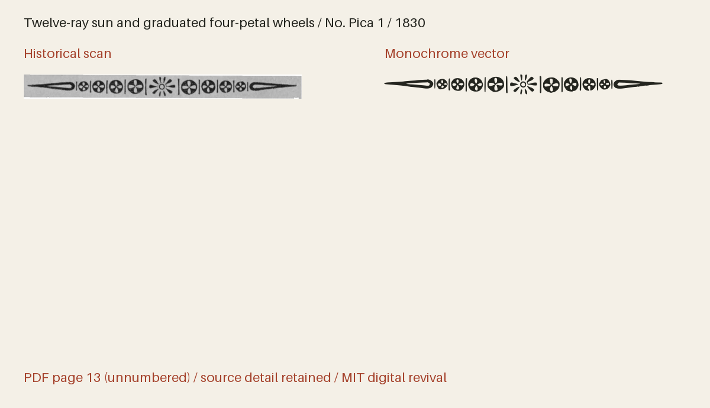

# Howe Ornaments 1830

96 distinct dashes, border pieces, frames and ornaments from J. Howe & Co.’s 1830 Philadelphia specimen.



**96 icon(s) · Version 1.000 · Artwork: MIT · Fonts: MIT or SIL OFL 1.1**

[SVG files](svg/) · [SVG sprite](web/icons.svg) · [OTF](fonts/HoweOrnaments1830-Regular.otf) · [TTF](fonts/HoweOrnaments1830-Regular.ttf) · [WOFF2](web/HoweOrnaments1830-Regular.woff2) · [Comparison and size proof](specimens/specimen.pdf) · [Icon manifest](icons.json) · [Changes](CHANGELOG.md)


## Use in HTML

[Download the web bundle (ZIP)](downloads/howe-ornaments-1830-web.zip), unzip it, and place
the extracted `collection` folder beside your HTML file. Keep its subfolders
together. The examples below then work as written; adjust the paths if you move
the folder elsewhere. The bundle contains SVGs, PNGs, fonts, CSS, instructions
and license notices. No JavaScript or font installation is needed for SVG use.

### Three-tone image — works from disk too

The individual SVG displays all three tones at their default strengths, with a
transparent background. Change `height` to resize it; the proportions are retained.

```html

```

An `` has its own colour context: page CSS cannot recolour its internal
regions. For a decorative image beside a text label, use `alt=""` instead.

### Three-tone sprite — customise every tone

Copy `web/icons-multitone.svg` and use the following complete example on an
HTTP(S) page served from the same origin as the sprite. It draws dark primary ink
and two strengths of red. Each colour and opacity can be changed independently.

```html
<style>
  .revival-cut {
    display: inline-block;
    font-size: 96px;
    height: 1em;
    width: 0.941406em;
    vertical-align: middle;
    --fr-primary-color: #24251f;
    --fr-secondary-color: #a5422c;
    --fr-tertiary-color: #a5422c;
    --fr-primary-opacity: 1;
    --fr-secondary-opacity: 0.55;
    --fr-tertiary-opacity: 0.25;
  }
</style>
<svg class="revival-cut" role="img" aria-label="Twelve-ray sun and graduated four-petal wheels">
  <use href="collection/howe-ornaments-1830/web/icons.svg#howe-1830-p013-pica-1"></use>
</svg>
```

Use the same secondary and tertiary colour and opacity for a two-tone appearance.
The defaults are primary 100%, secondary 55% and tertiary 25%; these are separate
vector regions, not a gradient. The tone assignments interpret the historical
impression. A transparent PNG of the default tones is also provided.

External SVG sprites can be blocked on `file://` pages. To customise tones on a
page opened from disk, open the individual SVG in a text editor, copy its complete
`<svg>…</svg>` markup into your HTML, and add `class="revival-cut"` to that SVG.
The same CSS above then applies to its inline paths. Keep its `viewBox` and paths.
The gallery itself uses inline SVG so its previews work directly from disk.

### Monochrome icon font

Copy the whole `web/` folder, including CSS and webfonts. Standard icon fonts show
the solid artwork; use the SVG examples above for three-tone artwork.

```html
<link rel="stylesheet" href="collection/howe-ornaments-1830/web/icons.css">
<span class="fr-icon fr-howe-1830-p013-pica-1" aria-hidden="true"
      style="font-size:96px;color:#a5422c"></span>
<span>Twelve-ray sun and graduated four-petal wheels</span>
```

The example hides a decorative icon from screen readers and supplies visible
text. For an icon that conveys meaning on its own, use `role="img"` and an
`aria-label` instead of `aria-hidden`. Font size and colour use ordinary CSS.

Install the OTF or TTF for desktop use. The manifest lists each icon's Private Use
codepoint and recommended minimum display size. These codepoints are not ordinary
text characters; IDs and codepoints are permanent within this collection.
The example above uses U+E000 and is recommended from
64 px. The 16–192 pt proofs show how detail holds up at different sizes.
Keep the included LICENSE with redistributed assets.

The fonts and editable font source data are available under your choice of the [MIT License](LICENSE) or [SIL Open Font License 1.1](OFL.txt) (`MIT OR OFL-1.1`), with no Reserved Font Names. See [font licensing](FONT-LICENSES.txt) for the scope and notices. Other original project files, including standalone artwork, code and documentation, use MIT.

## Evidence and editing

**Foundry:** J. Howe & Co., Philadelphia

**Designer:** Individual engravers unidentified in the specimen

**Observed:** Distinct complete dashes from unnumbered PDF page 13; source-size repeats and existing designs are linked in the source inventory.

**Interpreted or new:** No invented ornamental content. Recorded crop cleanup excludes neighbouring numbers and isolated scan specks. Measured rigid rotations straighten tilted impressions; uniform scaling preserves proportions.

- [Specimen of printing types and ornaments, J. Howe & Co. (1830), Dashes; unpaginated PDF page 13, archive leaf 13](https://archive.org/details/specimenofprinti00jhow/page/n13/mode/1up) — 1830 US publication, public domain by age. Library of Congress scan; the retained archive record states that the Library is unaware of copyright restrictions. [Rights basis](https://archive.org/details/specimenofprinti00jhow).
- [Specimen of printing types and ornaments, J. Howe & Co. (1830), unpaginated PDF page 15, archive leaf 15](https://archive.org/details/specimenofprinti00jhow/page/n15/mode/1up) — 1830 US publication, public domain by age. Library of Congress scan; the retained archive record states that the Library is unaware of copyright restrictions. [Rights basis](https://archive.org/details/specimenofprinti00jhow).
- [Specimen of printing types and ornaments, J. Howe & Co. (1830), unpaginated PDF page 11, archive leaf 11](https://archive.org/details/specimenofprinti00jhow/page/n11/mode/1up) — 1830 US publication, public domain by age. Library of Congress scan; the retained archive record states that the Library is unaware of copyright restrictions. [Rights basis](https://archive.org/details/specimenofprinti00jhow).
- [Specimen of printing types and ornaments, J. Howe & Co. (1830), unpaginated PDF page 141, archive leaf 141](https://archive.org/details/specimenofprinti00jhow/page/n141/mode/1up) — 1830 US publication, public domain by age. Library of Congress scan; the retained archive record states that the Library is unaware of copyright restrictions. [Rights basis](https://archive.org/details/specimenofprinti00jhow).
- [Specimen of printing types and ornaments, J. Howe & Co. (1830), unpaginated PDF page 145, archive leaf 145](https://archive.org/details/specimenofprinti00jhow/page/n145/mode/1up) — 1830 US publication, public domain by age. Library of Congress scan; the retained archive record states that the Library is unaware of copyright restrictions. [Rights basis](https://archive.org/details/specimenofprinti00jhow).
- [Specimen of printing types and ornaments, J. Howe & Co. (1830), unpaginated PDF page 147, archive leaf 147](https://archive.org/details/specimenofprinti00jhow/page/n147/mode/1up) — 1830 US publication, public domain by age. Library of Congress scan; the retained archive record states that the Library is unaware of copyright restrictions. [Rights basis](https://archive.org/details/specimenofprinti00jhow).
- [Specimen of printing types and ornaments, J. Howe & Co. (1830), unpaginated PDF page 149, archive leaf 149](https://archive.org/details/specimenofprinti00jhow/page/n149/mode/1up) — 1830 US publication, public domain by age. Library of Congress scan; the retained archive record states that the Library is unaware of copyright restrictions. [Rights basis](https://archive.org/details/specimenofprinti00jhow).
- [Specimen of printing types and ornaments, J. Howe & Co. (1830), unpaginated PDF page 151, archive leaf 151](https://archive.org/details/specimenofprinti00jhow/page/n151/mode/1up) — 1830 US publication, public domain by age. Library of Congress scan; the retained archive record states that the Library is unaware of copyright restrictions. [Rights basis](https://archive.org/details/specimenofprinti00jhow).
- [Specimen of printing types and ornaments, J. Howe & Co. (1830), unpaginated PDF page 153, archive leaf 153](https://archive.org/details/specimenofprinti00jhow/page/n153/mode/1up) — 1830 US publication, public domain by age. Library of Congress scan; the retained archive record states that the Library is unaware of copyright restrictions. [Rights basis](https://archive.org/details/specimenofprinti00jhow).
- [Specimen of printing types and ornaments, J. Howe & Co. (1830), unpaginated PDF page 155, archive leaf 155](https://archive.org/details/specimenofprinti00jhow/page/n155/mode/1up) — 1830 US publication, public domain by age. Library of Congress scan; the retained archive record states that the Library is unaware of copyright restrictions. [Rights basis](https://archive.org/details/specimenofprinti00jhow).
- [Specimen of printing types and ornaments, J. Howe & Co. (1830), unpaginated PDF page 204, archive leaf 204](https://archive.org/details/specimenofprinti00jhow/page/n204/mode/1up) — 1830 US publication, public domain by age. Library of Congress scan; the retained archive record states that the Library is unaware of copyright restrictions. [Rights basis](https://archive.org/details/specimenofprinti00jhow).
- [Specimen of printing types and ornaments, J. Howe & Co. (1830), unpaginated PDF page 238, archive leaf 238](https://archive.org/details/specimenofprinti00jhow/page/n238/mode/1up) — 1830 US publication, public domain by age. Library of Congress scan; the retained archive record states that the Library is unaware of copyright restrictions. [Rights basis](https://archive.org/details/specimenofprinti00jhow).
- [Specimen of printing types and ornaments, J. Howe & Co. (1830), unpaginated PDF page 246, archive leaf 246](https://archive.org/details/specimenofprinti00jhow/page/n246/mode/1up) — 1830 US publication, public domain by age. Library of Congress scan; the retained archive record states that the Library is unaware of copyright restrictions. [Rights basis](https://archive.org/details/specimenofprinti00jhow).
- [Specimen of printing types and ornaments, J. Howe & Co. (1830), unpaginated PDF page 248, archive leaf 248](https://archive.org/details/specimenofprinti00jhow/page/n248/mode/1up) — 1830 US publication, public domain by age. Library of Congress scan; the retained archive record states that the Library is unaware of copyright restrictions. [Rights basis](https://archive.org/details/specimenofprinti00jhow).
- [Specimen of printing types and ornaments, J. Howe & Co. (1830), unpaginated PDF page 256, archive leaf 256](https://archive.org/details/specimenofprinti00jhow/page/n256/mode/1up) — 1830 US publication, public domain by age. Library of Congress scan; the retained archive record states that the Library is unaware of copyright restrictions. [Rights basis](https://archive.org/details/specimenofprinti00jhow).
- [Boston Type and Stereotype Foundry specimen (1832), archive leaf 165](https://archive.org/details/specimenofprinti00bost/page/n165/mode/1up) — 1832 US publication, public domain by age. Library of Congress scan distributed through Internet Archive. The retained archive metadata states that the Library of Congress is unaware of any copyright restrictions for this item. No modern font or redrawing was traced. MIT applies to original project work. [Rights basis](https://archive.org/details/specimenofprinti00bost).

Copyright (c) 2026 Harold Lehmann. Historical public-domain material retains its status.
Read [the method](source/METHOD.md), [inventory](source/inventory.json) and
[icon workflow](../../docs/ICONS.md). The canonical master is `source/font.ttx`;
SVGs, sprite, fonts and manifests are generated from it with glyph edits applied.

```sh
python scripts/fontrevival.py build howe-ornaments-1830
python scripts/fontrevival.py sizecheck howe-ornaments-1830
python scripts/fontrevival.py check howe-ornaments-1830
python scripts/fontrevival.py glyph howe-ornaments-1830 uniE000
```

## Detailed icon fonts

The densest engravings use default OpenType `ccmp` shaping to assemble registered outline pieces. Each icon keeps one character code and its original advance width. This retains fine engraved detail while keeping each piece within renderer limits. Keep OpenType shaping enabled. Software that draws glyphs without shaping uses a simplified compatibility outline; use the SVG for full detail in those applications. The source manifest records each piece and the canonical drawing it belongs to.
