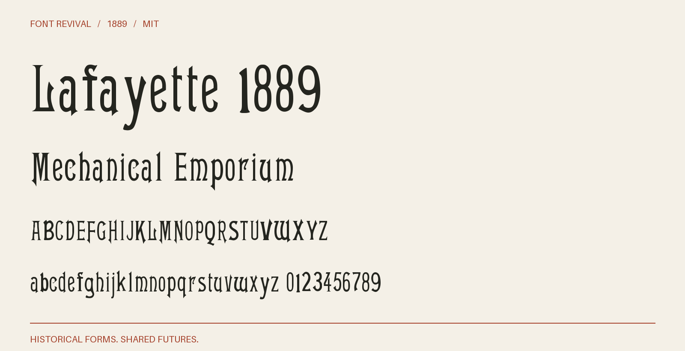

# Lafayette 1889

Tall condensed display letters with fine crossbars, triangular serifs and a distinct historical lowercase.



**1889 · Regular · Version 1.001 · 104 characters · MIT**

[OTF](fonts/Lafayette1889-Regular.otf) · [TTF](fonts/Lafayette1889-Regular.ttf) · [WOFF2](web/Lafayette1889-Regular.woff2) · [PDF specimen](specimens/specimen.pdf) · [Changes](CHANGELOG.md)

## Use

Install either desktop format. For websites, copy `web/`, include `font.css`,
and use `font-family: "Lafayette 1889"`. Designed for display sizes.

## Design

**Designer:** Unidentified in the consulted historical specimen

**Foundry:** Boston and Central Type Foundries

**Observed:** Directly traced characters: 0123456789ABCDEFGHILMNOPQRSTUWXYacdeghiklmnoprstuvy. Printed page 185, PDF page 191. Larger impressions anchor the master; smaller sizes supply additional characters. Original crops are also retained for separately labelled reconstructions. Additional directly traced impressions supply KVbfw. Exact editions, pages, crops, scale anchors and cleanup are recorded in source/tracing.json and reference/specimen-restoration-sources.json.

**Reconstructed:** Inferred companion letters and figures: JZjqz. Punctuation and remaining symbols are new project drawings. Both historical cases are retained. Spacing and harmonisation of optical sizes are modern choices. The 1889 suffix dates the source, not a claim of first release. Characters redrawn in place of coarse small-size traces: x; see companions.json for the construction of each.

## Sources

1. [Specimen book from the Boston type foundry (1889), Lafayette; printed p. 185, one-based PDF page 191, Internet Archive leaf 191](https://archive.org/details/specimenbookfrom00unse/page/n191/mode/1up) — 1889 US publication, public domain under the maximum historical 95-year term. Library of Congress scan hosted by Internet Archive; retained institutional metadata says the Library is unaware of copyright restrictions. Original native JP2 leaf; no modern digital typeface used. [Rights basis](https://archive.org/metadata/specimenbookfrom00unse).
2. [ATF 1897, leaf 241](https://archive.org/details/cu31924014559730/page/n241/mode/1up) — 1897 US publication, public domain by age. Historical scan and institutional metadata retained; no modern digital font used. Native JP2 page. [Rights basis](https://archive.org/metadata/cu31924014559730).
3. [ATF Desk Book 1898, printed p. 449, leaf 451](https://archive.org/details/deskbookofprinti00amer/page/n451/mode/1up) — 1898 US publication, public domain by age. Historical scan and institutional metadata retained; no modern digital font used. Native JP2 page. [Rights basis](https://archive.org/metadata/deskbookofprinti00amer).

Source images are in `reference/`; the source record is [font.json](font.json).
Historical reference material retains the rights status recorded there.
Copyright (c) 2026 Harold Lehmann. The digital revival is released under the included [MIT License](LICENSE).

## Build or improve

From the repository root:

```sh
python scripts/fontrevival.py build lafayette-1889
python scripts/fontrevival.py check lafayette-1889
```

Edit `source/font.ttx` or export an individual glyph with
`python scripts/fontrevival.py glyph lafayette-1889 j`.
Follow the shared [revival workflow](../../docs/WORKFLOW.md) for additions and revisions.
