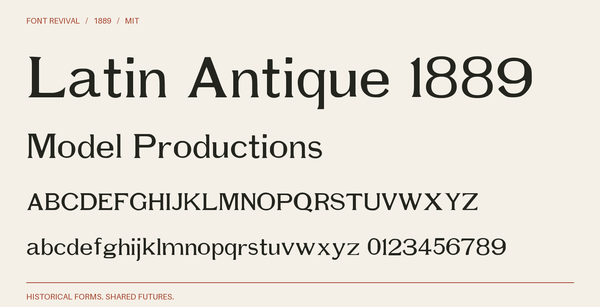

# Latin Antique 1889

Broad display letters with tapered serifs, open round bowls and a lightly contrasted historical lowercase.



**1889 · Regular · Version 1.000 · 104 characters · MIT**

[OTF](fonts/LatinAntique1889-Regular.otf) · [TTF](fonts/LatinAntique1889-Regular.ttf) · [WOFF2](web/LatinAntique1889-Regular.woff2) · [PDF specimen](specimens/specimen.pdf) · [Changes](CHANGELOG.md)

## Use

Install either desktop format. For websites, copy `web/`, include `font.css`,
and use `font-family: "Latin Antique 1889"`. Designed for display sizes.

## Design

**Designer:** Unidentified in the consulted historical specimen

**Foundry:** Boston and Central Type Foundries

**Observed:** Directly traced characters: 012345679ABCDEFGHIJKLMNOPQRSTUXacdefgiklmnorstuvwy. Printed page 139, PDF page 145. Larger impressions anchor the master; smaller optical sizes supply additional characters. Crops are retained for separately labelled small-source reconstructions as well.

**Reconstructed:** Inferred companion letters and figures: Zbjqxz. Punctuation and remaining symbols are new project drawings. Both historical cases are retained. Spacing and harmonisation of optical sizes are modern choices. The 1889 suffix dates the source, not a claim of first release. Characters redrawn in place of coarse smaller-size traces: 8VWYhp; see companions.json for the construction of each.

## Sources

1. [Specimen book from the Boston type foundry (1889), Latin Antique; printed p. 139, one-based PDF page 145, Internet Archive leaf 145](https://archive.org/details/specimenbookfrom00unse/page/n145/mode/1up) — 1889 US publication, public domain under the maximum historical 95-year term. Library of Congress scan hosted by Internet Archive; retained institutional metadata says the Library is unaware of copyright restrictions. Original native JP2 leaf; no modern digital typeface used. [Rights basis](https://archive.org/metadata/specimenbookfrom00unse).

Source images are in `reference/`; the source record is [font.json](font.json).
Historical reference material retains the rights status recorded there.
Copyright (c) 2026 Harold Lehmann. The digital revival is released under the included [MIT License](LICENSE).

## Build or improve

From the repository root:

```sh
python scripts/fontrevival.py build latin-antique-1889
python scripts/fontrevival.py check latin-antique-1889
```

Edit `source/font.ttx` or export an individual glyph with
`python scripts/fontrevival.py glyph latin-antique-1889 j`.
Follow the shared [revival workflow](../../docs/WORKFLOW.md) for additions and revisions.
