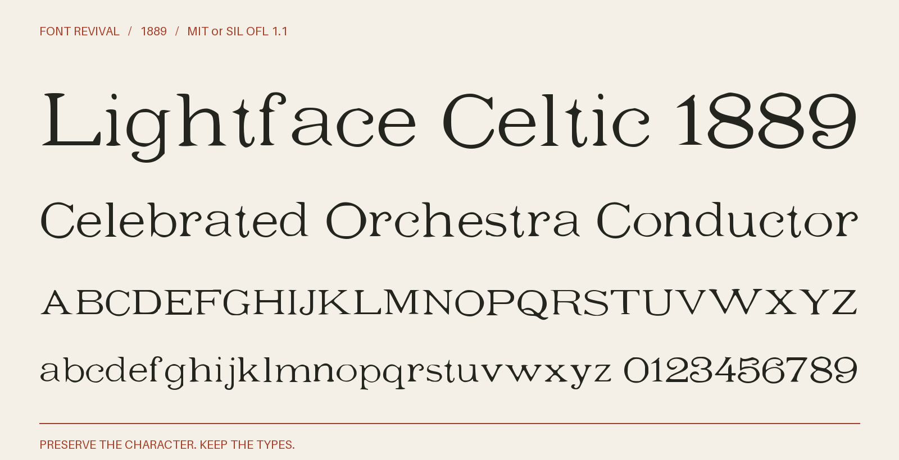

# Lightface Celtic 1889

Broad, lightly contrasted serif letters from the twelve-point Light-face Celtic cut, with single-storey a and g, curling figures and a sweeping Q tail.



**1889 · Regular · Version 1.001 · 67 characters · MIT or SIL OFL 1.1**

[OTF](fonts/LightfaceCeltic1889-Regular.otf) · [TTF](fonts/LightfaceCeltic1889-Regular.ttf) · [WOFF2](web/LightfaceCeltic1889-Regular.woff2) · [PDF specimen](specimens/specimen.pdf) · [Changes](CHANGELOG.md)

## Use

Install either desktop format. For websites, copy `web/`, include `font.css`,
and use `font-family: "Lightface Celtic 1889"`. Designed for display sizes.

## Design

**Designer:** Unidentified in the consulted historical specimens

**Foundry:** Boston and Central Type Foundries; later shown as American in the GPO document specimen

**Observed:** All 26 capitals, 26 lowercase letters, ten figures and four punctuation marks are directly observed in the twelve-point cut. The 1897 GPO source establishes complete alphabets; the census provides larger matching letters and all ten figures; sharper job-room and document impressions supply selected characters and punctuation. The 1889 Boston specimen provides earlier named provenance, and the ATF 1896 page calls the design Lightface Celtic No. 40. Exact selections, original scans and measurements are retained.

**Reconstructed:** No visible glyphs are invented. Modern spacing, digital metrics, local paper illumination correction and measured rigid rotations prepare the observed forms. The date suffix identifies an inspected historical source, not the first release of the type.

## Sources

1. [Specimens of the job division type, Government Printing Office (1897), Light-face Celtic; printed p. 26, archive leaf 61](https://archive.org/details/specimensofjobdi00unit/page/n61/mode/1up) — 1897 United States publication, public domain by age. Original historical scan and institutional metadata retained; no modern digital font used. [Rights basis](https://archive.org/metadata/specimensofjobdi00unit).
2. [Specimens of type faces, brass, rule, etc (1900), Light-face Celtic; printed p. 2, archive leaf 5](https://archive.org/details/specimensoftypef00unit_0/page/n5/mode/1up) — 1900 United States publication, public domain by age. Original historical scan and institutional metadata retained; no modern digital font used. [Rights basis](https://archive.org/metadata/specimensoftypef00unit_0).
3. [Job room type faces (1904), Light-face Celtic; printed p. 38, archive leaf 54](https://archive.org/details/123459_1904/page/n54/mode/1up) — 1904 United States publication, public domain by age. Original historical scan and institutional metadata retained; no modern digital font used. [Rights basis](https://archive.org/metadata/123459_1904).
4. [Specimen book of type (1904), Light-face Celtic; printed p. 40, archive leaf 85](https://archive.org/details/specimenbookofty00unit_0/page/n85/mode/1up) — 1904 United States publication, public domain by age. Original historical scan and institutional metadata retained; no modern digital font used. [Rights basis](https://archive.org/metadata/specimenbookofty00unit_0).
5. [Specimen book from the Boston type foundry ...containing also a complete price list of printing material (1889), Light-face Celtic; printed p. 194, archive leaf 200](https://archive.org/details/specimenbookfrom00unse/page/n200/mode/1up) — 1889 United States publication, public domain by age. Original historical scan and institutional metadata retained; no modern digital font used. [Rights basis](https://archive.org/metadata/specimenbookfrom00unse).
6. [American Type Founders collective specimen (1896), Lightface Celtic No. 40; printed p. 181, provider part 11, PDF page 4](https://www.circuitousroot.com/images/artifice/letters/press/noncomptype/typography/atf/atf-collective-specimen-garland-badscan/atf-1896-specimens-of-type-garland-1981-part-11-publicdomain.pdf) — Historical 1896 United States specimen page, public domain by age. Provider separates historical specimen pages from modern reprint editorial material. This is the original embedded scan JPEG of printed page 181; comparison only. [Rights basis](https://www.circuitousroot.com/artifice/letters/press/noncomptype/typography/atf/atf-collective-specimen-garland-badscan/index.html).

Source images are in `reference/`; the source record is [font.json](font.json).
Historical reference material retains the rights status recorded there.
Copyright (c) 2026 Harold Lehmann. The fonts and editable font source data are available under your choice of the [MIT License](LICENSE) or [SIL Open Font License 1.1](OFL.txt) (`MIT OR OFL-1.1`), with no Reserved Font Names. See [font licensing](FONT-LICENSES.txt) for the scope and notices. Other original project files, including standalone artwork, code and documentation, use MIT.

## Build or improve

From the repository root:

```sh
python scripts/fontrevival.py build lightface-celtic-1889
python scripts/fontrevival.py check lightface-celtic-1889
```

Edit `source/font.ttx` or export an individual glyph with
`python scripts/fontrevival.py glyph lightface-celtic-1889 j`.
Follow the shared [revival workflow](../../docs/WORKFLOW.md) for additions and revisions.
