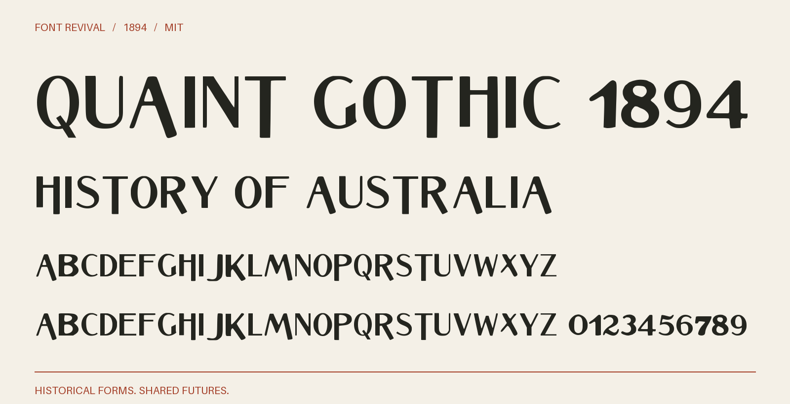

# Quaint Gothic 1894

Contrasting sans-serif capitals with narrow hairlines and long descending strokes, revived from Ryan’s 1894 specimen.



**1894 · Regular · Version 1.002 · 104 characters · Capitals only · MIT**

[OTF](fonts/QuaintGothic1894-Regular.otf) · [TTF](fonts/QuaintGothic1894-Regular.ttf) · [WOFF2](web/QuaintGothic1894-Regular.woff2) · [PDF specimen](specimens/specimen.pdf) · [Changes](CHANGELOG.md)

## Use

Install either desktop format. For websites, copy `web/`, include `font.css`,
and use `font-family: "Quaint Gothic 1894"`. Designed for display sizes.

## Design

**Designer:** Unidentified in the consulted historical specimen

**Foundry:** John Ryan Foundry (specimen seller)

**Observed:** Capitals A–P and R–Y; figures 1, 2, 4, 5, 6, 9 and dollar sign on page 148. The 24–48-point impressions anchor the master; smaller impressions supply B, J, K, M, P and X. Additional directly traced impressions supply 0378. Exact editions, pages, crops, scale anchors and cleanup are recorded in source/tracing.json and reference/specimen-restoration-sources.json.

**Reconstructed:** Q and Z; punctuation and remaining symbols. All figures are observed. Lowercase input aliases capitals, as this historical specimen shows a capitals-only face. Spacing, kerning and harmonisation between optical sizes are new. The 1894 suffix dates the source, not a claimed first release.

## Sources

1. [John Ryan Foundry, Latest and Standard Faces in Type (September 1894), p. 148](https://archive.org/details/lateststandardfa00ryan/page/148/mode/1up) — 1894 US publication, beyond the 95-year maximum term. Library of Congress scan; Archive metadata states that the Library of Congress is unaware of copyright restrictions. Metadata evidence retained in reference/ryan-rights.json. [Rights basis](https://archive.org/metadata/lateststandardfa00ryan).
2. [ATF Desk Book 1898 (NYPL), printed p. 377, leaf 390](https://archive.org/details/ATF1898DeskBook/page/n390/mode/1up) — 1898 US publication, public domain by age. Historical scan and institutional metadata retained; no modern digital font used. Native JP2 page. [Rights basis](https://archive.org/metadata/ATF1898DeskBook).
3. [Central and Boston 1892, Quaint Gothic, unnumbered leaf 89](https://archive.org/details/CentralBoston1892Specimen/page/n89/mode/1up) — 1892 US publication, public domain by age. Historical scan and institutional metadata retained; no modern digital font used. Native JP2 page. [Rights basis](https://archive.org/metadata/CentralBoston1892Specimen).

Source images are in `reference/`; the source record is [font.json](font.json).
Historical reference material retains the rights status recorded there.
Copyright (c) 2026 Harold Lehmann. The digital revival is released under the included [MIT License](LICENSE).

## Build or improve

From the repository root:

```sh
python scripts/fontrevival.py build quaint-gothic-1894
python scripts/fontrevival.py check quaint-gothic-1894
```

Edit `source/font.ttx` or export an individual glyph with
`python scripts/fontrevival.py glyph quaint-gothic-1894 j`.
Follow the shared [revival workflow](../../docs/WORKFLOW.md) for additions and revisions.
