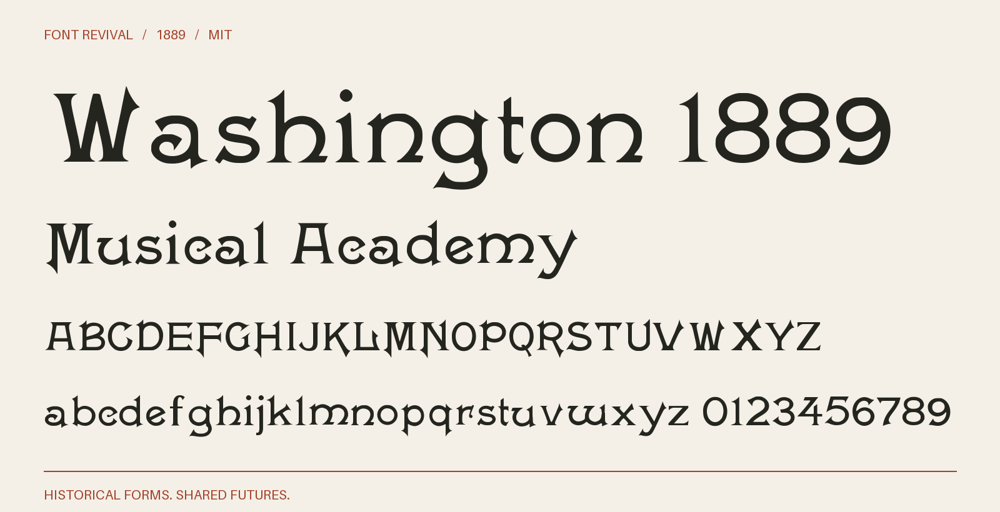

# Washington 1889

Broad high-contrast display letters with triangular entry serifs and a lively historical lowercase.



**1889 · Regular · Version 1.001 · 104 characters · MIT**

[OTF](fonts/Washington1889-Regular.otf) · [TTF](fonts/Washington1889-Regular.ttf) · [WOFF2](web/Washington1889-Regular.woff2) · [PDF specimen](specimens/specimen.pdf) · [Changes](CHANGELOG.md)

## Use

Install either desktop format. For websites, copy `web/`, include `font.css`,
and use `font-family: "Washington 1889"`. Designed for display sizes.

## Design

**Designer:** Unidentified in the consulted historical specimen

**Foundry:** Boston and Central Type Foundries

**Observed:** The 1889 Boston page anchors the face. Larger Washington impressions in Central/Boston 1892 and ATF 1896/1898 supply 4579VWbghkmpuwy, including the continuous curved y, flared k terminal, and uncial m/u/w. Exact crops and transcribed rows distinguish observed forms from reconstruction. Source-derived 457Vbgmpw receive documented display-weight corrections against the larger d/o/n.

**Reconstructed:** Inferred companions without a located impression: JQZjq. The small observed 0fvz are redrawn; v uses the newly observed V at lowercase scale with its own weight correction, and q reflects the refined p. Punctuation and remaining symbols are project drawings. Spacing and weight harmonisation are digital work; h/k/m/w have wider advances to fit their observed outlines. The 1889 suffix dates the principal source, not a claim of first release.

## Sources

1. [Specimen book from the Boston type foundry (1889), Washington; printed p. 184, one-based PDF page 190, Internet Archive leaf 190](https://archive.org/details/specimenbookfrom00unse/page/n190/mode/1up) — 1889 US publication, public domain under the maximum historical 95-year term. Library of Congress scan hosted by Internet Archive; retained institutional metadata says the Library is unaware of copyright restrictions. Original native JP2 leaf; no modern digital typeface used. [Rights basis](https://archive.org/metadata/specimenbookfrom00unse).
2. [Popular Designs for Artistic Printers (Central and Boston Type Foundries, 1892), Washington; unnumbered leaves 78–79 (PDF pages 79–80)](https://archive.org/details/CentralBoston1892Specimen/page/n78/mode/2up) — 1892 US publication, public domain by age; the archive record marks this scan Public Domain Mark 1.0. University of Michigan copy digitized by Google, distributed through HathiTrust and assembled by David M. MacMillan / Circuitous Root. No modern digital font used. [Rights basis](https://archive.org/metadata/CentralBoston1892Specimen).
3. [American Type Founders Collective Specimen Book (1895/1896), Washington Series, printed p. 460](https://www.galleyrack.com/images/artifice/letters/press/noncomptype/typography/atf/atf-collective-specimen-garland-badscan/atf-1896-specimens-of-type-garland-1981-smallpart-323-washington-series-central-type-foundry-publicdomain.pdf) — Original 1895/1896 US specimen material is public domain, expressly identified as such by scan provider David M. MacMillan / Circuitous Root. This is a lossless crop of the historical page image extracted from the scan of the Garland facsimile; modern introductions and commentary are excluded. [Rights basis](https://www.circuitousroot.com/artifice/letters/press/noncomptype/typography/atf/atf-collective-specimen-garland-badscan/index.html).
4. [A desk book of printing types (American Type Founders, 1898), Washington Series, printed pp. 444–445; native JP2 leaves 446–447](https://archive.org/details/deskbookofprinti00amer/page/n446/mode/2up) — 1898 US publication, public domain by age. Library of Congress copy digitized by the Internet Archive; original native JP2 leaves and institutional metadata retained. No modern digital font used. [Rights basis](https://archive.org/metadata/deskbookofprinti00amer).

Source images are in `reference/`; the source record is [font.json](font.json).
Historical reference material retains the rights status recorded there.
Copyright (c) 2026 Harold Lehmann. The digital revival is released under the included [MIT License](LICENSE).

## Build or improve

From the repository root:

```sh
python scripts/fontrevival.py build washington-1889
python scripts/fontrevival.py check washington-1889
```

Edit `source/font.ttx` or export an individual glyph with
`python scripts/fontrevival.py glyph washington-1889 j`.
Follow the shared [revival workflow](../../docs/WORKFLOW.md) for additions and revisions.
